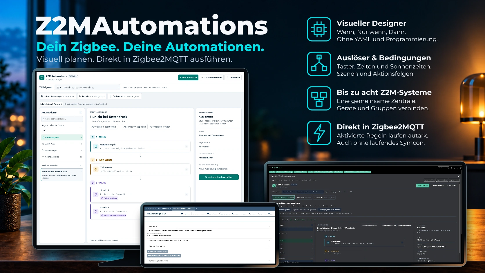
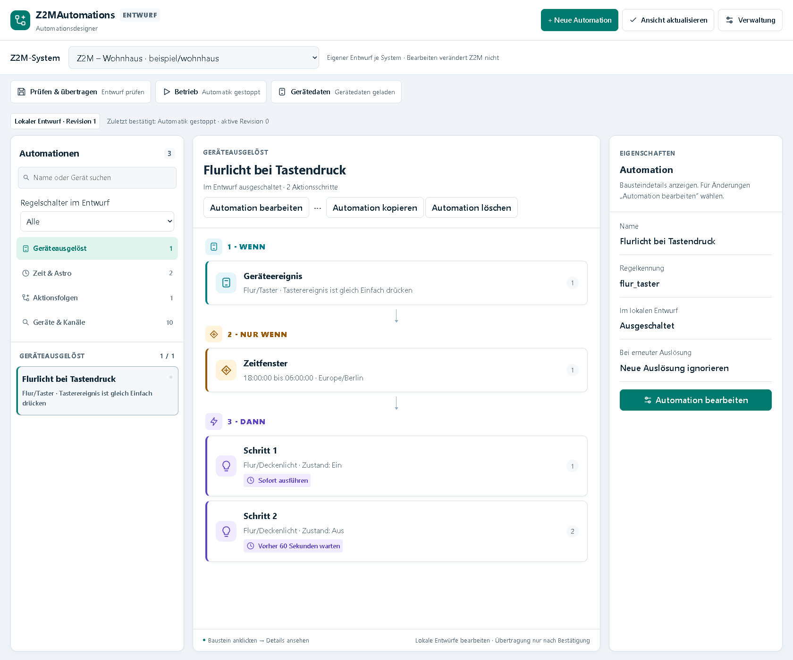
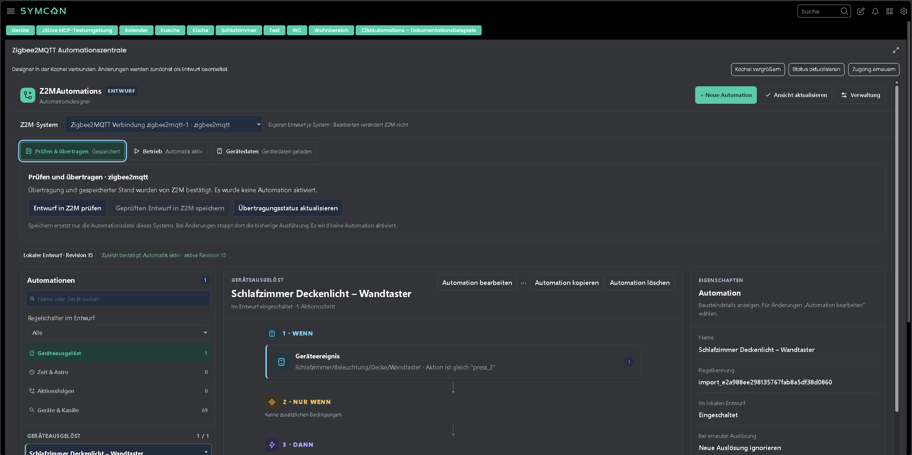
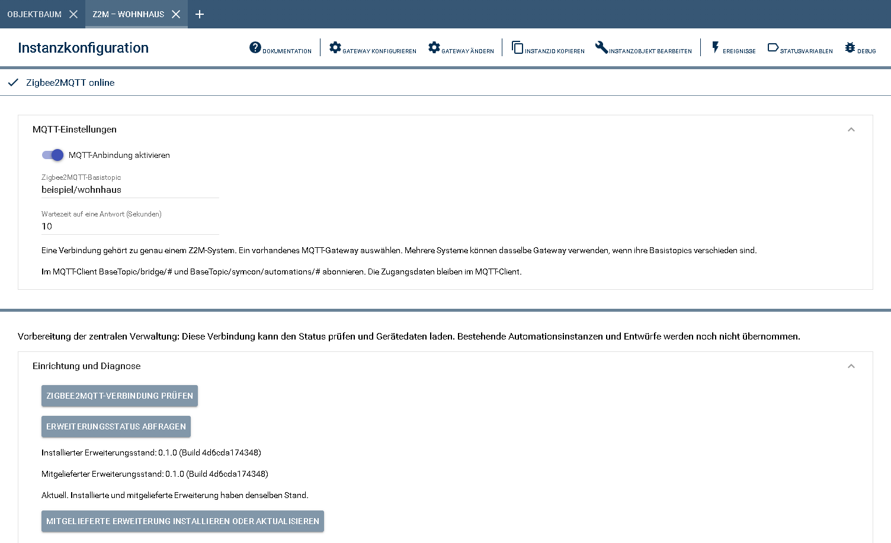
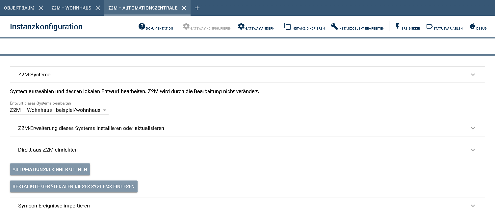

# Z2MAutomations

Erstellt und verwaltet Automationen für Zigbee2MQTT: Geräteauslöser, Uhrzeiten,
Sonnenzeiten, Bedingungen, Szenen und Aktionsfolgen. Eine Automationszentrale
verwaltet bis zu acht Z2M-Systeme. **Hauptarbeitsbereich ist das eigene Webfrontend,
der Automationsdesigner im Browser.** Dort werden Automationen ohne Programmier-
oder YAML-Kenntnisse erstellt, bearbeitet und verwaltet.

Der Designer ist auf Deutsch und Englisch verfügbar. Die Sprache lässt sich
auch während einer Bearbeitung wechseln; offene Eingaben bleiben erhalten.

Die Regeln werden an eine eigene Zigbee2MQTT-Erweiterung übertragen und dort
nach dem Aktivieren selbstständig ausgeführt. Symcon muss dafür nicht weiterlaufen.
Die native Symcon-Kachel bietet einen zusätzlichen Zugang zum Designer.

## Inhaltsverzeichnis

- [Screenshots](#screenshots)
- [1. Voraussetzungen](#1-voraussetzungen)
- [2. Funktionsumfang](#2-funktionsumfang)
- [3. Enthaltene Module](#3-enthaltene-module)
- [4. Installation](#4-installation)
- [5. Konfiguration in Symcon](#5-konfiguration-in-symcon)
- [6. Änderungen](#6-änderungen)
- [7. Lizenz](#7-lizenz)

## Screenshots

### Webfrontend: Automationsdesigner

Der Browserdesigner ist der Hauptanlaufpunkt für die Einrichtung von Automationen.
Links werden Regeln und Geräte ausgewählt, in der Mitte ist der Ablauf mit
**Wenn**, **Nur wenn** und **Dann** sichtbar. Rechts stehen die Eigenschaften.

### Alternative Kachelansicht

Derselbe Automationsdesigner lässt sich zusätzlich direkt in der nativen
Symcon-Kachel verwenden. Die Aufnahme zeigt die Ansicht als Kachel.

### Z2M-Verbindung

Hier werden die MQTT-Anbindung und das Basistopic des jeweiligen Z2M-Systems
eingerichtet sowie Verbindung und Erweiterungsstand angezeigt.

### Konfigurationsformular der Automationszentrale

Die Zentrale ordnet die Verbindungen zu und bietet die Systemauswahl.
Mit **Automationsdesigner öffnen** geht es von hier in das eigene Webfrontend.

## 1. Voraussetzungen

- Symcon ab Version **9.0** mit PHP **8.5**.
- Ein erreichbares Zigbee2MQTT-System und eine passende Symcon-Instanz vom Typ
  **MQTT Client** oder **MQTT Server**.
- Für die Installation der Erweiterung muss externes JavaScript in Z2M bereits
  freigeschaltet sein. Die Library ändert diese Einstellung nicht.
- Für Aktionen zwischen getrennten Brokern eine MQTT-Bridge und passende
  Partnerfreigaben der beteiligten Z2M-Systeme.
- Die native Großansicht der Kachel ist ab Symcon 9.1 verfügbar; unter 9.0
  steht der Designer innerhalb der normalen Kachel zur Verfügung.

Praxisnachweise liegen für Symcon 9.0 und 9.1 sowie Z2M 2.14.2 und 2.14.2-dev
vor. Umfang und Grenzen stehen in der [Kompatibilitätsübersicht](docs/COMPATIBILITY.md).

## 2. Funktionsumfang

- Geräteautomationen für Taster, Bewegungsmelder und andere Gerätezustände;
  mehrere Auslöser können dieselbe Regel unabhängig starten.
- Zeitautomationen mit mehreren Uhrzeiten, Wochentagen sowie Sonnenauf- und
  Sonnenuntergang mit Zeitversatz.
- Bedingungen für beispielsweise Helligkeit, Temperatur und Zeitfenster.
- Geräte und Gruppen schalten, Helligkeit und Farbe setzen und vorhandene
  Z2M-Szenen aufrufen.
- Mehrere Aktionen mit Wartezeiten ausführen und Aktionsfolgen in verschiedenen
  Automationen wiederverwenden.
- Bis zu acht Z2M-Systeme mit getrennten Entwürfen in einer Zentrale verwalten;
  freigegebene Geräte und Gruppen anderer Systeme als Aktionsziele verwenden.
- Vorhandene Z2M-Automationen einlesen und unterstützte Symcon-Ereignisse nach
  Vorschau als ausgeschaltete Entwürfe importieren.
- Automationen erstellen, bearbeiten, kopieren und löschen; gespeicherte Regeln
  aktivieren und stoppen sowie einzelne Abläufe einmal starten oder beenden.
- Bei erneuter Auslösung ignorieren, neu starten oder die Wartezeit zurücksetzen;
  automatischen Wiederanlauf nach einem Z2M-Neustart einstellen.
- Wartende Automatikläufe nach einem Z2M-Neustart wahlweise fortsetzen; bei bereits
  abgelaufener Wartezeit die ausstehende Aktion nachholen oder den Lauf beenden.

Die Bedienung der einzelnen Funktionen steht in der README des jeweiligen Moduls.

## 3. Enthaltene Module

- [Zigbee2MQTT Automationszentrale](Z2MAutomations/README.md)
  - Eine zentrale Instanz zum Erstellen, Bearbeiten, Prüfen und Übertragen der
    Automationen für bis zu acht Z2M-Systeme.
  - Stellt das eigene Webfrontend als Hauptoberfläche zur Einrichtung der
    Automationen bereit. Der vollständige Designer ist zusätzlich in der
    nativen Symcon-Kachel nutzbar.
  - Die Zentrale benötigt keine eigene MQTT-Schnittstelle.
- [Zigbee2MQTT Verbindung](Z2MConnection/README.md)
  - Eine Verbindungsinstanz je Z2M-System, verbunden mit dessen vorhandenem
    MQTT Client oder MQTT Server.
  - Stellt die Verbindung zum jeweiligen Z2M-System sowie dessen Erweiterungsstand
    und Gerätedaten für die Zentrale bereit.
  - Die Modulanleitung enthält auch die
    [Einrichtung mehrerer Mosquitto-Broker](Z2MConnection/README.md#bis-zu-acht-mqtt-broker-miteinander-verbinden).

## 4. Installation

Nach Veröffentlichung der ersten Beta im **Module Store** nach
**Z2MAutomations** suchen und den **Beta-Kanal** wählen. Der aktuelle
Vorbereitungsstand steht in der [Beta-Abnahme](docs/BETA_ABNAHME.md).

Alternativ die Library über die Symcon-Modulverwaltung aus dem Repository
[Burki24/Symcon_Z2MAutomations](https://github.com/Burki24/Symcon_Z2MAutomations) hinzufügen.
Als Zweig **main** verwenden.

## 5. Konfiguration in Symcon

1. Je Z2M-System eine Instanz **Zigbee2MQTT Verbindung** anlegen und dem passenden
   MQTT Client oder MQTT Server zuordnen. Das Z2M-Basistopic eintragen, die
   MQTT-Anbindung im Modul aktivieren und die Verbindung prüfen.
2. Eine **Zigbee2MQTT Automationszentrale** anlegen. Im Bereich **Z2M-Systeme**
   die gewünschten Verbindungen anhaken und **Systemzuordnung übernehmen** wählen.
3. Für jedes System den Erweiterungsstand prüfen und die Erweiterung bei Bedarf
   installieren. Unter **Direkt aus Z2M einrichten** auf **Z2M-Automationen sicher
   einlesen** klicken, die Vorschau prüfen und **Verbindung übernehmen und Entwurf
   einrichten** bestätigen. Dieser Schritt ist auch bei einem noch leeren Z2M-System
   nötig; er legt dessen lokalen Entwurf an und verändert keine Automationen in Z2M.
4. In der Zentrale auf **Automationsdesigner öffnen** klicken. Das eigene
   Webfrontend öffnet sich im Browser. Dort das gewünschte **Z2M-System** auswählen
   und über **+ Neue Automation** die Regel mit Auslösern, optionalen Bedingungen
   und Aktionen zusammenstellen.
5. Die Änderungen in den lokalen Entwurf übernehmen. Neue Regeln beginnen
   ausgeschaltet; vor der gewünschten Nutzung den Regelschalter einschalten.
6. Den Entwurf in Z2M prüfen, speichern und die gespeicherten Automationen
   aktivieren. Erst dann führt Z2M die eingeschalteten Regeln aus.

Eine Zentrale genügt für bis zu acht Z2M-Systeme. Mehrere Systeme können denselben
MQTT-Broker verwenden, wenn sie unterschiedliche Basistopics besitzen. Für getrennte
Broker beschreibt die [Modulanleitung der Verbindung](Z2MConnection/README.md#bis-zu-acht-mqtt-broker-miteinander-verbinden)
die Einrichtung. Empfangende Systeme benötigen zusätzlich eine gespeicherte
[Partnerfreigabe](Z2MAutomations/README.md#partnerfreigaben-im-browserdesigner)
für das sendende System; die Gegenrichtung wird separat erlaubt.

Nach einem Library-Update den Erweiterungsstand je System prüfen und bei einem
Updatehinweis die mitgelieferte Erweiterung über die Zentrale installieren.
Die Gerätedaten werden anschließend automatisch nachgeladen; Entwürfe bleiben
erhalten. Ein Erweiterungsupdate kann laufende Abläufe kurz unterbrechen.

Die weitere Konfiguration und Bedienung des Webfrontends stehen in der
[Anleitung zum Browserdesigner](Z2MAutomations/README.md#automationsdesigner-im-browser).
Die MQTT-Einrichtung ist in der README des Verbindungsmoduls beschrieben.

## 6. Änderungen

Neue Funktionen und Fehlerkorrekturen stehen im [Changelog](CHANGELOG.md).

## 7. Lizenz

[PolyForm Noncommercial License 1.0.0](LICENSE).
