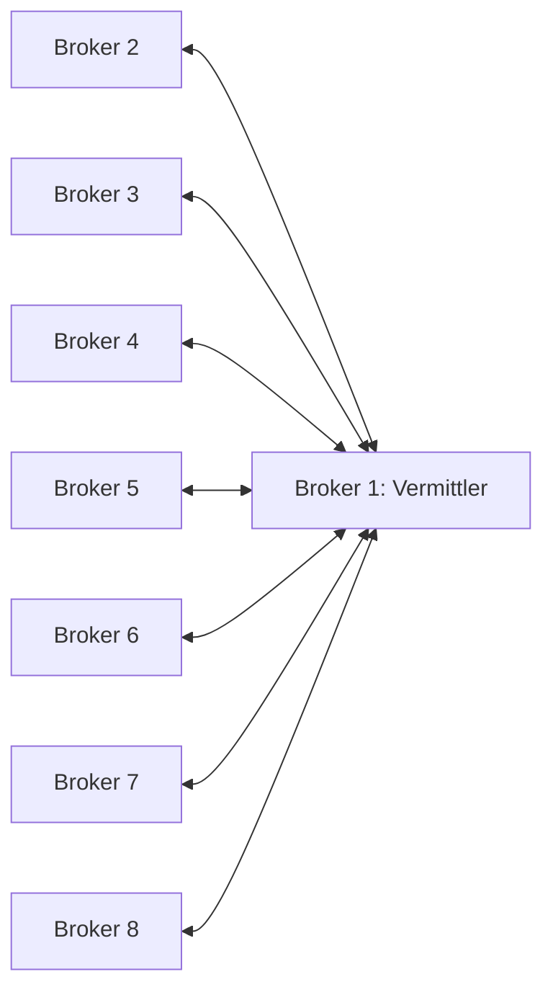

# Z2MAutomations

[](https://www.symcon.de/)
[](library.json)
[](LICENSE)
[](https://github.com/Burki24/Z2MAutomations/actions/workflows/style.yml?query=branch%3Adev)
[](https://github.com/Burki24/Z2MAutomations/actions/workflows/tests.yml?query=branch%3Adev)

Z2MAutomations vereinfacht die Einrichtung von Zigbee2MQTT-Automationen in Symcon.
Symcon erstellt die Regeln und überträgt sie als YAML an eine
eigene Erweiterung. Die Automationen werden direkt in Zigbee2MQTT ausgeführt.

Zusätzlich gibt es eine [native Symcon-Kachel](Z2MAutomations/README.md#native-symcon-kachel-und-designerzugang)
mit dem vollständigen eingebetteten Designer, Systemauswahl und Status.
Ab Symcon 9.1 steht er auch in der nativen Großansicht zur Verfügung.
Der Designerzugang wird bei geöffneter Ansicht ohne Neuladen verlängert.

Über [Partnerfreigaben](Z2MAutomations/README.md#partnerfreigaben-im-browserdesigner)
legen Sie im Designer fest, welche zugeordneten Z2M-Systeme Befehle an das
ausgewählte System senden dürfen. Änderungen werden zuerst im lokalen Entwurf geprüft.

Im Browserdesigner fasst [Systeme und Diagnose](Z2MAutomations/README.md#systeme-und-diagnose-im-browserdesigner)
die Verbindungs- und Erweiterungsstände zusammen. Dort lassen sich Prüfungen
ausdrücklich starten und Z2M-Abläufe je System zeitlich begrenzt aufzeichnen.
Die mitgelieferte Erweiterung lässt sich dort nach eigener Bestätigung für
das ausgewählte System installieren oder aktualisieren. Dasselbe ist im
nativen Zentralenformular möglich.

Bei erneuter Auslösung einer laufenden Automation lässt sich wählen, ob die
Auslösung ignoriert, die Folge von vorn begonnen oder nur die aktuelle Wartezeit
zurückgesetzt wird. Siehe [Bedienung](Z2MAutomations/README.md#wenn-eine-laufende-automation-erneut-ausgelöst-wird).

Wiederverwendbare Aktionsfolgen lassen sich einmal anlegen und in mehreren
Automationen auswählen. Änderungen an der Folge gelten nach Übertragung für
alle verwendenden Regeln. Siehe [Bedienung](Z2MAutomations/README.md#eine-aktionsfolge-mehrfach-verwenden).

Zeitgesteuerte Regeln unterstützen auch Sonnenauf- oder Sonnenuntergang mit
Standort und Zeitversatz. Die eigene tägliche Berechnung findet in Z2M statt;
siehe [Bedienung](Z2MAutomations/README.md#automationen-bei-sonnenauf--oder-sonnenuntergang).

Gespeicherte Automationen lassen sich zusätzlich gezielt einmal ausführen und
laufende Abläufe einzeln stoppen. Bedingungen gelten weiterhin; andere Regeln
und der automatische Wiederanlauf bleiben unverändert. Siehe
[Einzelsteuerung](Z2MAutomations/README.md#eine-gespeicherte-automation-einmal-ausführen).

Die MQTT-Anbindung empfängt den Z2M-Status, Versionsinformationen und die Liste
externer Erweiterungen. Eine Verbindungsprüfung sendet eine Gesundheitsanfrage
und zeigt das Ergebnis nach der passenden Antwort an.

Die eigene Z2M-Erweiterung lässt sich aus dem Modul über MQTT installieren.
Das Modul prüft YAML über den Empfänger und überträgt sie nach Vorschau und
Bestätigung in dessen persistenten Speicher. Die Erweiterung kann eine gespeicherte
Revision nach ausdrücklicher Aktivierung ausführen. Aktivierung und Stopp werden
im Modul bedient und von Z2M bestätigt. Der Klick-Editor lädt Geräte aus
Z2M und erstellt Geräte- oder Zeitautomationen mit Bedingungen und bis zu 16
geordneten Geräteaktionen. Die Wartezeit ist pro Schritt einstellbar;
YAML-Kenntnisse sind dafür nicht erforderlich. Unterstützte ausgelöste
Symcon-Ereignisse lassen sich nach Prüfung und Vorschau als deaktivierte Regeln
importieren. In der Zentrale und im Browserdesigner sind Suche und Vorschau
je System verfügbar; Originalereignisse und vorhandene Entwürfe bleiben erhalten.
[Bedienung des Imports](Z2MAutomations/README.md#symcon-ereignisse-in-der-zentrale-und-im-designer-importieren).
Gruppen und zustandsabhängiges Umschalten sind als Aktionsziele verfügbar.
Die Automationszentrale verwaltet bis zu acht Z2M-Verbindungen. Über einen gemeinsamen
Broker oder eine MQTT-Bridge lassen sich Geräte und Gruppen anderer freigegebener
Systeme als Aktionsziele wählen.
Das empfangende System benötigt dafür die gespeicherte Freigabe des sendenden
Systems und einen aktiven Automatikbetrieb. Die Gegenrichtung wird separat erlaubt.
[Bedienung](Z2MAutomations/README.md), [Ausführung und Grenzen](docs/RUNTIME.md).
Ein [synthetisches YAML-Beispiel](libs/z2m/examples/automations.yaml) zeigt das
eigene Format; der [YAML-Vertrag](docs/YAML_SCHEMA.md) beschreibt die Felder.

Weitere, im Klick-Editor nicht darstellbare Regelstrukturen sind über die zusätzliche
YAML-Ansicht möglich. Die Ausführung aktivierter Regeln findet in Z2M statt und benötigt
kein laufendes Symcon. Auf Wunsch startet Z2M den zuletzt aktivierten Regelstand
nach einem Neustart selbstständig wieder; bestätigtes Stoppen bleibt wirksam.
Die standardmäßig eingeschaltete Option wird beim Aktivieren an Z2M übertragen.

## Voraussetzungen

- IP-Symcon ab Version 9.0 mit PHP 8.5.
- Zigbee2MQTT und eine konfigurierte Symcon-Instanz vom Typ MQTT Client oder
  MQTT Server, über die dieselbe Z2M-Installation erreichbar ist.
- Beim MQTT Client müssen die Z2M-Bridge- und Erweiterungstopics abonniert sein,
  beispielsweise zigbee2mqtt/bridge/# und zigbee2mqtt/symcon/automations/#.
  Ein vorhandenes Abonnement # genügt ebenfalls.
- Für die Erweiterungsinstallation muss externes JavaScript in Z2M bereits
  freigeschaltet sein. Das Modul ändert diese Einstellung nicht und startet Z2M nicht neu.
- Praktisch belegter Z2M-Stand: **2.14.2-dev**. Die stabile Ausgabe 2.14.2 ist
  das Schnittstellenziel und besitzt noch keine eigene Praxisabnahme. Die genaue
  Git-Revision des geprüften Entwicklungsstands ist nicht dokumentiert.
  [Versionsübersicht und Grenzen](docs/COMPATIBILITY.md).

## Module

- [Automationsdesigner im Browser](Z2MAutomations/README.md#automationsdesigner-im-browser):
  Geräte-, Zeit- und Sonnenregeln erstellen und vorhandene Automationen bearbeiten.
  Änderungen betreffen zunächst den lokalen Symcon-Entwurf. In der Zentrale sind
  Prüfung und Übertragung je System auch im Designer verfügbar. Neue Regeln
  beginnen ausgeschaltet; es erfolgt keine automatische Aktivierung.
- [Vorschau des Automationsdesigners](docs/prototypes/automation-designer/README.md):
  separat öffnbarer Oberflächenentwurf mit erfundenen Beispielen. Noch keine
  Anbindung an das Modul oder an Geräte.
- [Zigbee2MQTT Automationszentrale](Z2MAutomations/README.md#automationszentrale-anlegen):
  neue Z2MAutomations-Instanz ohne eigene MQTT-Schnittstelle anlegen und vorhandene
  Z2M-Verbindungen für die gemeinsame Bearbeitung zuordnen. Vorhandene Z2M-Regeln
  direkt einlesen und die Verbindungen ohne alte Einzelinstanzen übernehmen.
  Anschließend Entwürfe je System prüfen, übertragen, aktivieren, stoppen oder
  einzelne Regeln gezielt starten und stoppen.
- [Z2M-Verbindung](Z2MConnection/README.md): Verbindungsbaustein je Z2M-System.
  Prüft dessen Verbindung und Erweiterungsstand, lädt Geräte und ermöglicht
  begrenzte Ablaufaufzeichnungen. Die Zentrale übernimmt vorhandene Regeln
  ausdrücklich; ein Modulupdate allein migriert keine Instanzen.
- [Lokaler Mehrsystem-Arbeitsbereich](Z2MAutomations/README.md#lokaler-arbeitsbereich-für-mehrere-systeme):
  Systemliste und getrennte Entwürfe im gemeinsamen nativen und Browsereditor
  verwalten. Direkte Einrichtung und gesicherte Übernahme sind im nativen
  Zentralenformular verfügbar.
- [Eigene Z2M-Erweiterung](libs/z2m/README.md): Empfänger mit Schema-Prüfung,
  persistentem Konfigurationsspeicher und Sicherung der vorherigen Fassung.

## Bis zu acht MQTT-Broker miteinander verbinden

Diese Anleitung verbindet **vorhandene Mosquitto-Broker** für systemübergreifende
Z2M-Automationen. Sie folgt der praktisch bestätigten Einrichtung mit zwei
Brokern: lesen, sichern, Benutzer und Rechte ergänzen, eine Bridge einrichten,
danach in beide Richtungen eine harmlose Testnachricht empfangen. Der Ausbau
auf drei bis acht Broker ist daraus abgeleitet und noch keine allgemeine
Praxisfreigabe dieses Umfangs.

Die Zentrale unterstützt bis zu acht **Z2M-Systeme**. Nutzen mehrere davon
denselben Broker, ist zwischen diesen Systemen keine Bridge nötig. Bei getrennten
Brokern wird nur `z2ma/mesh/#` weitergeleitet. Geräte- und Verwaltungs-Topics
bleiben auf ihrem jeweiligen Broker. Z2M führt die Automationen aus; Symcon
wird für die Weiterleitung nicht benötigt.

Auch zwei äußere Systeme können miteinander arbeiten: Ein Befehl von S3 nach
S4 läuft über den mittleren Broker S1. Eine zusätzliche direkte Bridge zwischen
S3 und S4 ist nicht nötig. S3 braucht S4 als freigegebenes Aktionsziel; S4 muss
Befehle von S3 ausdrücklich erlauben und seine Automatik muss aktiv sein. Die
Erweiterung von S1 muss dafür nicht laufen: Sein Broker übernimmt die Weiterleitung.
Dieser Weg ist mit drei und acht echten Erweiterungsinstanzen und synthetischem
Brokertransport geprüft; eine reale Mosquitto-Prüfung mit mehreren Brokern ersetzt
das nicht.

### 1. Aufbau und Bezeichnungen festlegen

Für zwei Broker genügt eine einzige Bridge. Sie wird im Beispiel auf Broker 1
angelegt und verbindet ihn **in beide Richtungen** mit Broker 2. Auf Broker 2
wird keine zweite Gegenbridge angelegt.

Für weitere Broker bleibt Broker 1 der Vermittler. Jeder zusätzliche Broker
wird einmal mit ihm verbunden. So entstehen bei acht Brokern sieben
Verbindungen, ohne Ring oder zusätzliche Direktverbindungen zwischen den Ästen.



Alle folgenden Adressen und Basistopics sind **Platzhalter**. Tragen Sie Ihre
Werte außerhalb des Repositorys ein. Vorhandene Basistopics bleiben unverändert;
jedes Z2M-System im Verbund braucht ein eindeutiges Basistopic, einschließlich
Groß-/Kleinschreibung.

| Broker | Adresse einsetzen | Basistopic im Beispiel | Verbindung |
| --- | --- | --- | --- |
| 1 | `BROKER_1_IP` | `z2m_demo_1` | Vermittler |
| 2 | `BROKER_2_IP` | `z2m_demo_2` | 1 ↔ 2 |
| 3 | `BROKER_3_IP` | `z2m_demo_3` | 1 ↔ 3 |
| 4 | `BROKER_4_IP` | `z2m_demo_4` | 1 ↔ 4 |
| 5 | `BROKER_5_IP` | `z2m_demo_5` | 1 ↔ 5 |
| 6 | `BROKER_6_IP` | `z2m_demo_6` | 1 ↔ 6 |
| 7 | `BROKER_7_IP` | `z2m_demo_7` | 1 ↔ 7 |
| 8 | `BROKER_8_IP` | `z2m_demo_8` | 1 ↔ 8 |

Fällt Broker 1 aus, funktionieren die Verbindungen zwischen seinen Ästen nicht.
Lokale Automationen der übrigen Z2M-Systeme benötigen diesen Vermittler nicht.

### 2. Auf beiden Rechnern zunächst nur lesen

Das Beispiel verwendet Debian/Raspberry Pi OS, Bash und Mosquitto 2.0.x mit
Passwortdatei `/etc/mosquitto/passwd`, ACL-Datei `/etc/mosquitto/acl` und einem
vorhandenen LAN-Listener auf Port 1883. Z2M muss bereits den jeweils richtigen
Broker verwenden. Andere Dateipfade oder eine andere Benutzerverwaltung zuerst
an die eigene Installation anpassen; vorhandene Einstellungen nicht ersetzen.

Öffnen Sie eine SSH-Sitzung auf jedem der beiden Rechner. Führen Sie die
Befehle einzeln aus und kontrollieren Sie das Ergebnis vor dem nächsten Schritt.
Nur den Code kopieren, keine Eingabeaufforderung oder frühere Ausgabe.

```bash
hostname
```

```bash
systemctl status mosquitto.service --no-pager
```

```bash
sudo ss -ltnp 'sport = :1883'
```

```bash
sudo grep -hE '^(listener|allow_anonymous|password_file|acl_file|include_dir) ' /etc/mosquitto/mosquitto.conf /etc/mosquitto/conf.d/*.conf
```

```bash
sudo grep -HE '^(connection|address|local_clientid|remote_clientid|topic) ' /etc/mosquitto/conf.d/*.conf
```

Erwartet: Dienst aktiv, LAN-Port erreichbar, Passwort- und ACL-Datei eingebunden,
anonyme Anmeldung deaktiviert. Die letzte Abfrage zeigt vorhandene Bridges ohne
Passwörter. Gibt es bereits eine Verbindung zwischen diesen Brokern, diese prüfen
und **keine zweite parallele Bridge** nach dieser Vorlage hinzufügen.

Auf Broker 1 die Adresse von Broker 2 einsetzen und die TCP-Verbindung prüfen:

```bash
z2ma_peer_address='BROKER_2_IP'
```

```bash
timeout 3 bash -c 'exec 3<>"/dev/tcp/$1/1883"' _ "$z2ma_peer_address" && echo 'Gegenstelle auf Port 1883 erreichbar'
```

Dasselbe auf Broker 2 mit `BROKER_1_IP` wiederholen. Die Erreichbarkeit ersetzt
noch keine erfolgreiche MQTT-Anmeldung. Port 1883 ist unverschlüsselt; dieses
Beispiel setzt ein vertrauenswürdiges LAN oder VPN voraus. Für ungeschützte
Netzwege TLS mit Zertifikatsprüfung einrichten.

### 3. Auf beiden Brokern die bestehende Konfiguration sichern

In jeder SSH-Sitzung einen eigenen geschützten Ordner anlegen:

```bash
z2ma_backup_dir="$(mktemp -d "$HOME/z2ma-mosquitto-vor-bridge-XXXXXXXX")"
```

```bash
sudo tar -czf "$z2ma_backup_dir/mosquitto.tar.gz" -C /etc mosquitto
```

```bash
sudo chown "$(id -u):$(id -g)" "$z2ma_backup_dir/mosquitto.tar.gz"
```

```bash
chmod 600 "$z2ma_backup_dir/mosquitto.tar.gz"
```

```bash
tar -tzf "$z2ma_backup_dir/mosquitto.tar.gz" > /dev/null
```

```bash
sha256sum "$z2ma_backup_dir/mosquitto.tar.gz"
```

```bash
printf 'Sicherungsordner: %s\n' "$z2ma_backup_dir"
```

Keine Ausgabe der Inhaltsprüfung bedeutet Erfolg. Sicherungsordner und
Prüfsumme privat notieren. Die Sicherung enthält Zugangsdaten und gehört nicht
in die Library. Bei einer neuen SSH-Sitzung muss die Variable wieder auf den
notierten Ordner gesetzt werden.

### 4. Einen eigenen Bridge-Benutzer auf beiden Brokern anlegen

Auf **Broker 1 und Broker 2** jeweils ausführen:

```bash
sudo mosquitto_passwd /etc/mosquitto/passwd bridge_z2ma_1_2
```

Geben Sie für dieses Verbindungspaar auf beiden Rechnern dasselbe eigene
Bridge-Passwort ein. Es wird verdeckt abgefragt. Für die Vorlage ein starkes
Passwort ohne Leerzeichen oder Zeilenumbrüche verwenden und privat aufbewahren.
`-c` wird hier nicht verwendet: Es würde eine vorhandene Passwortdatei ersetzen.

Auf beiden Brokern anschließend die Leserechte setzen:

```bash
sudo chown root:mosquitto /etc/mosquitto/passwd
```

```bash
sudo chmod 640 /etc/mosquitto/passwd
```

### 5. Die Rechte auf beiden Brokern ergänzen

```bash
sudo nano /etc/mosquitto/acl
```

Im **bereits vorhandenen Abschnitt des Z2M-Benutzers** zusätzlich
`topic readwrite z2ma/mesh/#` eintragen. Sein bisheriges Basistopic und alle
anderen benötigten Rechte behalten. Dazu einen Abschnitt für den neuen
Bridge-Benutzer ergänzen. Beispiel für Broker 1:

```text
user z2m
topic readwrite z2m_demo_1/#
topic readwrite z2ma/mesh/#

user symcon
topic readwrite z2m_demo_1/#

user bridge_z2ma_1_2
topic readwrite z2ma/mesh/#
```

Auf Broker 2 bleibt dessen eigenes Basistopic, im Beispiel `z2m_demo_2/#`,
erhalten. Verwenden Sie dort dieselben zusätzlichen Mesh-Rechte. Heißt Ihr
Z2M-Benutzer anders, seinen vorhandenen Abschnitt ergänzen; kein ungenutztes
zweites Konto `z2m` anlegen.

**Beide Rechte sind nötig:** Die Bridge transportiert Nachrichten, Z2M sendet
und empfängt sie. Nur Rechte für den Bridge-Benutzer reichen nicht. Symcons
Benutzer benötigt für die Regelverwaltung weiterhin nur seine eigenen
Basistopics, keine zusätzlichen Mesh-Rechte.

Lesbarkeit auf beiden Brokern prüfen:

```bash
sudo -u mosquitto test -r /etc/mosquitto/passwd && echo 'Passwortdatei ist lesbar'
```

```bash
sudo -u mosquitto test -r /etc/mosquitto/acl && echo 'ACL ist lesbar'
```

### 6. Auf beiden Brokern Benutzer und ACL neu laden

```bash
sudo systemctl reload mosquitto.service
```

```bash
systemctl status mosquitto.service --no-pager
```

Erwartet: weiterhin aktiv. Bei einer Fehlermeldung zuerst diese klären; noch
keine Bridge starten. Z2M-Konfiguration, Symcon-Gerätezuordnungen und bestehende
Automationsregeln werden für diese Verbindung nicht geändert.

### 7. Die einzige Bridge auf Broker 1 vorbereiten

Die folgende Datei ist **neu**. Der Befehl verweigert ein Überschreiben einer
bereits vorhandenen Datei:

```bash
sudo bash -c 'set -C; umask 027; : > /etc/mosquitto/conf.d/20-z2ma-bridge-1-2.conf'
```

```bash
sudo chown root:mosquitto /etc/mosquitto/conf.d/20-z2ma-bridge-1-2.conf
```

```bash
sudo chmod 640 /etc/mosquitto/conf.d/20-z2ma-bridge-1-2.conf
```

```bash
sudo nano /etc/mosquitto/conf.d/20-z2ma-bridge-1-2.conf
```

Folgenden Inhalt eintragen. Adresse und **beide** Passwortplatzhalter ersetzen:

```text
connection z2ma-1-2
address BROKER_2_IP:1883
local_clientid z2ma-bridge-1-2-local
remote_clientid z2ma-bridge-1-2
local_username bridge_z2ma_1_2
local_password HIER_BRIDGE_PASSWORT
remote_username bridge_z2ma_1_2
remote_password HIER_BRIDGE_PASSWORT
topic z2ma/mesh/# both 1
try_private true
cleansession true
local_cleansession true
notifications false
start_type automatic
restart_timeout 10
keepalive_interval 30
```

`both` transportiert beide Richtungen. Es gibt keine Topic-Umbenennung. Die
Clientkennungen müssen für jede Bridge eindeutig sein. Die lokale Anmeldung
gehört zu Broker 1, die entfernte zu Broker 2. Die Vorlage verwendet dasselbe
Passwort für diese beiden Konten des Verbindungspaars. Benachrichtigungen über
`$SYS` werden nicht benötigt; Automationsnachrichten werden nicht als retained
versendet und die Bridge verwendet keine dauerhaften Sitzungen.

Noch vorhandene Platzhalter ohne Ausgabe des Dateiinhalts prüfen:

```bash
if sudo grep -Eq 'BROKER_[1-8]_IP|HIER_BRIDGE_PASSWORT' /etc/mosquitto/conf.d/20-z2ma-bridge-1-2.conf; then
    echo 'Noch Platzhalter vorhanden: Datei zuerst vervollständigen'
else
    echo 'Keine Vorlage-Platzhalter mehr gefunden'
fi
```

```bash
sudo -u mosquitto test -r /etc/mosquitto/conf.d/20-z2ma-bridge-1-2.conf && echo 'Bridge-Datei ist lesbar'
```

Diese beiden Prüfungen bestätigen noch nicht das Passwort oder die vollständige
Konfigurationssyntax. Die Bestätigung folgt durch Dienststart und Empfang.

### 8. Nur Mosquitto auf Broker 1 neu starten

Eine neue Bridge in diesem 2.0.x-Aufbau durch einen Brokerneustart laden.
Das unterbricht kurz die MQTT-Verbindungen zu Broker 1; den Schritt in einem
geeigneten Zeitraum ausführen. Der Z2M-Dienst selbst wird nicht neu gestartet.

```bash
sudo systemctl restart mosquitto.service
```

```bash
systemctl status mosquitto.service --no-pager
```

Auf Broker 2 ist für die dortigen Benutzer-/ACL-Änderungen das Neuladen aus
Schritt 6 ausreichend. Auf ihm wird keine Gegenbridge eingerichtet.

### 9. Die angenommene Bridge-Verbindung prüfen

Auf beiden Rechnern:

```bash
sudo tail -n 20 /var/log/mosquitto/mosquitto.log
```

Bei einer abweichenden Protokollkonfiguration die eigene Logdatei bzw. das
Dienstprotokoll verwenden. Auf Broker 1 erscheint der Verbindungsversuch zu
Broker 2. Entscheidend ist auf Broker 2 die **angenommene Bridge-Verbindung** mit
`z2ma-bridge-1-2` und `bridge_z2ma_1_2`. Nur „Connecting bridge“ ist noch keine
Bestätigung. Bei „not authorised“ Benutzer, Passwort und ACL-Zuordnung prüfen,
bevor es weitergeht. Passwortdateien und Bridge-Dateien nicht zum Teilen ausgeben.

### 10. Den Testzugang auf beiden Rechnern vorbereiten

Wir testen als **Z2M-Benutzer**, damit seine Mesh-Rechte mitgeprüft werden.
Die folgenden Befehle verwenden die Sitzung mit dem lokalen Broker. Falls Ihr
Benutzer anders heißt, `-u z2m` im Block anpassen.

```bash
z2ma_test_dir="$(mktemp -d)"
```

Zuerst ohne Zugangsdaten prüfen, bevor die Testdateien angelegt werden:

```bash
XDG_CONFIG_HOME="$z2ma_test_dir" mosquitto_sub -h 127.0.0.1 -p 1883 -t 'z2ma/mesh/diagnose/pair_1_2' -C 1 -W 3 -d
```

Erwartet: anonyme Anmeldung abgelehnt. Danach auf beiden Rechnern diesen
**vollständigen Block** ausführen; davor keinen ausgegebenen Pfad einfügen:

```bash
(
    set +x
    umask 077
    IFS= read -r -s -p 'Lokales Z2M-MQTT-Passwort: ' z2ma_test_password
    printf '\n'
    printf '%s\n' \
        '-h 127.0.0.1' \
        '-p 1883' \
        '-u z2m' \
        "-P $z2ma_test_password" \
        > "$z2ma_test_dir/mosquitto_sub"
    cp "$z2ma_test_dir/mosquitto_sub" "$z2ma_test_dir/mosquitto_pub"
    unset z2ma_test_password
)
```

Das Passwort steht damit weder in der Befehlszeile noch in der Shell-Historie.
Der temporäre Ordner gehört nur dem angemeldeten Benutzer; die Dateien sind
nur für ihn lesbar. Ihre Inhalte nicht ausgeben. In den folgenden Schritten
dieselben beiden SSH-Sitzungen verwenden.

### 11. Zuerst von Broker 1 zu Broker 2 testen

**Auf Broker 2 zuerst den Empfang starten:**

```bash
XDG_CONFIG_HOME="$z2ma_test_dir" mosquitto_sub -t 'z2ma/mesh/diagnose/pair_1_2' -q 1 -R -C 1 -W 120 -v
```

Während dieses Fenster wartet, **auf Broker 1 senden:**

```bash
XDG_CONFIG_HOME="$z2ma_test_dir" mosquitto_pub -t 'z2ma/mesh/diagnose/pair_1_2' -q 1 -m 'Z2MA: Test von Broker 1 zu Broker 2' -d
```

Erst die passende Ausgabe auf Broker 2 bestätigt den Ende-zu-Ende-Empfang.
CONNACK bestätigt die Anmeldung, SUBACK das Abonnement und PUBACK allein noch
nicht den Empfang auf dem anderen Rechner. „Timed out“ bedeutet hier, dass
innerhalb von 120 Sekunden keine passende Nachricht empfangen wurde.

### 12. Danach von Broker 2 zu Broker 1 testen

**Auf Broker 1 zuerst den Empfang starten:**

```bash
XDG_CONFIG_HOME="$z2ma_test_dir" mosquitto_sub -t 'z2ma/mesh/diagnose/pair_2_1' -q 1 -R -C 1 -W 120 -v
```

**Auf Broker 2 senden:**

```bash
XDG_CONFIG_HOME="$z2ma_test_dir" mosquitto_pub -t 'z2ma/mesh/diagnose/pair_2_1' -q 1 -m 'Z2MA: Test von Broker 2 zu Broker 1' -d
```

Es werden nur Diagnosemeldungen verschickt, keine Gerätebefehle. Keine
retained-Testnachrichten verwenden. Nach erfolgreichem Empfang auf beiden
Rechnern die temporären Zugangsdateien jeweils entfernen:

```bash
rm -f -- "${z2ma_test_dir:?Testordner fehlt}/mosquitto_sub" "$z2ma_test_dir/mosquitto_pub"
rmdir -- "$z2ma_test_dir"
unset z2ma_test_dir
```

### 13. Broker 3 bis 8 einzeln ergänzen

Für jeden zusätzlichen Broker die Schritte 2–12 für das neue Paar wiederholen.
Vorher erneut sichern. Die neue Bridge liegt weiterhin ausschließlich auf
Broker 1; für die übrigen Dateien und bestehenden Verbindungen nichts ändern.

| Neues Paar | Benutzer auf beiden Enden | Neue Datei auf Broker 1 | Ziel und Kennungen |
| --- | --- | --- | --- |
| 1 ↔ 3 | `bridge_z2ma_1_3` | `20-z2ma-bridge-1-3.conf` | `BROKER_3_IP:1883`, `z2ma-1-3`, `z2ma-bridge-1-3-local`, `z2ma-bridge-1-3` |
| 1 ↔ 4 | `bridge_z2ma_1_4` | `20-z2ma-bridge-1-4.conf` | `BROKER_4_IP:1883`, `z2ma-1-4`, `z2ma-bridge-1-4-local`, `z2ma-bridge-1-4` |
| 1 ↔ 5 | `bridge_z2ma_1_5` | `20-z2ma-bridge-1-5.conf` | `BROKER_5_IP:1883`, `z2ma-1-5`, `z2ma-bridge-1-5-local`, `z2ma-bridge-1-5` |
| 1 ↔ 6 | `bridge_z2ma_1_6` | `20-z2ma-bridge-1-6.conf` | `BROKER_6_IP:1883`, `z2ma-1-6`, `z2ma-bridge-1-6-local`, `z2ma-bridge-1-6` |
| 1 ↔ 7 | `bridge_z2ma_1_7` | `20-z2ma-bridge-1-7.conf` | `BROKER_7_IP:1883`, `z2ma-1-7`, `z2ma-bridge-1-7-local`, `z2ma-bridge-1-7` |
| 1 ↔ 8 | `bridge_z2ma_1_8` | `20-z2ma-bridge-1-8.conf` | `BROKER_8_IP:1883`, `z2ma-1-8`, `z2ma-bridge-1-8-local`, `z2ma-bridge-1-8` |

Je Paar ein eigenes Passwort verwenden. Auf Broker 1 den neuen Bridge-Benutzer
zusätzlich in Passwortdatei und ACL eintragen; vorhandene Paar-Benutzer behalten.
Auf dem neuen Broker dessen Z2M-Benutzer und den neuen Bridge-Benutzer berechtigen.
Alle Datei-, Benutzer-, Verbindungs-, Client- und Testtopic-Kennungen der Vorlage
auf das neue Paar ändern, beispielsweise `pair_1_3` und `pair_3_1`.

Nach dem Paar-Test zusätzlich **von Broker 2 zu Broker 3 und zurück** testen:
Die Verbindung muss über Broker 1 funktionieren. Für weitere Äste ebenso einen
Empfang zwischen zwei Ästen nachweisen. Keine zusätzliche Bridge zwischen diesen
Ästen anlegen. Ein erfolgreicher TCP- oder Paar-Test allein ist noch kein
vollständiger Automationsnachweis für acht Systeme.

### 14. Systeme und Freigaben in der Automationszentrale zuordnen

1. Je Z2M-System eine **Zigbee2MQTT Verbindung** mit passendem MQTT-Gateway und
   seinem unveränderten Basistopic einrichten. Vorhandene Geräte bleiben zugeordnet.
2. Alle gewünschten Verbindungen in der **einen Automationszentrale** auswählen.
3. Erweiterung und Gerätedaten je System prüfen bzw. laden.
4. Beim empfangenden System unter **Partnerfreigaben** die sendenden Systeme
   erlauben. Die Gegenrichtung ist eine eigene Freigabe.
5. Den Empfangsentwurf ausdrücklich prüfen, speichern und aktivieren. Erst dann
   gilt die neue Freigabe in Z2M. Anschließend die gewünschte Ausgangsregel
   separat übertragen und aktivieren.

Brokerrechte erlauben den Transport; Partnerfreigaben erlauben die Aktion.
Eine Bridge allein aktiviert keine Regel. Für einen realen Schaltversuch erst
den ursprünglichen Betrieb sichern und gegebenenfalls das entsprechende
Originalereignis in Symcon vorübergehend deaktivieren, damit es nicht doppelt
ausgeführt wird. Jeder weitere reale Test bleibt eine bewusste eigene Aktion.

### 15. Rückweg bei einer fehlgeschlagenen Einrichtung

Nur die **in diesem Durchgang neu angelegte** Bridge-Datei auf Broker 1 aus
dem Ladepfad nehmen. Beispiel für das erste Paar:

```bash
sudo mv /etc/mosquitto/conf.d/20-z2ma-bridge-1-2.conf /etc/mosquitto/conf.d/20-z2ma-bridge-1-2.conf.disabled
```

Falls seit der Sicherung keine anderen Konfigurationsänderungen erfolgt sind,
auf jedem betroffenen Broker dessen eigene ACL und Passwortdatei zurückholen:

```bash
sudo tar -xzf "$z2ma_backup_dir/mosquitto.tar.gz" -C /etc mosquitto/acl mosquitto/passwd
```

Bei zwischenzeitlichen Änderungen die gesicherten und aktuellen Fassungen
gezielt abgleichen, nicht fremde Benutzer oder neue Rechte überschreiben.
Auf Broker 2 die Rechte neu laden, auf Broker 1 nach Entfernen der Bridge
Mosquitto neu starten und jeweils den Dienstzustand kontrollieren. Vorhandene
Z2M-Konfigurationen und Symcon-Gerätezuordnungen bleiben erhalten. Bereits
gesondert übertragene Regeln oder Freigaben benötigen ihren eigenen Rückweg;
das Entfernen der Bridge stellt keinen früheren Regelstand wieder her.

Grundlage der Beispiele sind die offiziellen Beschreibungen für
[Mosquitto-Bridge und ACL](https://mosquitto.org/man/mosquitto-conf-5.html),
[Passwortdateien](https://mosquitto.org/man/mosquitto_passwd-1.html) und
[Client-Konfigurationsdateien](https://mosquitto.org/man/mosquitto_sub-1.html).
Die hier verwendeten 2.0.x-Optionen sind außerdem gegen die offizielle
[Mosquitto-2.0.11-Konfigurationsreferenz](https://github.com/eclipse-mosquitto/mosquitto/blob/v2.0.11/man/mosquitto.conf.5.xml)
abgeglichen; das neuere Clientargument `-o` wird nicht benötigt.

## Installation

Es gibt noch keine für den Live-Betrieb freigegebene Version.
In einer Entwicklungsinstallation zuerst je Z2M-System eine Z2M-Verbindung mit
dem passenden vorhandenen MQTT-Gateway anlegen. Anschließend eine
Automationszentrale ohne eigene MQTT-Schnittstelle erstellen und die
Verbindungen dort ausdrücklich zuordnen.
Details stehen in der [Modulanleitung](Z2MAutomations/README.md).

Die MQTT-Anbindung der neuen Verbindungen ist zunächst deaktiviert. Nach dem
Einrichten einschalten, Einstellungen übernehmen und die Verbindung über die
zugehörigen Prüfbuttons bzw. **Systeme und Diagnose** bestätigen lassen.
Installation, Übertragung und Aktivierung erfolgen über die jeweiligen
Schaltflächen. Änderungen im Klick-Editor zuerst mit dessen
Übernehmen-Button in den Entwurf übernehmen, danach prüfen, speichern und aktivieren.
Der normale orangefarbene Symcon-Button gilt für die Moduleinstellungen.

## Lizenz und Änderungen

PolyForm Noncommercial License 1.0.0, siehe [LICENSE](LICENSE).
Änderungen stehen im [Changelog](CHANGELOG.md).

Im Klick-Editor werden Gerät, Eigenschaft beziehungsweise Kanal und Wert getrennt
gewählt. Aktionen bieten nur in Symcon schaltbare Variablen mit Z2M-Schreibrecht
an; lesbare Sensoren bleiben als Auslöser und Bedingungen verfügbar. Die Ausführung
bleibt vollständig in Z2M. Nach Aktualisierung der Library den Erweiterungsstand
je System prüfen. Bei einem Updatehinweis die mitgelieferte Erweiterung über
die Zentrale aktualisieren; nach bestätigter Installation werden die Gerätedaten
automatisch nachgeladen.
