# Zigbee2MQTT Automationszentrale

Mit der Automationszentrale erstellen und verwalten Sie Automationen für bis zu
acht Zigbee2MQTT-Systeme. **Hauptarbeitsbereich ist der Automationsdesigner im
Browser.** Geräte, Kanäle, Werte, Zeiten und Aktionen wählen Sie dort ohne
Programmier- oder YAML-Kenntnisse aus.

Symcon überträgt die fertigen Regeln an die eigene Z2M-Erweiterung. Nach dem
Speichern und Aktivieren führt Zigbee2MQTT sie selbstständig aus – auch wenn
Symcon ausgeschaltet ist. Die native Symcon-Kachel bietet einen zusätzlichen
Zugang zu demselben Designer.

## Inhaltsverzeichnis

- [1. Voraussetzungen](#1-voraussetzungen)
- [2. Funktionsumfang](#2-funktionsumfang)
- [3. Automationszentrale einrichten](#3-automationszentrale-einrichten)
- [4. Im Browserdesigner arbeiten](#4-im-browserdesigner-arbeiten)
- [5. Automationen erstellen](#5-automationen-erstellen)
- [6. Vorhandene Regeln verwalten](#6-vorhandene-regeln-verwalten)
- [7. Entwurf prüfen und an Z2M übertragen](#7-entwurf-prüfen-und-an-z2m-übertragen)
- [8. Automationen aktivieren und stoppen](#8-automationen-aktivieren-und-stoppen)
- [9. Aktionen zwischen Z2M-Systemen](#9-aktionen-zwischen-z2m-systemen)
- [10. Symcon-Ereignisse importieren](#10-symcon-ereignisse-importieren)
- [11. Native Bedienung und Kachel](#11-native-bedienung-und-kachel)
- [12. Einstellungen und Statusanzeigen](#12-einstellungen-und-statusanzeigen)
- [13. Skriptfunktionen](#13-skriptfunktionen)
- [14. Lizenz](#14-lizenz)

## 1. Voraussetzungen

- Symcon ab **9.0** mit PHP **8.5** und installierter Library Z2MAutomations.
- Für jedes Z2M-System eine eingerichtete **Zigbee2MQTT Verbindung**. Diese
  verwendet den passenden Symcon MQTT Client oder MQTT Server und das genaue
  Basistopic. Die Einrichtung beschreibt die [Anleitung des Verbindungsmoduls](../Z2MConnection/README.md).
- Die mitgelieferte Erweiterung **z2m-automations.mjs** auf jedem beteiligten
  Z2M-System. Die Installation ist über die Verbindung oder die Zentrale möglich.
  Externe JavaScript-Erweiterungen müssen in Z2M bereits erlaubt sein.
- Für Geräteaktionen passende **schaltbare Symcon-Variablen** und schreibbare
  Z2M-Eigenschaften. Lesbare Sensoren sind als Auslöser und Bedingungen erlaubt.
- Ein Browser, der den Webserver derselben Symcon-Installation erreichen kann.

Eine Zentrale verwaltet bis zu acht Systeme. Jedes davon besitzt einen eigenen
Entwurf und seine eigene Verbindung. Mehrere Systeme dürfen denselben Broker
nutzen; ihre Basistopics müssen für systemübergreifende Aktionen eindeutig sein.

Die [Kompatibilitätsübersicht](../docs/COMPATIBILITY.md) nennt die belegten Versionen.

## 2. Funktionsumfang

- Geräteereignisse, Messwerte, Uhrzeiten und Sonnenzeiten als Auslöser.
- Bis zu acht Auslöser pro Automation: Jeder kann die Regel allein starten.
- Bedingungen für Gerätewerte, unabhängige Wochentage und Zeitfenster.
- Geräte und Gruppen schalten, Werte und Farben setzen sowie vorhandene Szenen aufrufen.
- Mehrere Aktionen mit Wartezeiten; Reihenfolge per Drag & Drop oder Pfeilbuttons ändern.
- Wiederverwendbare Aktionsfolgen in mehreren Automationen verwenden.
- Regeln bearbeiten, als ausgeschaltete Kopie anlegen, löschen und filtern.
- Unterstützte Symcon-Ereignisse als ausgeschaltete Entwürfe importieren.
- Entwürfe je System prüfen und übertragen; Automatikbetrieb und einzelne Läufe steuern.
- Aktionen an andere freigegebene Z2M-Systeme senden.
- Verbindung und Erweiterungsstand prüfen sowie die Erweiterung je System aktualisieren.

| Grenze | Je Z2M-System beziehungsweise Automation |
| --- | --- |
| Automationen | Höchstens 100 je System |
| Wiederverwendbare Aktionsfolgen | Höchstens 32 je System |
| Auslöser | 1 bis 8 je Automation |
| Bedingungen | Höchstens 16 je Automation, einschließlich Wochentagen und Zeitfenstern |
| Ausgeführte Aktionsschritte | 1 bis 16 je Automation, einschließlich aufgerufener Folgen |
| Eigenschaften in einem gemeinsamen Gerätebefehl | Höchstens 8 |
| Wartezeit vor einem Schritt | 0 bis 86400 ganze Sekunden |
| Größe der Automationsdatei | Höchstens 128 KiB je System |

## 3. Automationszentrale einrichten

### Automationszentrale anlegen

1. Zuerst die benötigten [Z2M-Verbindungen](../Z2MConnection/README.md) anlegen
   und deren Verbindung prüfen.
2. Im Symcon-Objektbaum eine Instanz hinzufügen und nach
   **Zigbee2MQTT Automationszentrale** suchen.
3. Einen verständlichen Namen vergeben, beispielsweise **Z2M-Automationszentrale**.
   Für die Zentrale selbst wird kein MQTT Client oder Server ausgewählt.
4. Im Formular unter **Z2M-Systeme** die gewünschten Verbindungen in der Spalte
   **Verwenden** anhaken. Die Liste zeigt Name, Basistopic und MQTT-Zuordnung.
5. **Systemzuordnung übernehmen** wählen. Anschließend das gewünschte System in
   **Entwurf dieses Systems bearbeiten** auswählen.

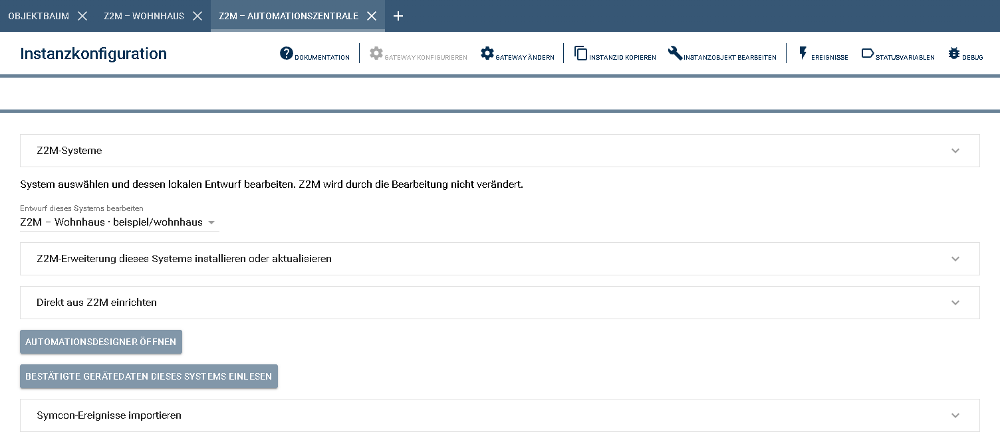

Das Zuordnen allein übernimmt noch keine Regeln. Bereits zugeordnete Verbindungen
bleiben erhalten. Eine Verbindung kann innerhalb dieser Symcon-Installation nur
von einer Zentrale verwaltet werden. Neue Verbindungen erscheinen nach erneutem
Öffnen des Formulars.

### Direkt aus Z2M einrichten

Jedes zugeordnete System wird einmal einzeln eingerichtet:

1. Im nativen Zentralenformular das gewünschte **Z2M-System** auswählen.
2. Falls die Erweiterung fehlt, den Bereich **Z2M-Erweiterung dieses Systems
   installieren oder aktualisieren** verwenden. Danach die Bestätigung abwarten.
3. **Direkt aus Z2M einrichten** öffnen und **Z2M-Automationen sicher einlesen**
   wählen. Der Abruf liest die gespeicherten Regeln und Gerätedaten als Vorschau.
4. In der Vorschau System, gespeicherten Stand, Regeln, Aktionsfolgen und
   Partnerfreigaben kontrollieren. Der bisherige lokale Stand wird zusätzlich gesichert.
5. **Verbindung übernehmen und Entwurf einrichten** wählen und bestätigen.
6. Nach der Erfolgsmeldung **Automationsdesigner öffnen** wählen.

Dieser Ablauf liest aus Z2M. Er speichert, aktiviert oder stoppt dort keine
Automation. Namen, Kennungen, Regelschalter und vorhandene Freigaben werden
übernommen. Ist Z2M noch leer, entsteht ein leerer lokaler Entwurf. Ein nicht
lesbarer Z2M-Speicher wird nicht als leer behandelt.

Besteht bereits ein lokaler Entwurf oder eine Zuständigkeit einer anderen
Instanz, wird dieser Stand geschützt. Für vorhandene Automations-Einzelinstanzen
gilt der [gesicherte Übernahmeweg](../docs/MIGRATION.md).

**Vorschau verwerfen** beendet die Vorbereitung. **Letzte Einrichtung lokal
zurücknehmen** stellt die vorherige lokale Zuordnung wieder her und sichert
spätere Entwurfsänderungen zusätzlich. Dieser Rückweg verändert keine Z2M-Datei.
Sobald eine Speicherung, Installation oder ein Betriebswechsel nach Z2M gesendet
worden sein könnte, kann der rein lokale Rückweg gesperrt sein. Die Meldung nennt
den Grund; die Wiederherstellung des tatsächlichen Z2M-Betriebs ist dann getrennt zu planen.

Sicherungen liegen außerhalb der Library unter
`IPS_GetKernelDir()/Z2MAutomations-private/`. Sie enthalten eigene Konfigurationen
und werden nicht automatisch gelöscht. Unter Windows gelten die lokalen
Dateisystemrechte. Einzelheiten beschreibt [Sicherung und Rückweg](../docs/MIGRATION.md).

## 4. Im Browserdesigner arbeiten

### Automationsdesigner im Browser

Im nativen Zentralenformular **Automationsdesigner öffnen** wählen. Der Designer
öffnet den Arbeitsbereich der Zentrale. Oben wählen Sie das Z2M-System; links
stehen die nummerierten Arbeitsschritte, rechts der gewählte Arbeitsbereich.
Der Designer startet bei den Automationen. Die Kachel verwendet denselben Aufbau;
bei wenig Platz ersetzt eine Schrittauswahl die linke Navigation. Die vorhandenen
Bildschirmbilder zeigen teilweise den früheren Aufbau.

| Schritt | Arbeitsbereich |
| --- | --- |
| 1. Zentrale | Verwendete Symcon-Zentrale und lokale Speicherung prüfen. |
| 2. MQTT-Verbindungen | Vorhandene MQTT-Parents überblicken. Broker und Zugangsdaten werden in Symcon eingerichtet. |
| 3. Z2M-Systeme | Vorhandene Z2M-Verbindungen ausdrücklich zuordnen und Partnerfreigaben öffnen. |
| 4. Bestand lesen | Gerätedaten nachladen, getrennte Geräte-/Gruppenlisten ansehen und die Erweiterung prüfen. |
| 5. Arbeitsstand | Den lokalen Entwurf öffnen und bei Bedarf als YAML exportieren. |
| 6. Automationen | Regeln und Aktionsfolgen erstellen, bearbeiten, kopieren und löschen. |
| 7. Entwurf prüfen | Fehler mit Regel, Abschnitt und Feld anzeigen; direkt zur Korrekturstelle wechseln. |
| 8. Nach Z2M übermitteln | Ziel und Wirkung bestätigen; Statusprüfung, nötiger Stopp, erneute Prüfung und Speicherung laufen geführt ab. |
| Betrieb | Gespeicherte Regeln starten, stoppen oder einmal ausführen; Freigaben im lokalen Entwurf ändern. |

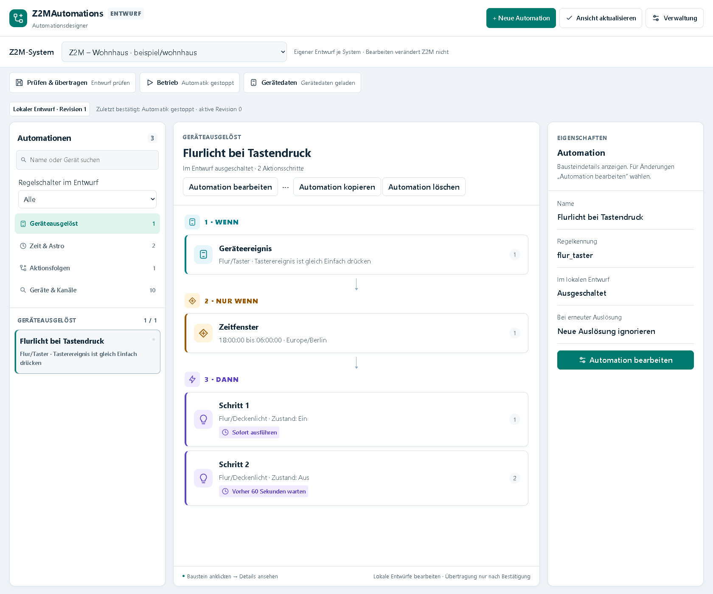

| Bereich | Bedienung |
| --- | --- |
| Z2M-System | Wählt das System, dessen Entwurf und Status angezeigt werden. |
| Automationen links | Regeln suchen, filtern und auswählen; zwischen Geräte-, Zeitregeln und Aktionsfolgen wechseln. |
| Ablauf in der Mitte | **Wenn**, **Nur wenn** und **Dann** zeigen Auslöser, Bedingungen und Aktionen. |
| Eigenschaften rechts | Ein angeklickter Baustein zeigt seine vorhandenen Angaben. Zum Ändern **Automation bearbeiten** wählen. |
| Neue Automation als Entwurf | Öffnet das gemeinsame Formular für das ausgewählte System. |
| Statuszeile | Zeigt ausgewähltes System, gespeicherte Z2M-Revision und bestätigten Betrieb getrennt. Der lokale Entwurf steht im Arbeitsbereich. |
| Entwurf prüfen / Nach Z2M übermitteln | Prüfung und bestätigte Übernahme haben eigene Schritte. |
| Betrieb | Gespeicherte Regeln aktivieren, stoppen oder einmal ausführen. |

Gerätebausteine zeigen ihr **Z2M-Netzwerk** mit Systemname und Basistopic direkt
im Ablauf. Das gilt auch für Bedingungen und Aktionen mit Geräten anderer
Systeme. Die Eigenschaften des angeklickten Bausteins zeigen dieselbe Zuordnung.
| Gerätedaten | Geräte, Kanäle, Gruppen und Szenen dieses Systems nachladen. |
| Verwaltung | Aktionsfolgen, Systeme und Diagnose, Partnerfreigaben sowie Ereignisimport öffnen. |

Die Darstellung folgt der Hell-/Dunkeleinstellung des Browsers. Schrift und
Anordnung passen sich an die verfügbare Breite an. Auf schmalen Ansichten lassen
sich die Automationsliste und die Eigenschaften aufklappen.

### System wechseln und Daten aktualisieren

Vor einem Systemwechsel offene Bearbeitungen übernehmen oder mit **Abbrechen**
schließen. Im nativen Formular müssen offene Eingaben ebenfalls zuerst übernommen
oder ausdrücklich verworfen werden. Regeln und Aktionsfolgen bleiben je System getrennt.


**Ansicht aktualisieren** liest nur den bereits vorhandenen Modulstand aus
Symcon. Für frische Gerätedaten aus Z2M:

Bei fehlenden oder unbestätigten Gerätedaten steht der Hinweis direkt unter der
Systemauswahl. Darin führt die hervorgehobene Schaltfläche
**Zu Schritt 4: Gerätedaten** direkt in den richtigen Bereich.
Der Button öffnet nur den Bereich. In Schritt 4 entfällt dieser zusätzliche
Navigationshinweis. Dort starten Sie den Abruf ausdrücklich mit der
hervorgehobenen Schaltfläche **Gerätedaten aktualisieren** in der Gerätedaten-Karte.
Andere Formularhinweise und Fehlermeldungen bleiben sichtbar. Beim Wechsel in
einen anderen Schritt erscheint der Gerätedatenhinweis wieder, solange der
Bestand noch nicht bestätigt ist.

1. Das gewünschte System auswählen und Schritt 4 **Verbinden und Bestand lesen** öffnen.
2. **Gerätedaten aktualisieren** wählen.
3. Die Verbindungsprüfung und den Geräteabruf abwarten. Währenddessen ist der
   Ladebutton gesperrt; anschließend erscheinen Ladezeit und Anzahl der Einträge.

Entwürfe, Namen, Regelschalter, Aktionsfolgen und Freigaben bleiben erhalten.
Der Abruf speichert oder aktiviert keine Automation. Ist währenddessen eine
Bearbeitung geöffnet, bleibt sie geschützt. Danach gegebenenfalls die Bearbeitung
schließen und **Ansicht aktualisieren** wählen.

**Gerätedaten geladen** bedeutet, dass sie für diese Verbindung bestätigt sind.
**Nicht bestätigt** kennzeichnet einen früheren, derzeit nicht verwendbaren Stand.
**Ladestatus prüfen** liest nur das Ergebnis eines Abrufs und startet keinen neuen.

### Zugang zum Designer

**Sprache:** Oben im Designer können Sie zwischen **Deutsch** und **English**
wechseln. Die Auswahl gilt für alle Bereiche und Dialoge. Zunächst gilt die
Browsersprache; Ihre Auswahl wird im Browser gespeichert. Andere
Browsersprachen verwenden Englisch. Offene Eingaben bleiben beim Wechsel
erhalten. Gerätenamen, eigene Regelnamen, Szenennamen und technische Werte
werden nicht übersetzt. Die nativen Symcon-Debugausgaben bleiben deutsch.

Der Zugang gilt zunächst 15 Minuten. Bei sichtbarer Ansicht wird er alle vier
Minuten automatisch verlängert. **Zugang verlängern** führt dies sofort aus,
ohne die Bearbeitung neu zu laden. Nach einem Modulupdate, geänderten
Systemzuordnungen oder spätestens acht Stunden den Designer erneut im Modul öffnen.
Wer selbst in Schritt 3 neue Verbindungen zuordnet, behält seinen Zugang;
andere bereits geöffnete Designer müssen danach erneut geöffnet werden.

Ein abgelaufener Link lässt sich nicht verlängern. Noch sichtbare Eingaben werden
nicht automatisch verworfen oder erneut gesendet. Höchstens vier Zugänge sind
gleichzeitig gültig; ein weiterer Öffnungsvorgang ersetzt den ältesten Zugang.
Designerlinks gewähren Zugriff auf die Bearbeitung und sollten nicht weitergegeben werden.

## 5. Automationen erstellen

### Erste Automation: Licht bei Tastendruck

1. Das System des Tasters auswählen. In Schritt 6 **Neue Automation
   als Entwurf** öffnen, das angezeigte System prüfen und einen Namen eingeben,
   etwa **Flurlicht bei Tastendruck**. Browserdesigner und Kachel verwenden
   dasselbe Formular.
2. Unter **Wenn** den Auslöser **Gerätestatus** und den Taster auswählen.
   **Eigenschaft / Kanal**, Vergleich und **Wert** einstellen, beispielsweise
   **Tasterereignis**, **ist gleich**, **Einfach drücken**.
3. Unter **Nur wenn** bei Bedarf Bedingungen ergänzen.
4. Unter **Dann** die Aktion **Werte setzen**, das Zielgerät, den Kanal und
   den Wert **Ein** auswählen. Einen zweiten Schritt für dasselbe Licht mit
   **Aus** und beispielsweise 60 Sekunden Wartezeit hinzufügen.
5. **Ausgeschaltet zum Entwurf hinzufügen** prüft die Eingaben und speichert die
   Regel im Symcon-Entwurf. YAML ist nur ein optionaler Export in Schritt 5.
   Die Übernahme nach Z2M erfolgt separat in Schritt 8.

Der folgende Ausschnitt zeigt Gerät, Kanal und Wert eines vorhandenen Auslösers:

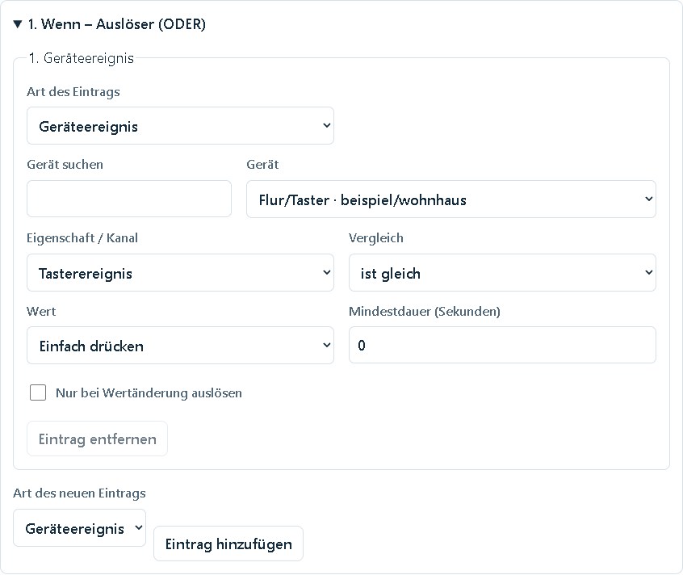

Neue Regeln beginnen ausgeschaltet. Vor dem späteren Aktivieren muss ihr
Regelschalter im Entwurf eingeschaltet und der geänderte Entwurf geprüft und
gespeichert werden. Das Anlegen oder Bearbeiten allein schaltet kein Gerät.

### Geräteauslöser und mehrere Kanäle

Mit **Auslöser hinzufügen** weitere Auslöser
ergänzen. Bis zu acht Einträge können dieselbe Regel unabhängig starten (ODER),
beispielsweise zwei Bewegungsmelder oder ein Bewegungsmelder und ein Taster.
Die Bedingungen der Regel gelten für jeden dieser Auslöser.

Mehrkanalgeräte bieten einzelne Eigenschaften wie **Zustand (Kanal L1)** und
**Zustand (Kanal L2)**. Den gewünschten Kanal ausdrücklich wählen. Ein allgemeiner
Zustand ersetzt keinen einzelnen Kanal.

**Mindestdauer** 0 reagiert sofort. 1 bis 86400 Sekunden verlangen einen so lange
anliegenden Zustand. Für kurze Tastendrücke normalerweise 0 verwenden.
**Nur bei Wertänderung auslösen** verhindert, dass eine unveränderte passende
Meldung erneut startet. Ereignisse ohne dauerhaft gespeicherten Zustand, etwa
Tastendrücke, werden anhand der seit Aktivierung beobachteten Meldungen verglichen.

Messwerte unterstützen gleich, ungleich, größer, kleiner, mindestens und höchstens.
Bei Zuständen und Ereignissen stehen gleich und ungleich zur Verfügung.
Ein Auslöser kann beispielsweise verlangen, dass die Helligkeit seit 30 Sekunden
kleiner als 50 Lux ist.

### Uhrzeiten und Sonnenzeiten

Für einen zeitlichen Auslöser **Art des Eintrags → Uhrzeit** wählen, die Uhrzeit
und Zeitzone eintragen. Weitere Uhrzeiten als zusätzliche Einträge hinzufügen.
Der Browsereditor erlaubt bis zu acht Auslöser insgesamt. Ungültige oder doppelte
Uhrzeiten lassen sich nicht übernehmen.

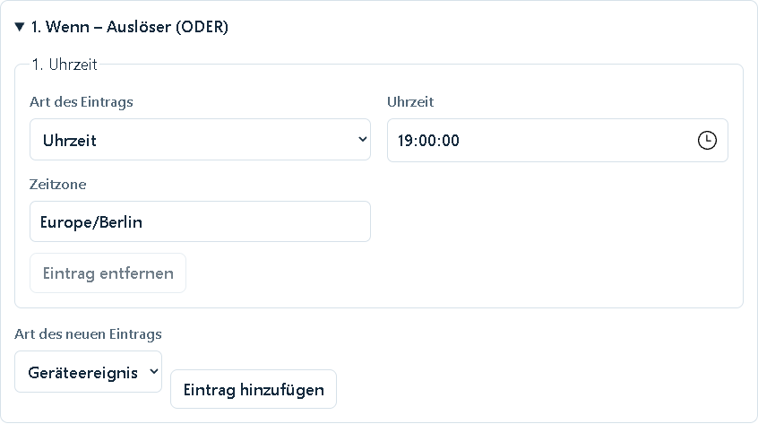

Für Sonnenauf- oder Sonnenuntergang die entsprechende **Art des Eintrags** wählen:

1. **Sonnenaufgang** oder **Sonnenuntergang** auswählen.
2. Breitengrad und Längengrad des Standorts in Dezimalgrad eintragen.
3. Die passende Zeitzone angeben; eine automatische Ortung findet nicht statt.
4. Den **Zeitversatz** in ganzen Minuten einstellen: −30 bedeutet eine halbe
   Stunde vorher, +15 eine Viertelstunde danach. Erlaubt sind −720 bis +720 Minuten.

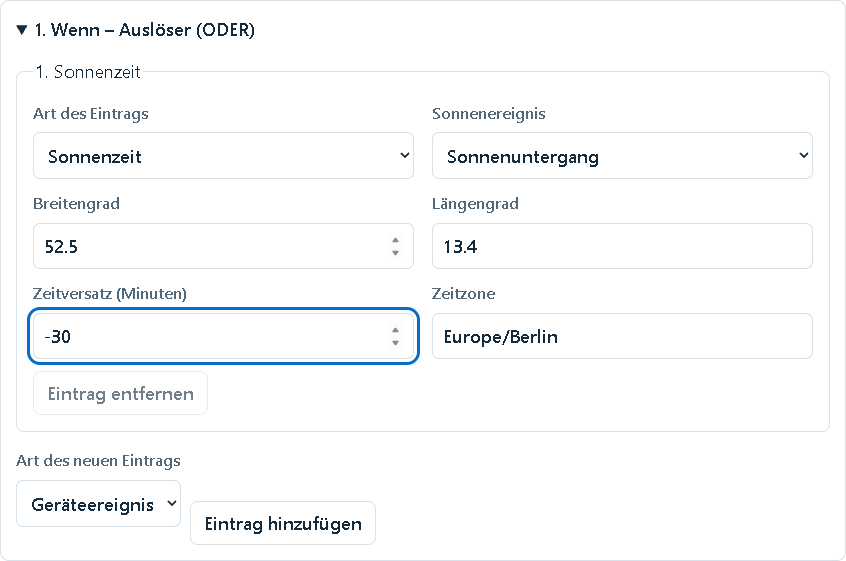

Ohne Bedingungen gelten Zeitregeln täglich. Z2M berechnet die Sonnenzeiten
selbstständig. Verpasste Zeiten werden nicht nachgeholt. In einer bei der
Zeitumstellung doppelt vorkommenden Stunde wird eine Uhrzeit nur einmal pro Tag
ausgelöst. Die Sonnenberechnung berücksichtigt weder Gelände noch Wetter;
an Tagen ohne das gewählte Sonnenereignis startet die Regel nicht.

### Bedingungen: nur wenn alle Angaben passen

Unter **2. Nur wenn – Bedingungen (UND)** Gerätewerte, Wochentage oder
Zeitfenster hinzufügen. Alle eingetragenen Bedingungen müssen erfüllt sein.
Insgesamt sind höchstens 16 Bedingungen erlaubt.

- **Gerätewert:** Gerät, Eigenschaft, Vergleich und Wert wählen, etwa Helligkeit
  kleiner als 50 Lux. Ein unbekannter Gerätewert erfüllt auch „ungleich“ nicht.
- **Wochentage:** Mindestens einen Tag und die Zeitzone wählen. Das funktioniert
  unabhängig von einem Zeitfenster, auch für Geräte- und Sonnenregeln.
- **Zeitfenster:** Beginn, Ende und Zeitzone eintragen. Der Beginn zählt mit,
  das Ende nicht; gleiche Zeiten sind ungültig. Ein Fenster Montag 22:00 bis
  06:00 gilt bis Dienstagmorgen. Maßgeblich ist sein Starttag.

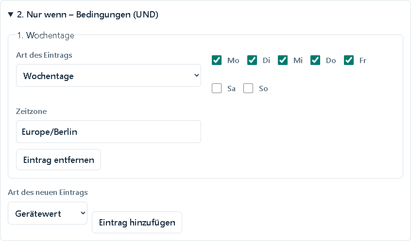

Eine zusätzliche Wochentagsbedingung prüft den aktuellen Kalendertag. Soll das
Montag-Zeitfenster auch am Dienstagmorgen gelten, muss die unabhängige
Wochentagsbedingung daher ebenfalls Dienstag erlauben.

Gerätebedingungen werden normalerweise beim Start und vor jeder Aktion erneut
geprüft. Mit **Nur beim Start prüfen** gilt eine Gerätebedingung nur für den
Beginn eines neuen Ablaufs. Das ist beispielsweise für eine Helligkeitsgrenze
sinnvoll: Ein Bewegungsmelder soll das Licht nur im Dunkeln einschalten, nach
der Wartezeit aber auch dann ausschalten, wenn es inzwischen heller geworden ist.
Zeitfenster und Wochentage werden weiterhin erneut geprüft.

### Aktionen, Wartezeiten und Reihenfolge

Die Aktionen laufen von oben nach unten. Die **Wartezeit vor diesem Schritt**
gilt jeweils vor der zugehörigen Aktion. 0 bedeutet sofort; bei weiteren Schritten
beginnt die Wartezeit nach der Übergabe der vorherigen Aktion an Z2M.

Das Beispiel schaltet sofort ein und wartet vor dem Ausschalten 60 Sekunden:

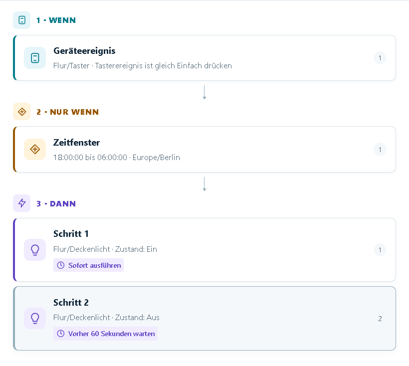

Die Reihenfolge am Griff **Verschieben** ziehen oder mit **Nach oben** und
**Nach unten** ändern. Die Wartezeit bleibt bei ihrem Schritt. Erst das
Übernehmen der gesamten Regel speichert die geänderte Reihenfolge im Entwurf.

| Aktionsart im Browser | Verwendung |
| --- | --- |
| Werte setzen | Gerät oder Gruppe wählen, Eigenschaft/Kanal und gewünschten Wert einstellen. |
| Umschalten | Bekannten Ein-/Aus-Zustand umkehren. Bei unbekanntem Zustand endet der Schritt mit Fehler. |
| Szene aufrufen | Eine bereits in Z2M vorhandene Szene eines Geräts oder einer Gruppe wählen. |
| Aktionsfolge aufrufen | Eine wiederverwendbare Folge dieses Systementwurfs verwenden. |

Nur schaltbare Eigenschaften werden als Aktionsziele angeboten. Für **Werte
setzen** können Sie mit **Weiteren Wert hinzufügen** bis zu acht Eigenschaften
desselben Geräts in einem Schritt kombinieren, etwa Einschalten, Helligkeit und
Farbe. Der gemeinsame Befehl wird einmal an Z2M übergeben. Farbe und
Farbtemperatur desselben Kanals in getrennte Schritte aufteilen.

Für geeignete Farbleuchten erscheint eine Farbauswahl. Bei Gruppen werden nur
die tatsächlich angebotenen Eigenschaften verwendet. Fehlt eine Eigenschaft,
Geräteunterstützung und schaltbare Symcon-Variable prüfen und Gerätedaten nachladen.

Szenen werden nur aufgerufen, nicht neu angelegt oder verändert. Fehlt die
gewünschte Szene, zuerst in Z2M anlegen und danach die Gerätedaten aktualisieren.
Die Ausführung einer Aktion bestätigt ihre Befehlsübergabe, nicht die physische
Wirkung am Gerät. Bereits gesendete Befehle lassen sich durch Stoppen nicht zurücknehmen.

### Wiederverwendbare Aktionsfolgen

1. In Schritt 6 **Neue Aktionsfolge** wählen und einen Namen vergeben.
2. Aktionen, Geräte, Kanäle, Werte und Wartezeiten wie bei einer Regel zusammenstellen.
3. Die Reihenfolge anordnen und **Aktionsfolge in den Entwurf übernehmen** wählen.
4. Eine Automation bearbeiten, als Aktion **Aktionsfolge aufrufen** wählen und
   die gewünschte Folge auswählen.

Vorhandene Folgen links unter **Aktionsfolgen** auswählen und mit **Aktionsfolge
bearbeiten** öffnen. Die Anzeige nennt die verwendenden Automationen. Änderungen
gelten nach dem Übertragen für alle diese Regeln. Eine Folge hat keinen eigenen
Auslöser und keinen Regelschalter.

Die Wartezeit am Aufruf kommt zur Wartezeit des ersten Folgenschritts hinzu:
5 Sekunden am Aufruf plus 2 Sekunden am ersten Schritt ergeben 7 Sekunden.
Pro Automation sind höchstens 16 tatsächlich ausgeführte Schritte erlaubt,
einschließlich aufgerufener Folgen. Eine Folge kann keine weitere Folge aufrufen.
Eine verwendete Folge lässt sich erst löschen, wenn ihre Aufrufe entfernt sind.

### Erneute Auslösung und Nachlaufzeit

Unter **Bei erneuter Auslösung** festlegen, was bei einer weiteren passenden
Meldung während eines laufenden Ablaufs passieren soll:

| Auswahl im Browser | Wirkung |
| --- | --- |
| Ignorieren | Die aktuelle Folge läuft unverändert weiter. |
| Von vorn beginnen | Der noch offene Rest endet; die Folge beginnt wieder bei der ersten Aktion. |
| Laufende Wartezeit zurücksetzen | Nur die aktuelle Wartezeit beginnt erneut mit ihrer vollen Dauer. Erledigte Aktionen werden nicht wiederholt. Ohne laufende Wartezeit hat die Meldung keine Wirkung. |

Für ein Bewegungslicht mit Nachlaufzeit: einschalten, vor dem Ausschalten
beispielsweise 60 Sekunden warten und **Laufende Wartezeit zurücksetzen** wählen.
Jede passende neue Bewegung während dieser Wartezeit verlängert sie.

Weitere Bedingungen müssen erneut passen, ausgenommen Gerätebedingungen mit
**Nur beim Start prüfen**. Ein Neuanfang prüft alle Bedingungen wieder. Es läuft
höchstens ein Ablauf derselben Regel; zwischen Startversuchen gilt eine Sperrzeit
von einer Sekunde. Bei einem Neuanfang können bereits erledigte Aktionen erneut
ausgeführt werden, auch Umschaltbefehle. Eine fehlgeschlagene oder nicht bestätigte
vorherige Befehlsübergabe kann den vorgemerkten Neustart verhindern.

## 6. Vorhandene Regeln verwalten

Links eine Automation auswählen und **Automation bearbeiten** öffnen. Name,
Regelschalter, Auslöser, Bedingungen und Aktionen werden vorbelegt. Danach
**Änderungen in den Entwurf übernehmen** wählen.

Der Regelschalter wirkt zunächst nur auf den Entwurf. Er verändert keine laufende
Z2M-Regel. Fehlen Gerätedaten oder Schaltrechte oder ist ein Bereich nicht vollständig
darstellbar, bleibt dieser geschützt erhalten. Name und Regelschalter können
weiterhin bearbeitet werden. Eine Meldung erklärt die Einschränkung.

- **Suchen und filtern:** Mit **Name oder Gerät suchen** die Liste eingrenzen.
  **Regelschalter im Entwurf** filtert Alle, Aktiviert oder Deaktiviert. Der
  Filter beschreibt den lokalen Entwurf, nicht den bestätigten Z2M-Betrieb.
- **Kopieren:** **Automation kopieren** legt nach Bestätigung eine ausgeschaltete
  Kopie mit eigener Kennung an. Auslöser, Bedingungen und Aktionen bleiben erhalten.
  Verweise auf Aktionsfolgen zeigen weiterhin auf dieselben Folgen.
- **Löschen:** **Automation löschen** entfernt die Regel nach Bestätigung aus dem
  lokalen Entwurf. Erst Prüfung und Speicherung übertragen diese Änderung nach Z2M.
- **Aktionsfolge löschen:** Nur für unbenutzte Folgen möglich. Der Dialog nennt
  andernfalls die verwendenden Regeln, einschließlich ausgeschalteter Automationen.

Suchtext, Filter und Auswahl bleiben je System getrennt. Ein leeres Suchergebnis
löscht nichts. Bei zwischenzeitlichen Änderungen bleiben die eigenen Eingaben
im Dialog; erst **Neu laden und Eingaben verwerfen** lädt nach Bestätigung den
aktuellen Stand. **Abbrechen** verwirft nur die nicht übernommenen Dialogeingaben.

## 7. Entwurf prüfen und an Z2M übertragen

Die drei Schritte haben unterschiedliche Auswirkungen:

| Schritt | Was passiert? |
| --- | --- |
| In den Entwurf übernehmen | Speichert die Bearbeitung lokal in Symcon. Z2M bleibt unverändert. |
| In Z2M prüfen | Prüft, ob Z2M den Entwurf verwenden kann. Es wird keine Automation aktiviert. |
| In Z2M speichern | Ersetzt die Automationsdatei genau dieses Systems. Bei geändertem Inhalt stoppt die bisherige Ausführung. |

1. Das gewünschte Z2M-System auswählen und offene Bearbeitungen übernehmen oder schließen.
2. Schritt 7 **Entwurf prüfen** wählen. Bei Fehlern nennt die Liste die betroffene
   Automation, den Abschnitt und die Eigenschaft. **Zur Stelle im Entwurf** öffnet
   das Feld zur Korrektur. Anschließend erneut prüfen.
3. Bei erfolgreicher Prüfung Schritt 8 **Nach Z2M übermitteln** öffnen und
   **Geprüften Entwurf in Z2M speichern** wählen. Den
   Bestätigungsdialog lesen und bestätigen.
4. Der Designer liest den Betriebsstatus, stoppt nötigenfalls Betrieb,
   Wiederanlauf und offene Einzelläufe und prüft den aktuellen Entwurf erneut.
   Auf **Übertragung und gespeicherter Stand wurden von Z2M bestätigt** warten.
5. Soll die neue Fassung laufen, anschließend im Bereich **Betrieb** aktivieren.


Eine Entwurfsänderung oder ein Z2M-Neustart kann eine neue Prüfung erforderlich
machen. Vor dem Senden werden die Schaltrechte erneut geprüft. Andere Systeme
behalten ihre Entwürfe und ihren Betrieb.

Die Regelschalter des nativen Entwurfs bleiben beim Speichern erhalten. Die
Erweiterung sichert den bisherigen Dateistand auf dem Z2M-Host. Der Ablauf
aktiviert keine Automation. Fehlt eine Bestätigung, wird kein Steuer- oder
Speicherauftrag automatisch erneut gesendet.

Im Bereich **Betrieb → Regeln für den Automatikbetrieb freigeben** können Sie
die Häkchen der gewünschten Regeln direkt ändern. Das speichert ausschließlich
den jeweiligen lokalen Schalter. Danach prüfen und in Schritt 8 übermitteln.
Die Anzahl der in Z2M freigegebenen Regeln wird nur für einen bestätigten,
mit dem Entwurf übereinstimmenden Stand angezeigt; andernfalls steht dort ein Hinweis.

Bei Ablehnung nennt die Fehlerliste Automation, betroffenen Schritt und Ursache.
Es werden bis zu 20 Fehler gleichzeitig angezeigt. Die Nummern beziehen sich auf
die Reihenfolge aller Regeln der Datei, auch ausgeschalteter Regeln. Die Details
bleiben bei Statusabfragen bis zur nächsten Entwurfsprüfung erhalten.

**Übertragungsstatus aktualisieren** liest das vorhandene Ergebnis und wiederholt
keinen Schreibauftrag. Eine Zeitüberschreitung beweist nicht, dass Z2M nichts
gespeichert hat. Zuerst den Status und gespeicherten Stand prüfen. Fehlt nur die
anschließende Betriebsbestätigung, nicht deshalb noch einmal speichern.

## 8. Automationen aktivieren und stoppen

### Automatikbetrieb eines Systems

Im Designer zuerst oben das gewünschte **Z2M-System** auswählen. Direkt darunter
stehen die drei Bereiche **Prüfen & übertragen**, **Betrieb** und **Gerätedaten**.
Auf **Betrieb** klicken, um die Betriebssteuerung aufzuklappen:

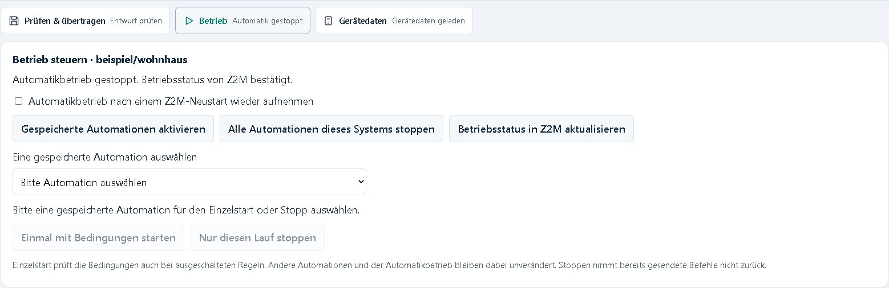

Oben im aufgeklappten Bereich stehen der Systemname und der bestätigte Zustand.
Darunter finden Sie die Wiederanlaufoption und die Buttons zum Aktivieren,
Stoppen und Aktualisieren. Im unteren Teil wird eine einzelne gespeicherte
Automation für einen einmaligen Start oder gezielten Stopp ausgewählt.

1. Bei unbekanntem Stand **Betriebsstatus in Z2M aktualisieren** wählen.
2. **Automatikbetrieb nach einem Z2M-Neustart wieder aufnehmen** nach Wunsch einstellen.
3. **Gespeicherte Automationen aktivieren** wählen und bestätigen.
4. Die frische Statusbestätigung abwarten. Erst dann gilt die Aktivierung als bestätigt.

Aktiviert wird der gespeicherte Stand mit allen darin eingeschalteten Regeln.
Der lokale Entwurf muss dazu passen. Ist der Aktivierungsbutton gesperrt,
den angezeigten Hinweis beachten: gegebenenfalls offene Eingaben übernehmen,
Änderungen prüfen und speichern oder den Betriebsstatus aktualisieren.

**Alle Automationen dieses Systems stoppen** beendet den Automatikbetrieb und
laufende Abläufe des Systems, einschließlich ausstehender Wartezeiten. Stoppen
bleibt auch bei offenen Entwurfsänderungen möglich. Ein Timeout bestätigt keinen
Stopp; in diesem Fall den Betriebsstatus erneut abfragen. Empfangene Partneraktionen
werden bei gestoppter Automatik ebenfalls nicht ausgeführt.

Ein ausgeschaltetes Symcon oder eine unterbrochene Verbindung zu Symcon stoppt
die Z2M-Regeln nicht. Sie laufen nach erfolgreicher Aktivierung selbstständig weiter.

### Automatischer Wiederanlauf

Das Häkchen **Automatikbetrieb nach einem Z2M-Neustart wieder aufnehmen** finden
Sie im geöffneten Bereich **Betrieb**, direkt über den Aktivierungs- und Stoppbuttons
(siehe Abbildung oben).

Die Wiederanlaufoption wird erst mit der nächsten Aktivierung in Z2M gespeichert.
Danach stellt Z2M nach einem Neustart denselben freigegebenen Regelstand selbst
wieder bereit. Ein bewusster Stopp bleibt dauerhaft wirksam. Das bloße Speichern
geänderter Regeln erteilt keine neue Wiederanlauffreigabe.

Verpasste Zeit- und Sonnenauslöser werden nicht nachgeholt. Für unterbrochene
Aktionsfolgen wählen Sie beim Erstellen oder Bearbeiten einer Automation unter
**Nach einem Zigbee2MQTT-Neustart** eines der folgenden Verhalten:

| Auswahl | Verhalten |
| --- | --- |
| Unterbrochenen Lauf beenden | Standard. Die laufende Folge und ihre Wartezeit enden beim Neustart. |
| Fortsetzen; bei abgelaufener Wartezeit den Lauf beenden | Am gespeicherten Aktionsschritt nur die verbleibende Zeit warten. Ist sie beim Neustart bereits verstrichen, endet der Lauf. |
| Fortsetzen; bei abgelaufener Wartezeit die ausstehende Aktion nachholen | Nur die verbleibende Zeit warten; ist sie bereits verstrichen, die ausstehende Aktion nach erneuter Bedingungsprüfung ausführen. |

Diese Auswahl gilt nur für **wartende Automatikläufe** und setzt zusätzlich
den aktivierten Automatikbetrieb nach Neustart voraus. Regeln ohne die neue
Angabe behalten den Standard. Die Ausfallzeit zählt zur Wartezeit. Folgende
Wartezeiten beginnen regulär, wenn der jeweilige Schritt erreicht wird.
Erledigte Aktionen werden nicht erneut ausgeführt. Bereits übergebene oder
unbestätigte Gerätebefehle werden nicht wiederholt; es gibt keine Zusicherung,
dass ein gerade übergebener Befehl das Gerät erreicht hat.

Einzelstarts und noch laufende Mindestdauern von Auslösern werden nicht
fortgesetzt. Ein bestätigter Stopp, ein anderer Regelstand oder eine beschädigte
Fortsetzungsdatei verhindert die Wiederaufnahme des alten Laufs. Ein bereits
eingeschaltetes Licht wird durch den Abbruch nicht automatisch ausgeschaltet.

Gerätebedingungen benötigen neue Werte; **Nur beim Start** wird bei einer
Fortsetzung nicht erneut geprüft. Fehlende Geräte,
beschädigte Dateien oder ein abweichender Regelstand können den Wiederanlauf
verhindern. Bei systemübergreifenden Aktionen brauchen beide Seiten ihre eigene
Aktivierung und Wiederanlaufeinstellung.

### Eine gespeicherte Regel einmal starten oder gezielt stoppen

1. Unter **Eine gespeicherte Automation auswählen** die gewünschte Regel wählen.
2. **Einmal mit Bedingungen starten** wählen und bestätigen. Auch eine
   ausgeschaltete Regel kann so einmal ausgeführt werden; Geräte können schalten.
3. Die Statusanzeige verfolgen: laufend, abgeschlossen, wegen einer Bedingung
   nicht ausgeführt, fehlgeschlagen oder gestoppt.
4. **Nur diesen Lauf stoppen** beendet genau den angezeigten Lauf. Bereits
   gesendete Befehle werden nicht rückgängig gemacht.

Ein Einzelstart ändert weder Regelschalter noch Automatikbetrieb. Bedingungen
gelten weiterhin, auch vor späteren Aktionen, sofern nicht **Nur beim Start prüfen**
gewählt ist. Ein späterer regulärer Auslöser darf erneut starten. Hat inzwischen
ein anderer Lauf begonnen, wird ein veralteter Stoppauftrag abgelehnt.
„Abgeschlossen“ bestätigt die Befehlsübergabe, nicht die tatsächliche Gerätewirkung.

## 9. Aktionen zwischen Z2M-Systemen

Eine Automation gehört zum System ihres Auslösers. Ihre Geräteauslöser und
Gerätebedingungen stammen aus diesem System; Aktionen dürfen freigegebene Geräte,
Gruppen und Szenen anderer Systeme verwenden.

Bei einem gemeinsamen MQTT-Broker ist keine Broker-Bridge erforderlich. Bei
getrennten Brokern muss der Bereich `z2ma/mesh/#` verbunden sein. Auch die Benutzer,
mit denen sich Z2M selbst anmeldet, benötigen dort Lese- und Schreibrecht.
Die vollständige Anleitung steht unter
[Bis zu acht MQTT-Broker miteinander verbinden](../Z2MConnection/README.md#bis-zu-acht-mqtt-broker-miteinander-verbinden).

### Partnerfreigaben im Browserdesigner

Eine Freigabe gilt nur in eine Richtung. Soll ein Taster auf **System A** ein Licht
auf **System B** schalten, geben Sie **auf System B das System A frei**.

Den Zugang finden Sie **oben rechts unter Verwaltung → Partnerfreigaben**.
Im selben Menü liegt auch der Ereignisimport aus Punkt 10:

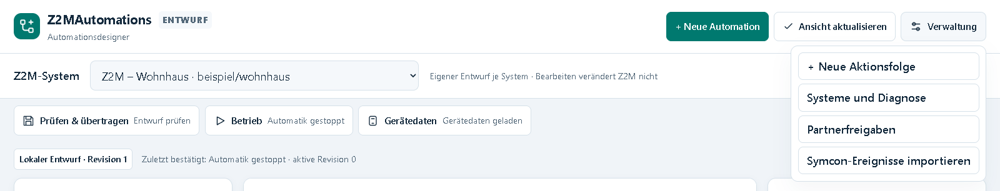

1. Oben das empfangende **System B** wählen.
2. Unter **Verwaltung → Partnerfreigaben** das sendende **System A** anhaken.
3. **Änderungen prüfen** wählen. Beim Entziehen einer Freigabe erscheinen die
   betroffenen lokalen Automationen, einschließlich ausgeschalteter Regeln und Folgen.
4. **Freigaben im Entwurf übernehmen** bestätigen.
5. Den Entwurf des Empfängers in Z2M prüfen, speichern und aktivieren.
6. Auf dem sendenden System die Geräte der Gegenseite laden, die gewünschte
   Aktion auswählen und auch dessen fertigen Entwurf prüfen, speichern und aktivieren.

Im folgenden Beispiel ist **Wohnhaus** der Empfänger. Das Häkchen erlaubt
Befehle vom System **Garten** an **Wohnhaus**; die Gegenrichtung wird damit
nicht freigegeben. Über **Änderungen prüfen** gelangen Sie zur Bestätigung:

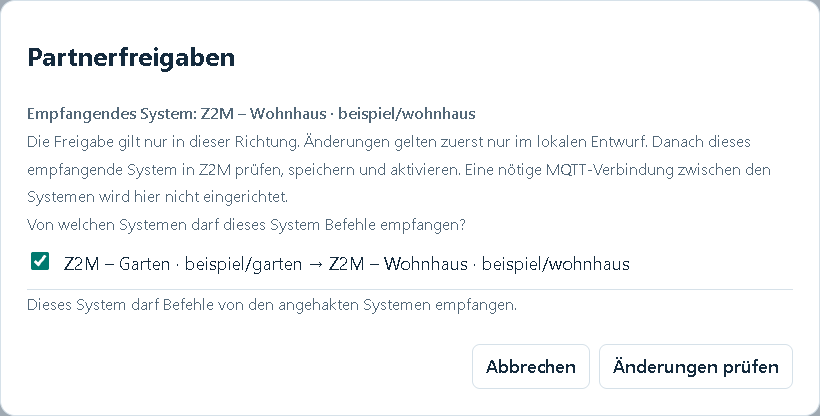

Aktionsziele anderer Systeme tragen deren Basistopic vor dem Namen. Gerät,
Kanal und Wert werden wie bei einem lokalen Ziel ausgewählt. Der Empfänger muss
auch dann aktiviert sein, wenn er keine eigene eingeschaltete Automation besitzt.
Stoppen auf der Empfangsseite sperrt auch Partneraktionen.

Bisherige Freigaben für nicht zugeordnete Systeme bleiben sichtbar und angehakt;
deren externe Nutzer können hier nicht geprüft werden. Bei vielen betroffenen
Regeln werden Gesamtzahl und die ersten 20 je Sender angezeigt. Entfernen Sie
eine solche Freigabe nur bewusst. Die Gegenrichtung bleibt unverändert.

Fehlt eine Gegenstelle, endet die Aktionsfolge mit Fehler. Sie wird nicht
automatisch nachgeholt. Eine Bestätigung des Zielsystems bedeutet, dass es den
Befehl übernommen hat; sie ersetzt keine Prüfung der tatsächlichen Gerätewirkung.

## 10. Symcon-Ereignisse importieren

Den Import öffnen Sie **oben rechts unter Verwaltung → Symcon-Ereignisse
importieren**. Der Dialog zeigt oben das ausgewählte Z2M-System. Mit
**Vorhandene Ereignisse prüfen** beginnt die Suche; darunter erscheinen
anschließend Treffer und die Vorschau zum ausgewählten Ereignis.

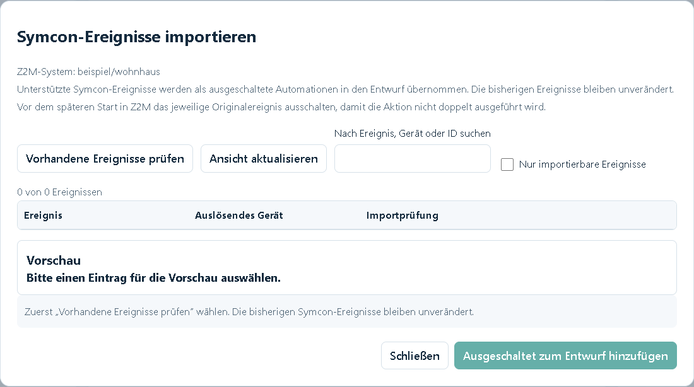

Die leere Liste in der Abbildung zeigt den Zustand vor der ersten Suche.
**Ausgeschaltet zum Entwurf hinzufügen** wird erst bei einem ausgewählten,
importierbaren Ereignis freigegeben.

1. Das Z2M-System auswählen, zu dem der Auslöser gehört.
2. Bei fehlenden Gerätedaten zuerst **Gerätedaten aktualisieren** wählen.
3. Unter **Verwaltung → Symcon-Ereignisse importieren** den Button
   **Vorhandene Ereignisse prüfen** betätigen.
4. Nach Ereignis, Gerät oder Instanz-ID suchen; bei Bedarf **Nur importierbare
   Ereignisse** anzeigen. Die Liste nennt Ereignis, auslösendes Gerät und ID.
5. Einen Eintrag wählen und die Vorschau mit Auslöser, Kanal, Wert, Ziel und Aktion prüfen.
6. **Ausgeschaltet zum Entwurf hinzufügen** wählen. Danach lässt sich die Regel
   wie jede andere Automation bearbeiten.
7. Vor dem späteren Aktivieren in Z2M das zugehörige Originalereignis in Symcon
   ausschalten, damit beide Systeme nicht dieselbe Aktion ausführen.

Die Suche ordnet Ereignisse anhand der Variablen-IDs, MQTT-Verbindung und des
Basistopics zu. Namen sind nur Anzeige; auch namenlose Ereignisse können
importiert und danach umbenannt werden. Das Ereignis kann im Baum beim Zielgerät
liegen und trotzdem eine Variable eines anderen Geräts überwachen.

Unterstützt sind Auslöser **Bei bestimmtem Wert**, native Ein-/Aus- und direkt
zuordenbare Text-/Auswahlaktionen sowie **Wert umschalten**. Zusätzliche Bedingungen,
Ausführungsbegrenzungen, PHP-Code, Ablaufpläne oder nicht sicher zuordenbare
Zahlenskalierungen werden mit Begründung abgewiesen. Es wird keine unvollständige
Teilregel erzeugt und kein PHP-Code ausgeführt.

Die Importprüfung sagt **Importierbar**, **Nicht importierbar** oder
**Noch nicht prüfbar**, jeweils mit Erklärung. Ist die wiederholte Ausführung im
Originalereignis ausgeschaltet, erhält der Auslöser **Nur bei Wertänderung**.
Der Import selbst ändert oder deaktiviert das Originalereignis nicht.

Ein bereits importiertes Ereignis erzeugt keine zweite Regel. Geänderte Ereignisse
oder offene Eingaben verhindern eine unbemerkte Übernahme. Andere Entwürfe und
Freigaben bleiben erhalten. Die Suche ist auf 4096 Ereignisse und 256 passende
Quellen begrenzt; erreichte Grenzen werden angezeigt. Ein entferntes Aktionsziel
benötigt die zuvor eingerichtete Partnerfreigabe.

## 11. Native Bedienung und Kachel

### Bearbeitung im nativen Formular

Das native Formular bietet dieselben getrennten Systementwürfe. Unter
**Entwurf dieses Systems bearbeiten** das System auswählen. Geräte- und
zeitgesteuerte Regeln besitzen eigene Bereiche; Name, Auslöser, Bedingungen und
Aktionsliste werden beim Auswählen vorbelegt.

Neue Regeln über **Neue Automation erstellen** beginnen. Bestehende Änderungen
mit dem Button **Änderungen in den Entwurf übernehmen** anwenden. Das ist ein
eigener Bearbeitungsschritt: Der normale orange Symcon-Button **Übernehmen**
ersetzt ihn nicht. Vor einem Regel- oder Bereichswechsel offene Angaben übernehmen
oder ausdrücklich verwerfen.

Prüfen und Übertragen erfolgt gemeinsam im Bereich **Entwurf für dieses System
prüfen und übertragen**. Betriebssteuerung steht unter **Gespeicherte Automationen
dieses Systems steuern**. Die Buttons gelten jeweils nur für das dort genannte System.

Der **Erweiterte YAML-Editor** zeigt in der Zentrale den vorhandenen Entwurf an;
das Textfeld ist dort gegen direkte Änderungen gesperrt. Zur grafischen Bedienung
muss dieser Bereich nicht geöffnet werden. Nicht vollständig darstellbare Regeln
bleiben erhalten; Name und Regelschalter können weiterhin bearbeitet werden.

### Native Symcon-Kachel und Designerzugang

1. Die Automationszentrale als Objekt in die Kachelvisualisierung aufnehmen.
2. Die Kachel öffnen. Der vollständige Designer verbindet sich direkt darin.
3. Das gewünschte System wählen. Entwurfsassistent und Statuszeile funktionieren
   wie im Browserdesigner.

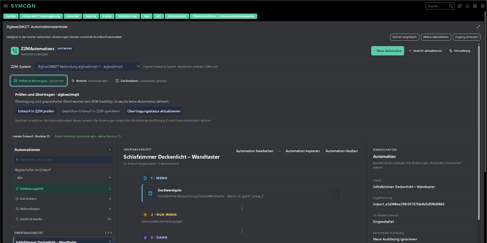

Die Aufnahme zeigt die Ansicht als Kachel. Farben, Grundschriftgröße und Breite
richten sich nach dem Symcon-Client. **Status aktualisieren** liest den vorhandenen
Modulstand. **Zugang erneuern** verlängert den Zugang, ohne offene Eingaben oder
die Systemauswahl zu verwerfen.

Die normale Kachel ist unter Symcon 9.0 verfügbar. **Kachel vergrößern** verwendet
ab Symcon 9.1 dessen native HTML-Großansicht. Vor dem Vergrößern offene Dialoge
übernehmen oder schließen. Für Symcon 9.0 die Kachel im Layout ausreichend groß einstellen.

Eine IPSView-Administrationsansicht wird nicht angeboten. Frühere IPSView-Platzierungen
und die nicht mehr aktualisierte Variable **Automationsdesigner für IPSView** können
nach Entfernen ihrer Verknüpfungen manuell entfernt werden.

## 12. Einstellungen und Statusanzeigen

Die Zentrale braucht keine eigenen MQTT-Zugangsdaten. Broker, Basistopic und
Antwortzeit werden in den [Verbindungsmodulen](../Z2MConnection/README.md) eingerichtet.

| Einstellung | Speicherung und Bedeutung |
| --- | --- |
| Z2M-Systeme / Verwenden | Leere Anfangsauswahl; 1 bis 8 vorhandene Verbindungen ausdrücklich zuordnen. Bereits zugeordnete Systeme bleiben erhalten. |
| Entwurf dieses Systems bearbeiten / Z2M-System | Auswahl eines zugeordneten Systems; die Bearbeitung gilt ausschließlich für dessen lokalen Entwurf. |
| Automatikbetrieb nach einem Z2M-Neustart wieder aufnehmen | Boolean je System; gilt erst mit der nächsten bestätigten Aktivierung in Z2M. |

Die Systemliste und Wiederanlaufoption werden über die jeweiligen Bedienbuttons
verwaltet, nicht durch manuelles Ändern der alten MQTT-Properties des Moduls.
`Active`, `BaseTopic`, `PeerModuleID`, `RequestTimeout` und die bisherige
`ResumeAfterRestart`-Property betreffen den noch vorhandenen Einzelbetrieb.
Ihre vollständige Referenz steht unter [Bestehende Einzelinstanzen](../docs/SINGLE_INSTANCE_REFERENCE.md).

Die folgenden zusätzlichen Zentralenvariablen sind reine Textanzeigen ohne
Schaltaktion und ohne Einheit:

| Anzeige / Ident | Typ | Bedeutung |
| --- | --- | --- |
| Gewähltes Z2M-System für Prüfung und Übertragung / `TransferSystem` | String | System, auf dessen Entwurf sich die angezeigte Prüfung oder Übertragung bezieht. |
| Prüfung und Übertragung / `TransferStatus` | String | Fortschritt beziehungsweise Ergebnis dieses Auftrags. |
| Einzelheiten zur Entwurfsprüfung / `TransferError` | String | Details der letzten Prüfung, einschließlich betroffener Regel und Angabe. |
| Gewähltes Z2M-System für Betriebssteuerung / `RuntimeSystem` | String | System, auf das sich die Betriebsanzeige bezieht. |
| Betriebssteuerung und Einzelstart / `RuntimeStatus` | String | Bestätigter Automatikzustand und Rückmeldung zur Betriebssteuerung. |

Der Betriebsstatus jedes Systems steht im Designer und in der zugehörigen
Z2M-Verbindung. Die aus dem Einzelbetrieb vorhandenen MQTT-/Laufzeitvariablen
der Zentrale sind keine gemeinsame Betriebsanzeige aller Systeme. Insbesondere
ist ihr eigener MQTT-Instanzstatus kein Nachweis für den Zustand der Z2M-Verbindungen.

### Systeme und Diagnose im Browserdesigner

Unter **Verwaltung → Systeme und Diagnose** sehen Sie alle zugeordneten Systeme
mit Name, Basistopic, Verbindung, MQTT-Zuordnung, Erweiterungsstand und Aufzeichnung.
Das gewünschte System anklicken, bevor Sie eine Aktion ausführen.

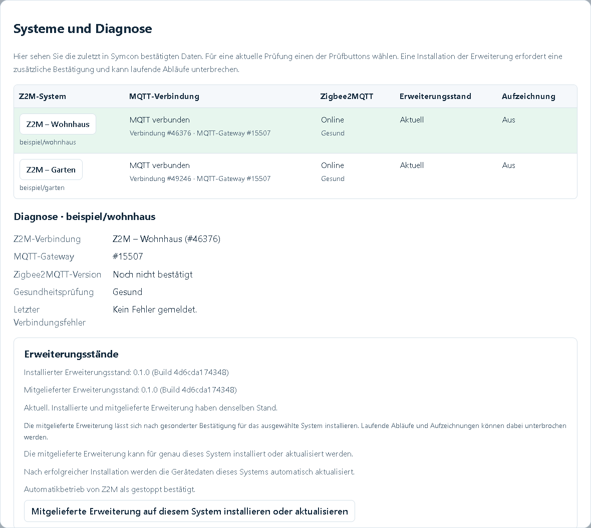

- **Zigbee2MQTT-Verbindung prüfen** fragt das gewählte System frisch ab und
  zeigt die Rückmeldung an. Eine MQTT-Verbindung allein bestätigt nur den Brokerkontakt.
- **Erweiterungsstatus abfragen** aktualisiert installierten und mitgelieferten
  Erweiterungsstand samt Buildkennung. **Noch nicht bestätigt** bedeutet nicht
  automatisch, dass die Erweiterung fehlt.
- **Diagnosestand neu laden** liest den vorhandenen Symcon-Stand und sendet
  keinen neuen Prüfauftrag.

Zum Aktualisieren **Mitgelieferte Erweiterung auf diesem System installieren
oder aktualisieren** wählen und die Bestätigung prüfen. Die Installation kann
laufende Abläufe kurz unterbrechen. Erfolg wird erst nach Bereitschaftsbestätigung
der neuen Erweiterung gemeldet. Danach werden Gerätedaten automatisch nachgeladen;
Entwürfe und offene Eingaben bleiben erhalten.

Scheitert nur das Nachladen, meldet die Anzeige **Erweiterung installiert.
Gerätedaten nicht aktualisiert**. Dann den Geräteabruf erneut starten, ohne
deshalb die Erweiterung nochmals zu installieren. Nach einem Erweiterungswechsel
gilt die in Z2M gespeicherte Wiederanlaufeinstellung; es wird kein zusätzlicher
Aktivierungsauftrag aus Symcon gesendet.

Für eine zeitlich begrenzte Ablaufaufzeichnung:

1. Das native Debugfenster der angezeigten **Z2M-Verbindung** öffnen und starten.
2. Im Designer 1, 5, 10 oder 15 Minuten wählen und **Aufzeichnung starten** betätigen.
3. Die bestätigte Aufzeichnung und Endzeit abwarten. Bei Partneraktionen beide
   Verbindungen aufzeichnen, um denselben Regellauf und Aktionsschritt zu verfolgen.
4. **Eigene Aufzeichnung stoppen** beendet nur diese Aufzeichnung, keine Automation.

Die Aufzeichnung endet automatisch zur ursprünglichen Endzeit. Statusabfragen
verlängern sie nicht; das Schließen des Dialogs beendet sie nicht vorzeitig.
Der Browser speichert keine eigene Kopie der Ablaufmeldungen.

## 13. Skriptfunktionen

Für die normale Bedienung genügt das Formular beziehungsweise der Browserdesigner.
Für zusätzliche Symcon-Skripte stehen unter anderem folgende Funktionen bereit.
`InstanceID` ist die ID der **Automationszentrale**, nicht die einer Verbindung.

| Funktion | Rückgabe und Wirkung |
| --- | --- |
| `Z2MA_OpenAutomationDesigner(int InstanceID): string` | Erstellt einen befristeten Designerzugang als `link:`-Adresse; leer bei Fehler. Den Link nicht veröffentlichen. |
| `Z2MA_GetDesignerData(int InstanceID): string` | Liest den vorhandenen Designerstand als JSON; sendet keine Z2M-Anfrage. |
| `Z2MA_GetWorkspaceOverview(int InstanceID): string` | Systemübersicht mit Zuordnung und Fingerabdruck als JSON. |
| `Z2MA_GetWorkspaceSystem(int InstanceID, string SystemID): string` | Dokument, Auswahl und offene Eingaben des genannten Systems als JSON. |
| `Z2MA_GetWorkspaceTransferStatus(int InstanceID, string SystemID): string` | Liest das bestehende Prüf-/Speicherergebnis; wiederholt keine Übertragung. |
| `Z2MA_GetWorkspaceRuntimeStatus(int InstanceID, string SystemID): string` | Liest den bestehenden Betriebsauftrag und die Laufstatusanzeige. |
| `Z2MA_GetWorkspaceDeviceCatalogStatus(int InstanceID, string SystemID): string` | Liest den vorhandenen Geräteabrufstatus. |
| `Z2MA_GetWorkspaceDiagnostics(int InstanceID, string SystemID): string` | Systemdiagnose, Erweiterungsstände und Aufzeichnungsstatus als JSON. |
| `Z2MA_GetWorkspaceInstallationStatus(int InstanceID, string SystemID): string` | Liest den vorhandenen Installations- und Geräteabrufstatus. |
| `Z2MA_GetWorkspaceSetupStatus(int InstanceID): string` | Liest Vorschau, Übernahme oder lokalen Rückweg der direkten Einrichtung. |

Die Arbeitsbereichsfunktionen melden `ok`, `error` und eine verständliche
`message`. `SystemID` ist die stabile UUID aus der Übersicht beziehungsweise
`binding.systemId`, kein frei gewählter Name, Basistopic oder Symcon-Objekt-ID.
`GetDesignerData` verwendet dagegen den eigenen Designer-Datenaufbau.

Beispiel einer rein lesenden Systemübersicht mit synthetischer Instanz-ID:

```php
$automationID = 12345; // Durch die ID der eigenen Automationszentrale ersetzen.
$overview = json_decode(Z2MA_GetWorkspaceOverview($automationID), true, 32, JSON_THROW_ON_ERROR);
if (!$overview['ok']) {
    echo $overview['message'];
    return;
}
foreach ($overview['systems'] as $system) {
    echo $system['name'] . ' – ' . $system['binding']['baseTopic'] . PHP_EOL;
}
```

Aufrufe zum Ändern benötigen zusätzlich die aktuelle Systemgeneration,
Bearbeitungsfingerabdrücke und eine Auftragskennung. Formulare und Designer
übergeben diese automatisch. Parameter und Datenformate für eigene Skripte
stehen in der [Skriptreferenz des zentralen Arbeitsbereichs](../docs/CENTRAL_SCRIPTING.md).
Die [Übernahmereferenz](../docs/MIGRATION.md) erläutert Sicherung und Rückweg.
Die [Arbeitsbereichsreferenz](../docs/WORKSPACE.md) enthält die weiteren
systemgebundenen Aufträge für Geräteabruf, Installation, Diagnose und Betrieb.

Ein angenommener Auftrag ist noch kein bestätigter Erfolg. Nach einer fehlenden
Antwort zuerst den jeweiligen Status lesen; Speicher-, Installations- und
Betriebsaufträge werden nicht automatisch erneut gesendet. Die direkten
Funktionen bisheriger Einzelinstanzen sind in deren
[separater Referenz](../docs/SINGLE_INSTANCE_REFERENCE.md) dokumentiert.

## 14. Lizenz

[PolyForm Noncommercial License 1.0.0](../LICENSE).
