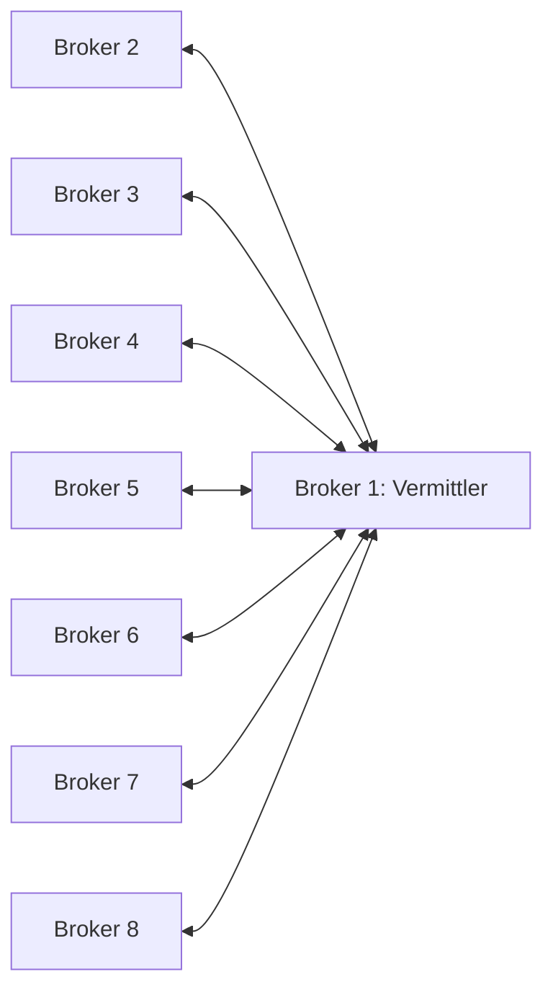

# Z2M-Verbindung

Dieses Modul verbindet genau ein Zigbee2MQTT-System mit Symcon. Es verwendet
einen vorhandenen MQTT Client oder MQTT Server. Anmeldung, Passwort, TLS und
Abonnements werden dort eingestellt.

Die Automationszentrale verwaltet bis zu acht solcher Verbindungen. Dieser
Baustein kann Verbindung, Erweiterungsstand und Gerätedaten prüfen sowie
Automationsabläufe zeitlich begrenzt aufzeichnen. Bestehende Automationsinstanzen
und Entwürfe bleiben erhalten. Sie werden durch ein Modulupdate oder das Anlegen
einer Verbindung **noch nicht in eine zentrale Instanz übernommen**.

Eine ausdrücklich gestartete [direkte Einrichtung](../Z2MAutomations/README.md#direkt-aus-z2m-einrichten)
oder [lokale Übernahme aus Einzelinstanzen](../docs/MIGRATION.md) ordnet diese
Verbindung genau einer zentralen Verwaltung zu. Zwei Verwaltungen
können sie danach nicht unabhängig beschreiben. Status, Katalog und Debug bleiben
an dieser Verbindung verfügbar; ein unabhängiger Erweiterungsupload ist nach
dem Besitzerwechsel gesperrt. Der Rückweg löst die Besitzerzuordnung, ohne die
Instanz, MQTT-Einstellungen oder Geräte zu löschen.

## Voraussetzungen und Einrichtung

Bei mehreren unabhängigen Brokern beschreibt die
[Schritt-für-Schritt-Anleitung](#bis-zu-acht-mqtt-broker-miteinander-verbinden)
deren Verbindung. Mehrere Z2M-Systeme am selben Broker benötigen keine Bridge.

- IP-Symcon 9.0 mit PHP 8.5 und ein erreichbares Zigbee2MQTT-System.
- Ein vorhandenes MQTT-Gateway zum zugehörigen Broker.
- Für Erweiterungsstatus, Gerätedaten und Ablaufaufzeichnung die eigene
  z2m-automations.mjs in diesem Z2M-System.

1. Instanz „Zigbee2MQTT Verbindung“ anlegen und mit dem vorhandenen MQTT-Gateway
   verbinden. Das Modul legt weder einen MQTT-Client noch Geräte an.
2. Das exakte Z2M-Basistopic eintragen; Groß-/Kleinschreibung beachten.
3. Im MQTT Client `BaseTopic/bridge/#` und `BaseTopic/symcon/automations/#`
   abonnieren. Ein bereits vorhandenes `#` genügt ebenfalls.
4. MQTT-Anbindung einschalten und die Einstellungen übernehmen.
5. „Zigbee2MQTT-Verbindung prüfen“ wählen. Das Ergebnis erscheint nach der
   passenden Antwort als Popup. Bei ausbleibender Antwort erscheint ein Hinweis.
6. „Erweiterungsstatus abfragen“ und danach „Gerätedaten aktualisieren“ wählen.
   Die Rückmeldungen stehen direkt darunter.

Mehrere Verbindungen dürfen denselben MQTT Client verwenden, wenn ihre
Basistopics verschieden sind. Unterschiedliche Broker benötigen jeweils ihre
eigene native MQTT-Anbindung. Gleiche Topics auf getrennten Brokern sind für
den einzelnen Transport unterscheidbar; für einen gemeinsamen Automationsverbund
bleiben eindeutige Basistopics erforderlich.

Das Öffnen des Formulars und Übernehmen unveränderter Einstellungen senden
keine MQTT-Anfrage. Die Prüfung wird über die beschriebenen Buttons gestartet.

## Einstellungen

Die zentrale Browseransicht **Systeme und Diagnose** kann die vorhandenen
Verbindungs- und Erweiterungsprüfungen sowie die befristete Ablaufaufzeichnung
dieser Verbindung bedienen. Sie verwendet dieselbe Aufzeichnung wie das native
Formular. Ablaufmeldungen erscheinen weiterhin im Debugfenster dieser Instanz.
Die Anzeige nennt dafür ausdrücklich Name und Instanz-ID der Z2M-Verbindung.
Statusabfragen und ein Update der Zentrale verlängern die gewählte Endzeit nicht.
Siehe [Bedienung](../Z2MAutomations/README.md#systeme-und-diagnose-im-browserdesigner).

| Feld / Property | Typ | Standard | Bedeutung |
| --- | --- | --- | --- |
| MQTT-Anbindung aktivieren / `Active` | Boolean | false | Empfang und Anfragen dieser Verbindung einschalten. |
| Zigbee2MQTT-Basistopic / `BaseTopic` | String | zigbee2mqtt | Höchstens 128 Zeichen; Buchstaben, Ziffern, Unterstrich und Bindestrich, optional durch `/` getrennt. Keine Platzhalter. |
| Wartezeit auf eine Antwort / `RequestTimeout` | Integer | 10 | 1 bis 120 Sekunden pro Anfragephase. |
| `SystemID` | String | automatisch erzeugte UUID | Stabile interne Systemkennung; nicht von Hand ändern. |
| `Generation` | Integer | 1 | Interne Zuordnungsgeneration; nicht von Hand ändern. Zulässig sind 1 bis 9007199254740991. |

Gateway, Topic, Systemkennung und Generation begrenzen, zu welchem System
Antworten und Gerätedaten gehören. Nach einem Wechsel ist eine neue Bestätigung
nötig. Ein vorhandener Katalog bleibt gespeichert, wird für eine geänderte oder
nicht bestätigte Verbindung jedoch nicht als aktuell ausgegeben.

## Erweiterung und Aufzeichnung

Die Anzeige nennt installierte und mitgelieferte Erweiterungsstände und weist
auf unterschiedliche Builds hin. Ein unbekannter Stand gilt nicht als aktuell.
„Mitgelieferte Erweiterung installieren oder aktualisieren“ verwendet die
offizielle Z2M-Schnittstelle und fordert vorher eine Bestätigung an. Externes
JavaScript muss in Z2M bereits freigegeben sein. Das Modul schaltet es nicht ein.
Ein Update kann laufende Automationen kurz unterbrechen. Erfolg wird erst nach
Bestätigung des neu geladenen Empfängers gemeldet.

„Aufzeichnung für 10 Minuten starten“ macht die Ablaufmeldungen im Debugfenster
dieser Instanz sichtbar. Bei Aktionen zwischen Systemen beide Verbindungen
aufzeichnen. „Eigene Aufzeichnung beenden“ beendet nur die eigene Aufzeichnung.
Sie endet auch automatisch; Automationen werden dadurch weder gestartet noch
gestoppt. Unveränderte Einstellungen und Formularaufrufe verlängern ihre Endzeit
nicht. Bei geänderter Verbindung oder Empfängersitzung endet die Aufzeichnung.

## Statusvariablen

Alle Variablen dienen der Anzeige und sind nicht schaltbar.

| Ident | Typ / Einheit | Bedeutung |
| --- | --- | --- |
| MQTTConnected | Boolean / keine | Native MQTT-Anbindung aktiv und verbunden. |
| BridgeOnline | Boolean / keine | Z2M hat online gemeldet oder die Verbindungsprüfung beantwortet. |
| Z2MVersion | String / keine | Zuletzt empfangene Z2M-Version der aktuellen Verbindung. |
| ExtensionInstalled | Boolean / keine | Erweiterung in der Z2M-Liste erkannt, Upload bestätigt oder bereiter Empfänger durch passende Statusantwort bestätigt. |
| HealthStatus | String / keine | Ergebnis der Verbindungsprüfung, zum Beispiel „Funktionsfähig“, „Antwort von Z2M steht noch aus“ oder „Keine rechtzeitige Antwort“. |
| ExtensionReady | Boolean / keine | Empfänger durch passende frische Antwort bestätigt. |
| StoredRevision | Integer / keine | Bestätigte gespeicherte Revision; 0 bedeutet leer oder nicht bestätigt. |
| OperationStatus | String / keine | Laufender oder zuletzt abgeschlossener Erweiterungsauftrag. |
| LastError | String / keine | Verständlicher Grund eines fehlgeschlagenen Auftrags. |
| ExecutionActive | Boolean / keine | Ausführung laut zuletzt bestätigtem Z2M-Status aktiv. False bedeutet gestoppt oder nicht bestätigt. |

„Online“ und „Ausführung aktiv“ sind Zustandsmeldungen, keine ständige Prüfung.
Bei Verbindungsabbruch verlieren Bestätigungen ihre Gültigkeit. Nach erneutem
Verbinden den Status abfragen. Eine laufende Z2M-Automation arbeitet unabhängig
von der Erreichbarkeit von Symcon weiter.

## Öffentliche Funktionen

`InstanceID` ist jeweils die ID dieser Verbindungsinstanz im Symcon-Objektbaum.

| Funktion | Rückgabe und Wirkung |
| --- | --- |
| `Z2MC_CheckConnection(int InstanceID): string` | Startet Verbindungsprüfung mit Popup; Transaktionskennung bei angenommener Anfrage, sonst leer. |
| `Z2MC_CheckHealth(int InstanceID, bool RefreshExtension = false): string` | Gleiche Prüfung ohne Popup; optional anschließend einmalig Erweiterungsstatus abfragen. |
| `Z2MC_RequestExtensionStatus(int InstanceID): string` | Auftragskennung oder leer. Liest Status und Build; verändert keine Regeln. |
| `Z2MC_RequestDeviceCatalog(int InstanceID): string` | Auftragskennung oder leer. Prüft zuerst den Empfänger, lädt danach Geräte, Kanäle, Gruppen und Szenen. Überträgt keine Entwürfe. |
| `Z2MC_InstallExtension(int InstanceID, bool Notify = false): string` | Auftragskennung oder leer. Lädt ausschließlich die mitgelieferte Datei hoch und prüft anschließend die Bereitschaft. `Notify` aktiviert die Popup-Rückmeldung. |
| `Z2MC_GetConnectionInfo(int InstanceID): string` | JSON mit Vertragsversion, Systemkennung, Generation, Gateway, Topic und bereinigtem Status; keine neue MQTT-Anfrage. |
| `Z2MC_GetConnectionDiagnostics(int InstanceID): string` | Lesende Build- und Aufzeichnungsansicht mit Systembindung und absoluter Endzeit. Client, Empfängersitzung und Transaktionen werden nicht ausgegeben. |
| `Z2MC_GetTransportState(int InstanceID): string` | Bereinigter lokaler Transportstatus als JSON; keine neue MQTT-Anfrage. |
| `Z2MC_GetDeviceCatalog(int InstanceID): string` | JSON mit Systemkennung, Generation, `available`, Ladezeit und normalisiertem Katalog; keine neue MQTT-Anfrage. Bei `available: false` leere Gerätelisten. |
| `Z2MC_StartRuntimeDebug(int InstanceID, int Seconds = 600): bool` | Fragt eine eigene Aufzeichnung für 1 bis 900 Sekunden an. True bedeutet Anfrage gesendet, noch nicht von Z2M bestätigt. |
| `Z2MC_StopRuntimeDebug(int InstanceID): bool` | Fragt Ende der eigenen Aufzeichnung an; True bedeutet gesendet. |
| `Z2MC_ExpireRequest(int InstanceID): void` | Prüft lokale Anfragezeitlimits; vom Modultimer verwendet. |
| `Z2MC_ExpireRuntimeDebug(int InstanceID): void` | Prüft Ende der lokalen Aufzeichnung; vom Modultimer verwendet. |
| `Z2MC_GetCompatibleParents(int InstanceID): string` | JSON mit den unterstützten nativen MQTT-Gateways für die Konsole. |

Eine Auftragskennung bestätigt das Annehmen beziehungsweise Absenden der Anfrage,
nicht ihren erfolgreichen Abschluss. Der Status folgt erst nach passender
Z2M-Antwort. Je Verbindung läuft höchstens ein Erweiterungsauftrag; eine zweite
Anfrage ersetzt ihn nicht. Zeitablauf führt zu keiner automatischen Wiederholung.

Der Katalog enthält die von Z2M gemeldeten Zugriffsrechte (`access`: 1 lesbar,
2 schreibbar, 3 beides). Diese Daten ersetzen nicht die zusätzliche Prüfung der
Symcon-Schaltrechte im Automationseditor. `loadedAt` ist ein UTC-Unixzeitstempel
in Sekunden; er zeigt den Ladezeitpunkt, keine permanente Aktualität.

Das Modul stellt in dieser Stufe keine Funktionen zum Speichern, Aktivieren
oder Stoppen von Automationsregeln bereit. Dafür wird weiterhin die vorhandene
[Z2MAutomations-Instanz](../Z2MAutomations/README.md) verwendet.

Lizenz: [PolyForm Noncommercial License 1.0.0](../LICENSE).

## Entwürfe aus der zuständigen Zentrale

Nach abgeschlossener gesicherter Übernahme nimmt diese Verbindung Prüf- und
Speicheraufträge ausschließlich von ihrem eingetragenen Besitzer an. Die
Zentrale nennt jeweils genau dieses System und den zugehörigen Entwurfsstand.
Andere Verbindungen sind von einem Fehler oder einer ausbleibenden Antwort
nicht betroffen. Die Verbindung legt keine zweite bearbeitbare Entwurfskopie an.

Prüfung und Speicherung verwenden die bestehende Z2M-Erweiterung. Vor dem
Speichern muss die Prüfung noch zur aktuellen Empfängersitzung und Revision
passen. Eine neue Statusabfrage bestätigt anschließend die gespeicherte Datei.
Bei einem Abbruch wird der Auftrag nicht automatisch erneut gesendet. Es wird
keine Automation aktiviert; bei geänderter Datei stoppt die bestehende Ausführung.

Die Funktionen `Z2MC_RequestDraftTransfer(InstanceID, Owner, OperationID, Yaml)`
und `Z2MC_GetDraftTransferResult(InstanceID, Owner, OperationID)` sind für den
internen Aufruf der zuständigen Zentrale bestimmt. Der erste Auftrag benötigt
deren aktuelle systemgebundene Freigabe. Ein bloß übergebener Besitzerwert ist
keine Berechtigung. Der zweite Aufruf liest nur das vorhandene Ergebnis.

## Lesen für die direkte Einrichtung

Die Zentrale kann über diese Verbindung zuerst eine reine Vorschau gespeicherter
Z2M-Automationen samt Gerätedaten abrufen. Vor dem ausdrücklichen Besitzerwechsel
wird der gespeicherte Stand durch eine frische Statusantwort erneut geprüft.
Ohne passende Freigabe und Zuordnung wird kein Auftrag angenommen. Der Abruf
verwendet ausschließlich die vorhandenen Z2M-Befehle status und editor; keine
Speicherung, Aktivierung, Deaktivierung oder Geräteaktion.

`RequestWorkspaceSnapshot`, `GetWorkspaceSnapshotResult`, `CancelWorkspaceSnapshot`
und `ClaimWorkspaceConnection` mit Präfix Z2MC dienen der internen Abstimmung mit
der Zentrale. Der begrenzte private Rückgabestand ist kein zweiter bearbeitbarer
Entwurf. Sitzungsdaten, YAML und Kataloginhalte werden nicht ins Debug geschrieben.
Die vorhandene Anbindung und ihre Passwörter werden durch die Einrichtung nicht
umgestellt.

## Betriebsaufträge der Zentrale

Die zuständige Zentrale kann gespeicherte Automationen aktivieren oder stoppen
und einzelne Regeln einmal starten oder gezielt stoppen. Die Verbindung führt
die bestehenden Z2M-Befehle aus; sie bearbeitet keinen eigenen Entwurf.
Aktivierung und globaler Stopp benötigen nach der Antwort eine weitere frische
Statusbestätigung. Einzelne Laufmeldungen bleiben an System und Laufkennung
gebunden. Bei verlorenen Antworten wird kein Befehl wiederholt.

`Z2MC_RequestRuntimeControl(InstanceID, Owner, OperationID)` benötigt einen
vorbereiteten Auftrag der tatsächlich zuständigen Zentrale.
`Z2MC_GetRuntimeControlResult(InstanceID, Owner, OperationID)` liest nur dessen
dauerhaftes Ergebnis. Der Besitzerwert allein erteilt keine Berechtigung.
`GetConnectionInfo` liefert den Sitzungsbezug als SHA-256-Vergleichswert,
keinen Aktivierungstoken. Deutsche Status- und Debugmeldungen erklären die
Bestätigung und Fehler; Namen, YAML und Aktionswerte erscheinen nicht im Debug.

## Erweiterungsinstallation der Zentrale

RequestOwnedInstallation und GetOwnedInstallationResult mit Präfix Z2MC benötigen
einen ausdrücklich bestätigten Auftrag. System, Verbindung, Zuordnung, Build
und tatsächliche Dateibytes sind fest gebunden. Ein beliebiger Besitzerwert
erteilt keine Berechtigung. Vor der ersten Übernahme ist die Installation nur
möglich, solange die Verbindung noch keinen Besitzer hat.

Die Verbindung nutzt ihren bestehenden Installer und die offizielle
bridge/request/extension/save-Schnittstelle. Eine neue Sitzung mit erwartetem
Build bestätigt das Ergebnis; ein bloßes Upload-OK genügt nicht. Dauerhafte
Quittungen verhindern Doppelversand. Statusabfragen senden keine Datei erneut.
Der direkte InstallExtension-Einstieg bleibt bei verwalteten Verbindungen
gesperrt. Es werden keine Automationsdateien gespeichert oder Startbefehle
gesendet. Z2Ms vorhandene Wiederanlaufeinstellung gilt weiterhin.

## Bis zu acht MQTT-Broker miteinander verbinden

Diese Anleitung verbindet **vorhandene Mosquitto-Broker** für systemübergreifende
Z2M-Automationen. Sie folgt der praktisch bestätigten Einrichtung mit zwei
Brokern: lesen, sichern, Benutzer und Rechte ergänzen, eine Bridge einrichten,
danach in beide Richtungen eine harmlose Testnachricht empfangen. Der Ausbau
auf drei bis acht Broker ist daraus abgeleitet und noch keine allgemeine
Praxisfreigabe dieses Umfangs.

Die Zentrale unterstützt bis zu acht **Z2M-Systeme**. Nutzen mehrere davon
denselben Broker, ist zwischen diesen Systemen keine Bridge nötig. Bei getrennten
Brokern wird nur `z2ma/mesh/#` weitergeleitet. Geräte- und Verwaltungs-Topics
bleiben auf ihrem jeweiligen Broker. Z2M führt die Automationen aus; Symcon
wird für die Weiterleitung nicht benötigt.

Auch zwei äußere Systeme können miteinander arbeiten: Ein Befehl von S3 nach
S4 läuft über den mittleren Broker S1. Eine zusätzliche direkte Bridge zwischen
S3 und S4 ist nicht nötig. S3 braucht S4 als freigegebenes Aktionsziel; S4 muss
Befehle von S3 ausdrücklich erlauben und seine Automatik muss aktiv sein. Die
Erweiterung von S1 muss dafür nicht laufen: Sein Broker übernimmt die Weiterleitung.
Dieser Weg ist mit drei und acht echten Erweiterungsinstanzen und synthetischem
Brokertransport geprüft; eine reale Mosquitto-Prüfung mit mehreren Brokern ersetzt
das nicht.

### 1. Aufbau und Bezeichnungen festlegen

Für zwei Broker genügt eine einzige Bridge. Sie wird im Beispiel auf Broker 1
angelegt und verbindet ihn **in beide Richtungen** mit Broker 2. Auf Broker 2
wird keine zweite Gegenbridge angelegt.

Für weitere Broker bleibt Broker 1 der Vermittler. Jeder zusätzliche Broker
wird einmal mit ihm verbunden. So entstehen bei acht Brokern sieben
Verbindungen, ohne Ring oder zusätzliche Direktverbindungen zwischen den Ästen.



Alle folgenden Adressen und Basistopics sind **Platzhalter**. Tragen Sie Ihre
Werte außerhalb des Repositorys ein. Vorhandene Basistopics bleiben unverändert;
jedes Z2M-System im Verbund braucht ein eindeutiges Basistopic, einschließlich
Groß-/Kleinschreibung.

| Broker | Adresse einsetzen | Basistopic im Beispiel | Verbindung |
| --- | --- | --- | --- |
| 1 | `BROKER_1_IP` | `z2m_demo_1` | Vermittler |
| 2 | `BROKER_2_IP` | `z2m_demo_2` | 1 ↔ 2 |
| 3 | `BROKER_3_IP` | `z2m_demo_3` | 1 ↔ 3 |
| 4 | `BROKER_4_IP` | `z2m_demo_4` | 1 ↔ 4 |
| 5 | `BROKER_5_IP` | `z2m_demo_5` | 1 ↔ 5 |
| 6 | `BROKER_6_IP` | `z2m_demo_6` | 1 ↔ 6 |
| 7 | `BROKER_7_IP` | `z2m_demo_7` | 1 ↔ 7 |
| 8 | `BROKER_8_IP` | `z2m_demo_8` | 1 ↔ 8 |

Fällt Broker 1 aus, funktionieren die Verbindungen zwischen seinen Ästen nicht.
Lokale Automationen der übrigen Z2M-Systeme benötigen diesen Vermittler nicht.

### 2. Auf beiden Rechnern zunächst nur lesen

Das Beispiel verwendet Debian/Raspberry Pi OS, Bash und Mosquitto 2.0.x mit
Passwortdatei `/etc/mosquitto/passwd`, ACL-Datei `/etc/mosquitto/acl` und einem
vorhandenen LAN-Listener auf Port 1883. Z2M muss bereits den jeweils richtigen
Broker verwenden. Andere Dateipfade oder eine andere Benutzerverwaltung zuerst
an die eigene Installation anpassen; vorhandene Einstellungen nicht ersetzen.

Öffnen Sie eine SSH-Sitzung auf jedem der beiden Rechner. Führen Sie die
Befehle einzeln aus und kontrollieren Sie das Ergebnis vor dem nächsten Schritt.
Nur den Code kopieren, keine Eingabeaufforderung oder frühere Ausgabe.

```bash
hostname
```

```bash
systemctl status mosquitto.service --no-pager
```

```bash
sudo ss -ltnp 'sport = :1883'
```

```bash
sudo grep -hE '^(listener|allow_anonymous|password_file|acl_file|include_dir) ' /etc/mosquitto/mosquitto.conf /etc/mosquitto/conf.d/*.conf
```

```bash
sudo grep -HE '^(connection|address|local_clientid|remote_clientid|topic) ' /etc/mosquitto/conf.d/*.conf
```

Erwartet: Dienst aktiv, LAN-Port erreichbar, Passwort- und ACL-Datei eingebunden,
anonyme Anmeldung deaktiviert. Die letzte Abfrage zeigt vorhandene Bridges ohne
Passwörter. Gibt es bereits eine Verbindung zwischen diesen Brokern, diese prüfen
und **keine zweite parallele Bridge** nach dieser Vorlage hinzufügen.

Auf Broker 1 die Adresse von Broker 2 einsetzen und die TCP-Verbindung prüfen:

```bash
z2ma_peer_address='BROKER_2_IP'
```

```bash
timeout 3 bash -c 'exec 3<>"/dev/tcp/$1/1883"' _ "$z2ma_peer_address" && echo 'Gegenstelle auf Port 1883 erreichbar'
```

Dasselbe auf Broker 2 mit `BROKER_1_IP` wiederholen. Die Erreichbarkeit ersetzt
noch keine erfolgreiche MQTT-Anmeldung. Port 1883 ist unverschlüsselt; dieses
Beispiel setzt ein vertrauenswürdiges LAN oder VPN voraus. Für ungeschützte
Netzwege TLS mit Zertifikatsprüfung einrichten.

### 3. Auf beiden Brokern die bestehende Konfiguration sichern

In jeder SSH-Sitzung einen eigenen geschützten Ordner anlegen:

```bash
z2ma_backup_dir="$(mktemp -d "$HOME/z2ma-mosquitto-vor-bridge-XXXXXXXX")"
```

```bash
sudo tar -czf "$z2ma_backup_dir/mosquitto.tar.gz" -C /etc mosquitto
```

```bash
sudo chown "$(id -u):$(id -g)" "$z2ma_backup_dir/mosquitto.tar.gz"
```

```bash
chmod 600 "$z2ma_backup_dir/mosquitto.tar.gz"
```

```bash
tar -tzf "$z2ma_backup_dir/mosquitto.tar.gz" > /dev/null
```

```bash
sha256sum "$z2ma_backup_dir/mosquitto.tar.gz"
```

```bash
printf 'Sicherungsordner: %s\n' "$z2ma_backup_dir"
```

Keine Ausgabe der Inhaltsprüfung bedeutet Erfolg. Sicherungsordner und
Prüfsumme privat notieren. Die Sicherung enthält Zugangsdaten und gehört nicht
in die Library. Bei einer neuen SSH-Sitzung muss die Variable wieder auf den
notierten Ordner gesetzt werden.

### 4. Einen eigenen Bridge-Benutzer auf beiden Brokern anlegen

Auf **Broker 1 und Broker 2** jeweils ausführen:

```bash
sudo mosquitto_passwd /etc/mosquitto/passwd bridge_z2ma_1_2
```

Geben Sie für dieses Verbindungspaar auf beiden Rechnern dasselbe eigene
Bridge-Passwort ein. Es wird verdeckt abgefragt. Für die Vorlage ein starkes
Passwort ohne Leerzeichen oder Zeilenumbrüche verwenden und privat aufbewahren.
`-c` wird hier nicht verwendet: Es würde eine vorhandene Passwortdatei ersetzen.

Auf beiden Brokern anschließend die Leserechte setzen:

```bash
sudo chown root:mosquitto /etc/mosquitto/passwd
```

```bash
sudo chmod 640 /etc/mosquitto/passwd
```

### 5. Die Rechte auf beiden Brokern ergänzen

```bash
sudo nano /etc/mosquitto/acl
```

Im **bereits vorhandenen Abschnitt des Z2M-Benutzers** zusätzlich
`topic readwrite z2ma/mesh/#` eintragen. Sein bisheriges Basistopic und alle
anderen benötigten Rechte behalten. Dazu einen Abschnitt für den neuen
Bridge-Benutzer ergänzen. Beispiel für Broker 1:

```text
user z2m
topic readwrite z2m_demo_1/#
topic readwrite z2ma/mesh/#

user symcon
topic readwrite z2m_demo_1/#

user bridge_z2ma_1_2
topic readwrite z2ma/mesh/#
```

Auf Broker 2 bleibt dessen eigenes Basistopic, im Beispiel `z2m_demo_2/#`,
erhalten. Verwenden Sie dort dieselben zusätzlichen Mesh-Rechte. Heißt Ihr
Z2M-Benutzer anders, seinen vorhandenen Abschnitt ergänzen; kein ungenutztes
zweites Konto `z2m` anlegen.

**Beide Rechte sind nötig:** Die Bridge transportiert Nachrichten, Z2M sendet
und empfängt sie. Nur Rechte für den Bridge-Benutzer reichen nicht. Symcons
Benutzer benötigt für die Regelverwaltung weiterhin nur seine eigenen
Basistopics, keine zusätzlichen Mesh-Rechte.

Lesbarkeit auf beiden Brokern prüfen:

```bash
sudo -u mosquitto test -r /etc/mosquitto/passwd && echo 'Passwortdatei ist lesbar'
```

```bash
sudo -u mosquitto test -r /etc/mosquitto/acl && echo 'ACL ist lesbar'
```

### 6. Auf beiden Brokern Benutzer und ACL neu laden

```bash
sudo systemctl reload mosquitto.service
```

```bash
systemctl status mosquitto.service --no-pager
```

Erwartet: weiterhin aktiv. Bei einer Fehlermeldung zuerst diese klären; noch
keine Bridge starten. Z2M-Konfiguration, Symcon-Gerätezuordnungen und bestehende
Automationsregeln werden für diese Verbindung nicht geändert.

### 7. Die einzige Bridge auf Broker 1 vorbereiten

Die folgende Datei ist **neu**. Der Befehl verweigert ein Überschreiben einer
bereits vorhandenen Datei:

```bash
sudo bash -c 'set -C; umask 027; : > /etc/mosquitto/conf.d/20-z2ma-bridge-1-2.conf'
```

```bash
sudo chown root:mosquitto /etc/mosquitto/conf.d/20-z2ma-bridge-1-2.conf
```

```bash
sudo chmod 640 /etc/mosquitto/conf.d/20-z2ma-bridge-1-2.conf
```

```bash
sudo nano /etc/mosquitto/conf.d/20-z2ma-bridge-1-2.conf
```

Folgenden Inhalt eintragen. Adresse und **beide** Passwortplatzhalter ersetzen:

```text
connection z2ma-1-2
address BROKER_2_IP:1883
local_clientid z2ma-bridge-1-2-local
remote_clientid z2ma-bridge-1-2
local_username bridge_z2ma_1_2
local_password HIER_BRIDGE_PASSWORT
remote_username bridge_z2ma_1_2
remote_password HIER_BRIDGE_PASSWORT
topic z2ma/mesh/# both 1
try_private true
cleansession true
local_cleansession true
notifications false
start_type automatic
restart_timeout 10
keepalive_interval 30
```

`both` transportiert beide Richtungen. Es gibt keine Topic-Umbenennung. Die
Clientkennungen müssen für jede Bridge eindeutig sein. Die lokale Anmeldung
gehört zu Broker 1, die entfernte zu Broker 2. Die Vorlage verwendet dasselbe
Passwort für diese beiden Konten des Verbindungspaars. Benachrichtigungen über
`$SYS` werden nicht benötigt; Automationsnachrichten werden nicht als retained
versendet und die Bridge verwendet keine dauerhaften Sitzungen.

Noch vorhandene Platzhalter ohne Ausgabe des Dateiinhalts prüfen:

```bash
if sudo grep -Eq 'BROKER_[1-8]_IP|HIER_BRIDGE_PASSWORT' /etc/mosquitto/conf.d/20-z2ma-bridge-1-2.conf; then
    echo 'Noch Platzhalter vorhanden: Datei zuerst vervollständigen'
else
    echo 'Keine Vorlage-Platzhalter mehr gefunden'
fi
```

```bash
sudo -u mosquitto test -r /etc/mosquitto/conf.d/20-z2ma-bridge-1-2.conf && echo 'Bridge-Datei ist lesbar'
```

Diese beiden Prüfungen bestätigen noch nicht das Passwort oder die vollständige
Konfigurationssyntax. Die Bestätigung folgt durch Dienststart und Empfang.

### 8. Nur Mosquitto auf Broker 1 neu starten

Eine neue Bridge in diesem 2.0.x-Aufbau durch einen Brokerneustart laden.
Das unterbricht kurz die MQTT-Verbindungen zu Broker 1; den Schritt in einem
geeigneten Zeitraum ausführen. Der Z2M-Dienst selbst wird nicht neu gestartet.

```bash
sudo systemctl restart mosquitto.service
```

```bash
systemctl status mosquitto.service --no-pager
```

Auf Broker 2 ist für die dortigen Benutzer-/ACL-Änderungen das Neuladen aus
Schritt 6 ausreichend. Auf ihm wird keine Gegenbridge eingerichtet.

### 9. Die angenommene Bridge-Verbindung prüfen

Auf beiden Rechnern:

```bash
sudo tail -n 20 /var/log/mosquitto/mosquitto.log
```

Bei einer abweichenden Protokollkonfiguration die eigene Logdatei bzw. das
Dienstprotokoll verwenden. Auf Broker 1 erscheint der Verbindungsversuch zu
Broker 2. Entscheidend ist auf Broker 2 die **angenommene Bridge-Verbindung** mit
`z2ma-bridge-1-2` und `bridge_z2ma_1_2`. Nur „Connecting bridge“ ist noch keine
Bestätigung. Bei „not authorised“ Benutzer, Passwort und ACL-Zuordnung prüfen,
bevor es weitergeht. Passwortdateien und Bridge-Dateien nicht zum Teilen ausgeben.

### 10. Den Testzugang auf beiden Rechnern vorbereiten

Wir testen als **Z2M-Benutzer**, damit seine Mesh-Rechte mitgeprüft werden.
Die folgenden Befehle verwenden die Sitzung mit dem lokalen Broker. Falls Ihr
Benutzer anders heißt, `-u z2m` im Block anpassen.

```bash
z2ma_test_dir="$(mktemp -d)"
```

Zuerst ohne Zugangsdaten prüfen, bevor die Testdateien angelegt werden:

```bash
XDG_CONFIG_HOME="$z2ma_test_dir" mosquitto_sub -h 127.0.0.1 -p 1883 -t 'z2ma/mesh/diagnose/pair_1_2' -C 1 -W 3 -d
```

Erwartet: anonyme Anmeldung abgelehnt. Danach auf beiden Rechnern diesen
**vollständigen Block** ausführen; davor keinen ausgegebenen Pfad einfügen:

```bash
(
    set +x
    umask 077
    IFS= read -r -s -p 'Lokales Z2M-MQTT-Passwort: ' z2ma_test_password
    printf '\n'
    printf '%s\n' \
        '-h 127.0.0.1' \
        '-p 1883' \
        '-u z2m' \
        "-P $z2ma_test_password" \
        > "$z2ma_test_dir/mosquitto_sub"
    cp "$z2ma_test_dir/mosquitto_sub" "$z2ma_test_dir/mosquitto_pub"
    unset z2ma_test_password
)
```

Das Passwort steht damit weder in der Befehlszeile noch in der Shell-Historie.
Der temporäre Ordner gehört nur dem angemeldeten Benutzer; die Dateien sind
nur für ihn lesbar. Ihre Inhalte nicht ausgeben. In den folgenden Schritten
dieselben beiden SSH-Sitzungen verwenden.

### 11. Zuerst von Broker 1 zu Broker 2 testen

**Auf Broker 2 zuerst den Empfang starten:**

```bash
XDG_CONFIG_HOME="$z2ma_test_dir" mosquitto_sub -t 'z2ma/mesh/diagnose/pair_1_2' -q 1 -R -C 1 -W 120 -v
```

Während dieses Fenster wartet, **auf Broker 1 senden:**

```bash
XDG_CONFIG_HOME="$z2ma_test_dir" mosquitto_pub -t 'z2ma/mesh/diagnose/pair_1_2' -q 1 -m 'Z2MA: Test von Broker 1 zu Broker 2' -d
```

Erst die passende Ausgabe auf Broker 2 bestätigt den Ende-zu-Ende-Empfang.
CONNACK bestätigt die Anmeldung, SUBACK das Abonnement und PUBACK allein noch
nicht den Empfang auf dem anderen Rechner. „Timed out“ bedeutet hier, dass
innerhalb von 120 Sekunden keine passende Nachricht empfangen wurde.

### 12. Danach von Broker 2 zu Broker 1 testen

**Auf Broker 1 zuerst den Empfang starten:**

```bash
XDG_CONFIG_HOME="$z2ma_test_dir" mosquitto_sub -t 'z2ma/mesh/diagnose/pair_2_1' -q 1 -R -C 1 -W 120 -v
```

**Auf Broker 2 senden:**

```bash
XDG_CONFIG_HOME="$z2ma_test_dir" mosquitto_pub -t 'z2ma/mesh/diagnose/pair_2_1' -q 1 -m 'Z2MA: Test von Broker 2 zu Broker 1' -d
```

Es werden nur Diagnosemeldungen verschickt, keine Gerätebefehle. Keine
retained-Testnachrichten verwenden. Nach erfolgreichem Empfang auf beiden
Rechnern die temporären Zugangsdateien jeweils entfernen:

```bash
rm -f -- "${z2ma_test_dir:?Testordner fehlt}/mosquitto_sub" "$z2ma_test_dir/mosquitto_pub"
rmdir -- "$z2ma_test_dir"
unset z2ma_test_dir
```

### 13. Broker 3 bis 8 einzeln ergänzen

Für jeden zusätzlichen Broker die Schritte 2–12 für das neue Paar wiederholen.
Vorher erneut sichern. Die neue Bridge liegt weiterhin ausschließlich auf
Broker 1; für die übrigen Dateien und bestehenden Verbindungen nichts ändern.

| Neues Paar | Benutzer auf beiden Enden | Neue Datei auf Broker 1 | Ziel und Kennungen |
| --- | --- | --- | --- |
| 1 ↔ 3 | `bridge_z2ma_1_3` | `20-z2ma-bridge-1-3.conf` | `BROKER_3_IP:1883`, `z2ma-1-3`, `z2ma-bridge-1-3-local`, `z2ma-bridge-1-3` |
| 1 ↔ 4 | `bridge_z2ma_1_4` | `20-z2ma-bridge-1-4.conf` | `BROKER_4_IP:1883`, `z2ma-1-4`, `z2ma-bridge-1-4-local`, `z2ma-bridge-1-4` |
| 1 ↔ 5 | `bridge_z2ma_1_5` | `20-z2ma-bridge-1-5.conf` | `BROKER_5_IP:1883`, `z2ma-1-5`, `z2ma-bridge-1-5-local`, `z2ma-bridge-1-5` |
| 1 ↔ 6 | `bridge_z2ma_1_6` | `20-z2ma-bridge-1-6.conf` | `BROKER_6_IP:1883`, `z2ma-1-6`, `z2ma-bridge-1-6-local`, `z2ma-bridge-1-6` |
| 1 ↔ 7 | `bridge_z2ma_1_7` | `20-z2ma-bridge-1-7.conf` | `BROKER_7_IP:1883`, `z2ma-1-7`, `z2ma-bridge-1-7-local`, `z2ma-bridge-1-7` |
| 1 ↔ 8 | `bridge_z2ma_1_8` | `20-z2ma-bridge-1-8.conf` | `BROKER_8_IP:1883`, `z2ma-1-8`, `z2ma-bridge-1-8-local`, `z2ma-bridge-1-8` |

Je Paar ein eigenes Passwort verwenden. Auf Broker 1 den neuen Bridge-Benutzer
zusätzlich in Passwortdatei und ACL eintragen; vorhandene Paar-Benutzer behalten.
Auf dem neuen Broker dessen Z2M-Benutzer und den neuen Bridge-Benutzer berechtigen.
Alle Datei-, Benutzer-, Verbindungs-, Client- und Testtopic-Kennungen der Vorlage
auf das neue Paar ändern, beispielsweise `pair_1_3` und `pair_3_1`.

Nach dem Paar-Test zusätzlich **von Broker 2 zu Broker 3 und zurück** testen:
Die Verbindung muss über Broker 1 funktionieren. Für weitere Äste ebenso einen
Empfang zwischen zwei Ästen nachweisen. Keine zusätzliche Bridge zwischen diesen
Ästen anlegen. Ein erfolgreicher TCP- oder Paar-Test allein ist noch kein
vollständiger Automationsnachweis für acht Systeme.

### 14. Systeme und Freigaben in der Automationszentrale zuordnen

1. Je Z2M-System eine **Zigbee2MQTT Verbindung** mit passendem MQTT-Gateway und
   seinem unveränderten Basistopic einrichten. Vorhandene Geräte bleiben zugeordnet.
2. Alle gewünschten Verbindungen in der **einen Automationszentrale** auswählen.
3. Erweiterung und Gerätedaten je System prüfen bzw. laden.
4. Beim empfangenden System unter **Partnerfreigaben** die sendenden Systeme
   erlauben. Die Gegenrichtung ist eine eigene Freigabe.
5. Den Empfangsentwurf ausdrücklich prüfen, speichern und aktivieren. Erst dann
   gilt die neue Freigabe in Z2M. Anschließend die gewünschte Ausgangsregel
   separat übertragen und aktivieren.

Brokerrechte erlauben den Transport; Partnerfreigaben erlauben die Aktion.
Eine Bridge allein aktiviert keine Regel. Für einen realen Schaltversuch erst
den ursprünglichen Betrieb sichern und gegebenenfalls das entsprechende
Originalereignis in Symcon vorübergehend deaktivieren, damit es nicht doppelt
ausgeführt wird. Jeder weitere reale Test bleibt eine bewusste eigene Aktion.

### 15. Rückweg bei einer fehlgeschlagenen Einrichtung

Nur die **in diesem Durchgang neu angelegte** Bridge-Datei auf Broker 1 aus
dem Ladepfad nehmen. Beispiel für das erste Paar:

```bash
sudo mv /etc/mosquitto/conf.d/20-z2ma-bridge-1-2.conf /etc/mosquitto/conf.d/20-z2ma-bridge-1-2.conf.disabled
```

Falls seit der Sicherung keine anderen Konfigurationsänderungen erfolgt sind,
auf jedem betroffenen Broker dessen eigene ACL und Passwortdatei zurückholen:

```bash
sudo tar -xzf "$z2ma_backup_dir/mosquitto.tar.gz" -C /etc mosquitto/acl mosquitto/passwd
```

Bei zwischenzeitlichen Änderungen die gesicherten und aktuellen Fassungen
gezielt abgleichen, nicht fremde Benutzer oder neue Rechte überschreiben.
Auf Broker 2 die Rechte neu laden, auf Broker 1 nach Entfernen der Bridge
Mosquitto neu starten und jeweils den Dienstzustand kontrollieren. Vorhandene
Z2M-Konfigurationen und Symcon-Gerätezuordnungen bleiben erhalten. Bereits
gesondert übertragene Regeln oder Freigaben benötigen ihren eigenen Rückweg;
das Entfernen der Bridge stellt keinen früheren Regelstand wieder her.

Grundlage der Beispiele sind die offiziellen Beschreibungen für
[Mosquitto-Bridge und ACL](https://mosquitto.org/man/mosquitto-conf-5.html),
[Passwortdateien](https://mosquitto.org/man/mosquitto_passwd-1.html) und
[Client-Konfigurationsdateien](https://mosquitto.org/man/mosquitto_sub-1.html).
Die hier verwendeten 2.0.x-Optionen sind außerdem gegen die offizielle
[Mosquitto-2.0.11-Konfigurationsreferenz](https://github.com/eclipse-mosquitto/mosquitto/blob/v2.0.11/man/mosquitto.conf.5.xml)
abgeglichen; das neuere Clientargument `-o` wird nicht benötigt.
