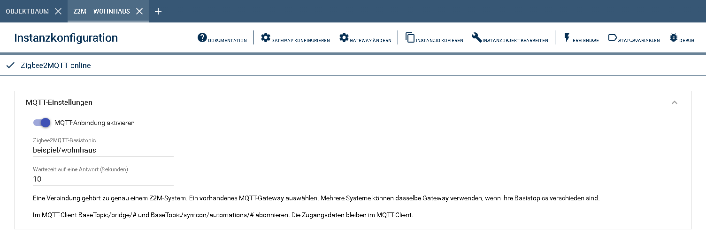
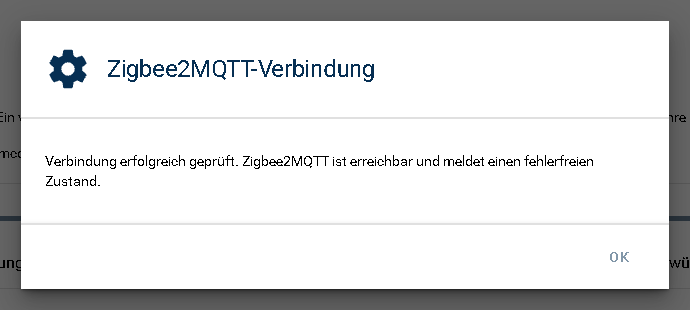
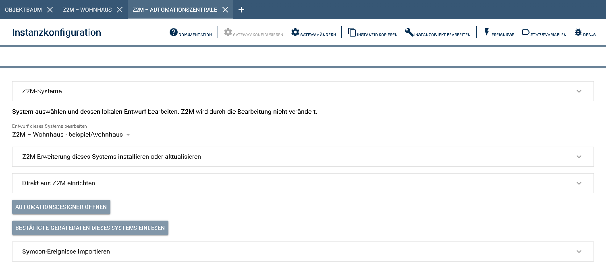
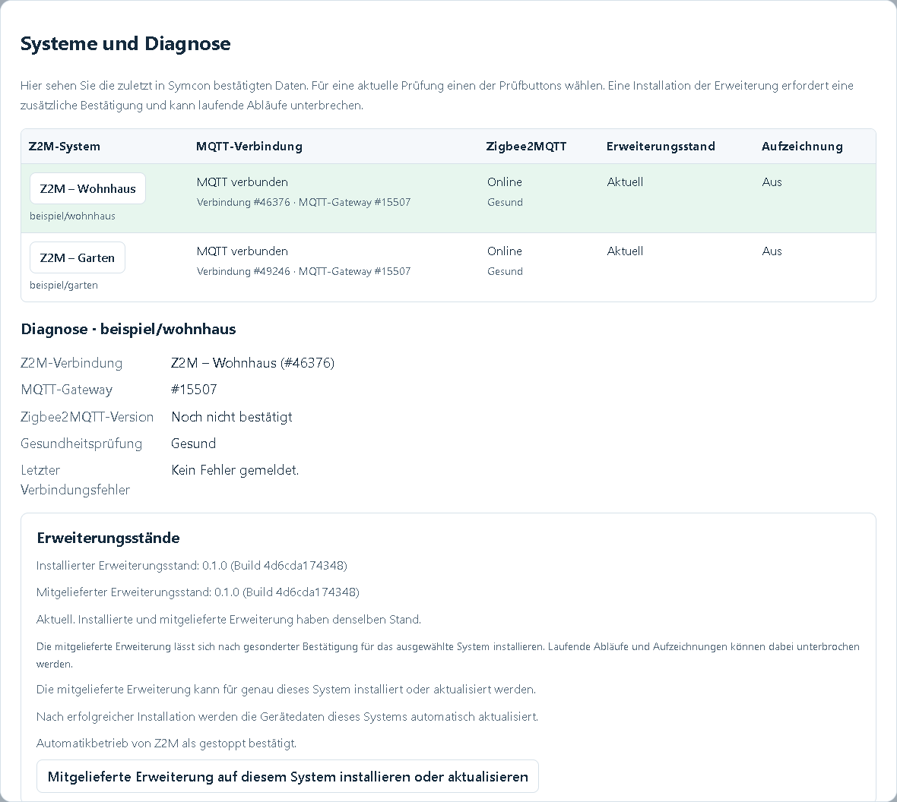
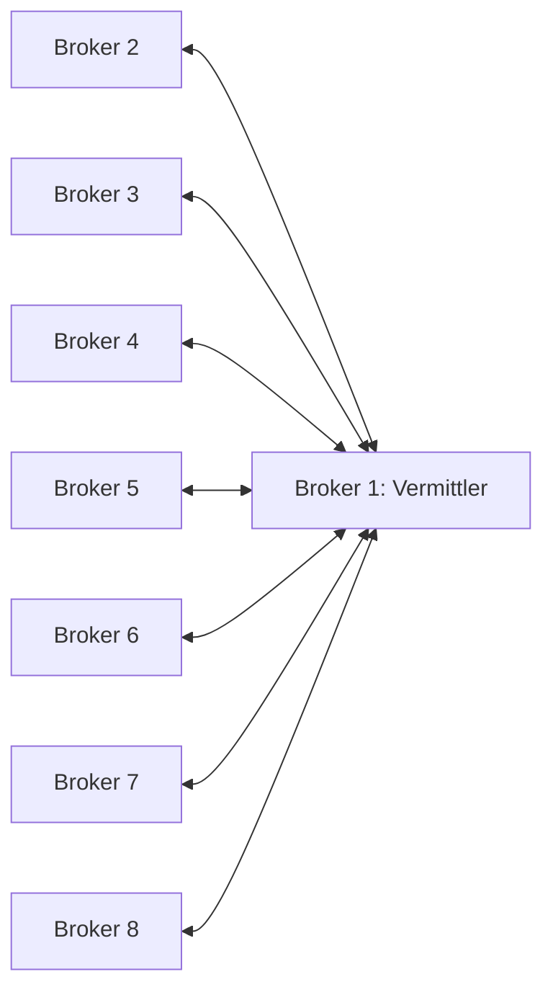

# Z2M-Verbindung

Verbindet ein Zigbee2MQTT-System mit der Automationszentrale. Das Modul verwendet
eine vorhandene MQTT-Anbindung von Symcon und stellt Verbindung, Erweiterungsstand
und Gerätedaten bereit. Für jedes Z2M-System wird eine eigene Verbindungsinstanz
angelegt; eine Zentrale kann bis zu acht davon verwalten.

Die Automationen werden im [Webfrontend der Zentrale](../Z2MAutomations/README.md#automationsdesigner-im-browser)
erstellt und bearbeitet. Das Verbindungsmodul sorgt für den Austausch mit dem
jeweiligen Z2M-System.

## Inhaltsverzeichnis

- [1. Voraussetzungen](#1-voraussetzungen)
- [2. Funktionsumfang](#2-funktionsumfang)
- [3. Installation](#3-installation)
- [4. Konfiguration in IP-Symcon](#4-konfiguration-in-ip-symcon)
- [5. Verbindung prüfen und Erweiterung einrichten](#5-verbindung-prüfen-und-erweiterung-einrichten)
- [6. Gerätedaten und Automationszentrale](#6-gerätedaten-und-automationszentrale)
- [7. Statusanzeigen](#7-statusanzeigen)
- [8. Skriptfunktionen](#8-skriptfunktionen)
- [Bis zu acht MQTT-Broker miteinander verbinden](#bis-zu-acht-mqtt-broker-miteinander-verbinden)
- [9. Lizenz](#9-lizenz)

## 1. Voraussetzungen

- IP-Symcon ab Version **9.0** mit PHP **8.5** und installierter Library Z2MAutomations.
- Ein erreichbares Zigbee2MQTT-System und dessen genaues **Basistopic**.
- Ein vorhandener Symcon **MQTT Client** oder **MQTT Server**, über den dieses
  Z2M-System erreichbar ist.
- Für die Geräteauswahl und Ausführung der Automationen die mitgelieferte
  Erweiterung **z2m-automations.mjs** im jeweiligen Z2M-System. Sie lässt sich
  nach der Verbindungsprüfung aus dem Modul beziehungsweise aus der Zentrale installieren.
- Für diese Installation muss die Verwendung externer JavaScript-Erweiterungen
  in Zigbee2MQTT bereits erlaubt sein. Die Library schaltet diese Freigabe nicht ein.

Die [Kompatibilitätsübersicht](../docs/COMPATIBILITY.md) nennt die belegten
Symcon- und Z2M-Versionen.

## 2. Funktionsumfang

- Eine vorhandene Symcon-MQTT-Anbindung für genau ein Z2M-System verwenden.
- Prüfen, ob Zigbee2MQTT erreichbar ist, und das Ergebnis als Popup anzeigen.
- Installierten und mitgelieferten Erweiterungsstand vergleichen und einen
  Updatehinweis anzeigen.
- Die eigene Z2M-Erweiterung installieren oder aktualisieren.
- Geräte, Eigenschaften, Kanäle, Gruppen und vorhandene Z2M-Szenen laden.
- Prüf-, Speicher- und Betriebsaufträge der zuständigen Automationszentrale
  an das zugehörige Z2M-System weitergeben.
- Den zuletzt bestätigten Verbindungs- und Automationsstatus als Variablen anzeigen.

Das Anlegen einer Verbindung ersetzt keine vorhandenen Geräteinstanzen und
ändert keine gespeicherten Automationen. Vorhandene Regeln werden erst über die
[Einrichtung der Zentrale](../Z2MAutomations/README.md#direkt-aus-z2m-einrichten)
als lokale Entwürfe eingelesen.

## 3. Installation

Die Library **Z2MAutomations** über die Symcon-Modulverwaltung installieren.
Anschließend im Objektbaum eine Instanz hinzufügen und nach
**Zigbee2MQTT Verbindung** suchen. Einen passenden Namen vergeben, zum Beispiel
**Z2M – Wohnhaus**.

Für ein zweites Z2M-System eine weitere Verbindung anlegen, etwa **Z2M – Garten**.
Die Anzahl richtet sich nach den Z2M-Systemen, nicht nach der Anzahl der Broker:
Auch zwei Z2M-Systeme an einem gemeinsamen Broker benötigen zwei Verbindungsinstanzen.

## 4. Konfiguration in IP-Symcon

### 4.1 Die passende MQTT-Schnittstelle auswählen

Beim Anlegen die vorhandene MQTT-Schnittstelle auswählen, über die das gewünschte
Z2M-System erreichbar ist. Bei einer bestehenden Instanz lässt sich die Zuordnung
über **Gateway ändern** anpassen; **Gateway konfigurieren** öffnet die Einstellungen
der zugeordneten Schnittstelle.

| Vorhandener Aufbau | Schnittstelle für die Z2M-Verbindung |
| --- | --- |
| Zigbee2MQTT verwendet einen externen Broker, beispielsweise Mosquitto. | Den Symcon **MQTT Client** auswählen, der mit genau diesem Broker verbunden ist. |
| Zigbee2MQTT verwendet Symcon selbst als MQTT-Broker. | Den entsprechenden Symcon **MQTT Server** auswählen. |

Serveradresse, Port, Benutzername, Passwort und Verschlüsselung werden in der
nativen MQTT-Anbindung eingestellt. Im Z2M-Verbindungsmodul sind dafür keine
zusätzlichen Zugangsdaten nötig.

### 4.2 Basistopic und Wartezeit einstellen

Im Bereich **MQTT-Einstellungen** das **Zigbee2MQTT-Basistopic** eintragen.
Es muss genau dem `base_topic` der zugehörigen Z2M-Installation entsprechen.
Groß- und Kleinschreibung beachten. Das Topic ist nicht die IP-Adresse oder
der Rechnername des Brokers.

Beispiele sind `zigbee2mqtt` oder `beispiel/wohnhaus`. An dieser Stelle keine
Platzhalter wie `#` oder `+` und kein angehängtes `/bridge/#` eintragen.



| Formularfeld / Property | Datentyp | Standard | Bedeutung |
| --- | --- | --- | --- |
| MQTT-Anbindung aktivieren / `Active` | Boolean | false | Schaltet Empfang und Anfragen dieser Verbindung ein. |
| Zigbee2MQTT-Basistopic / `BaseTopic` | String | zigbee2mqtt | Basistopic des zugehörigen Z2M-Systems; höchstens 128 Zeichen. Erlaubt sind Buchstaben, Ziffern, Unterstrich und Bindestrich, bei Bedarf durch `/` getrennt. |
| Wartezeit auf eine Antwort (Sekunden) / `RequestTimeout` | Integer | 10 | Zeitlimit von 1 bis 120 Sekunden je Antwort. Bei mehreren Teilschritten kann der gesamte Vorgang länger dauern. |

Die technischen Eigenschaften `SystemID` und `Generation` werden für die
Systemzuordnung verwendet. Sie werden nicht für die normale Einrichtung
bearbeitet: `SystemID` ist eine automatisch erzeugte UUID, `Generation` hat
anfangs den Wert 1.

### 4.3 Die benötigten Topics abonnieren

Bei Verwendung eines **MQTT Client** müssen dessen Abonnements die Z2M-Meldungen
enthalten. Für das Basistopic `zigbee2mqtt` sind dies:

```text
zigbee2mqtt/bridge/#
zigbee2mqtt/symcon/automations/#
```

Bei einem anderen Basistopic `zigbee2mqtt` durch den eigenen Wert ersetzen.
Ein bereits vorhandenes Abonnement `#` schließt beide Bereiche ein.
Die hier verwendeten Platzhalter gehören in die Abonnements des MQTT Client,
nicht in das Basistopic des Verbindungsmoduls.

### 4.4 Die Verbindung einschalten und speichern

1. **MQTT-Anbindung aktivieren** einschalten.
2. Die Einstellungen mit dem normalen Symcon-Button **Übernehmen** speichern.
3. Anschließend die Verbindung wie im nächsten Abschnitt beschrieben prüfen.

Mehrere Z2M-Verbindungen dürfen denselben MQTT Client verwenden, wenn ihre
Basistopics unterschiedlich sind. Bei getrennten Brokern die jeweils passende
MQTT-Anbindung auswählen. Für systemübergreifende Automationen benötigt jedes
Z2M-System im Verbund ein eindeutiges Basistopic, auch bei getrennten Brokern.

Nach einem späteren Wechsel von Gateway oder Basistopic die Verbindung erneut
prüfen und die Gerätedaten neu laden. Gespeicherte Gerätedaten bleiben erhalten,
gelten für eine geänderte Verbindung aber erst nach erneuter Bestätigung als aktuell.

## 5. Verbindung prüfen und Erweiterung einrichten

### 5.1 Zigbee2MQTT-Verbindung prüfen

Im Bereich **Einrichtung und Diagnose** auf **Zigbee2MQTT-Verbindung prüfen** klicken.
Das Modul sendet eine Anfrage an das eingestellte Z2M-System und wartet auf dessen
Antwort. Bei Erfolg erscheint ein Popup mit der Bestätigung. Antwortet Z2M nicht
rechtzeitig, nennt das Popup den Grund beziehungsweise die ausstehende Antwort.



Ein verbundener MQTT Client bestätigt zunächst nur den Kontakt zum Broker.
Erst die Antwort auf die Verbindungsprüfung bestätigt auch die Erreichbarkeit
von Zigbee2MQTT. Falls sie ausbleibt, MQTT-Zuordnung, Basistopic und Abonnements
mit der zugehörigen Z2M-Installation vergleichen.

Das Öffnen des Formulars allein startet keine neue Verbindungsprüfung.

### 5.2 Erweiterungsstand abfragen

Auf **Erweiterungsstatus abfragen** klicken. Danach nennt das Formular:

- **Installierter Erweiterungsstand:** die in Z2M bestätigte Erweiterung.
- **Mitgelieferter Erweiterungsstand:** die zur installierten Library gehörende Datei.
- **Aktuell** oder einen Hinweis, dass eine Aktualisierung erforderlich ist.

Die Buildkennung unterscheidet den tatsächlichen Inhalt zweier Erweiterungsdateien,
auch wenn ihre Versionsbezeichnung gleich ist. Die Version der Erweiterung muss
nicht mit der Versionsnummer der Symcon-Library übereinstimmen.

Ein noch nicht bestätigter Stand bedeutet, dass das Modul noch keine passende
Antwort erhalten hat. Die Erweiterung wird dann nicht als aktuell ausgegeben.

### 5.3 Erweiterung installieren oder aktualisieren

Solange die Verbindung noch keiner Zentrale zugeordnet ist:

1. Sicherstellen, dass Z2M erreichbar und die Verwendung externer
   JavaScript-Erweiterungen dort freigegeben ist.
2. **Mitgelieferte Erweiterung installieren oder aktualisieren** wählen.
3. Den Bestätigungsdialog lesen und bestätigen. Eine vorhandene Datei
   `z2m-automations.mjs` wird durch die mitgelieferte Fassung ersetzt.
4. Die abschließende Rückmeldung abwarten. Ein Erfolg wird erst gemeldet,
   wenn die neu geladene Erweiterung ihre Bereitschaft bestätigt hat.

Ist die Verbindung bereits einer Automationszentrale zugeordnet, die Installation
oder Aktualisierung dort ausführen: im Webfrontend unter **Verwaltung → Systeme
und Diagnose** das gewünschte System auswählen und den Installationsbutton verwenden.
Alternativ steht der Installationsbereich im nativen Zentralenformular bereit.

Ein Erweiterungsupdate kann laufende Abläufe kurz unterbrechen. Die gespeicherten
Regeln und die gewählte Wiederanlaufeinstellung bleiben maßgeblich. Nach einer
bestätigten Installation über die Zentrale werden die Gerätedaten automatisch
nachgeladen; vorhandene Entwürfe bleiben erhalten.

## 6. Gerätedaten und Automationszentrale

### 6.1 Geräte, Kanäle, Gruppen und Szenen laden

Im Verbindungsmodul **Gerätedaten aktualisieren** wählen. Voraussetzung ist eine
bereite Z2M-Erweiterung. Das Modul liest Geräte, deren Eigenschaften und Kanäle,
Gruppen sowie vorhandene Szenen dieses Systems. Der Ladezustand und das Ergebnis
stehen im Formular unter dem Button.

Der Abruf erstellt keine Automationen und überschreibt keine vorhandenen Entwürfe.
Er legt auch keine zusätzlichen Symcon-Geräteinstanzen an.

### 6.2 Die Verbindung der Zentrale zuordnen

1. Eine **Zigbee2MQTT Automationszentrale** anlegen oder die vorhandene öffnen.
2. Unter **Z2M-Systeme** die gewünschte Verbindung anhaken und
   **Systemzuordnung übernehmen** wählen.
3. Das System auswählen und über **Z2M-Automationen sicher einlesen** die
   gespeicherten Regeln mit Gerätedaten als Vorschau laden.
4. Die Vorschau prüfen und die Verbindung ausdrücklich übernehmen.
5. **Automationsdesigner öffnen** wählen. Die weitere Einrichtung der Regeln
   erfolgt im eigenen Webfrontend.



Eine Verbindung wird von genau einer Zentrale verwaltet. Die Zuordnung übernimmt
keine Zugangsdaten eines anderen Brokers und ändert keine Gerätezuordnungen.
Die direkte Einrichtung liest den vorhandenen Z2M-Stand ein; sie aktiviert keine
Regeln und ersetzt keine gespeicherte Automationsdatei.

Für vorhandene Entwürfe aus bisherigen Einzelinstanzen den
[gesicherten Übernahmeweg](../docs/MIGRATION.md) verwenden. Die
[detaillierte Einrichtung der Zentrale](../Z2MAutomations/README.md#direkt-aus-z2m-einrichten)
beschreibt Vorschau, Übernahme und lokalen Rückweg.

### 6.3 Systeme im Webfrontend verwalten

Im Automationsdesigner unter **Verwaltung → Systeme und Diagnose** stehen die
zugeordneten Verbindungen mit MQTT-Status, Z2M-Erreichbarkeit und Erweiterungsstand.
Das gewünschte System auswählen, bevor eine Prüfung oder Aktualisierung gestartet wird.



Gerätedaten lassen sich im Hauptbereich des Designers unter **Gerätedaten** für
das ausgewählte System nachladen. Die Anzeige verwendet zunächst die zuletzt in
Symcon bestätigten Daten. Eine neue Abfrage erfolgt erst über den jeweiligen Button.

Das Webfrontend bietet auch eine zeitlich begrenzte Ablaufaufzeichnung. Sie verändert
keine Regeln und startet oder stoppt keine Automation. Bei Aktionen zwischen zwei
Systemen auf beiden Seiten aufzeichnen. Die Bedienung ist in der
[Anleitung der Zentrale](../Z2MAutomations/README.md#systeme-und-diagnose-im-browserdesigner)
beschrieben.

## 7. Statusanzeigen

Die Statusvariablen dieser Verbindung dienen ausschließlich der Anzeige.
Sie sind nicht schaltbar und geben den zuletzt bestätigten Stand wieder.

| Anzeige / Ident | Typ / Einheit | Bedeutung |
| --- | --- | --- |
| MQTT verbunden / `MQTTConnected` | Boolean / keine | Die zugeordnete MQTT-Anbindung ist aktiv und verbunden. |
| Zigbee2MQTT online / `BridgeOnline` | Boolean / keine | Z2M hat sich online gemeldet oder auf die Verbindungsprüfung geantwortet. |
| Zigbee2MQTT-Version / `Z2MVersion` | String / keine | Zuletzt gemeldete Z2M-Version dieser Verbindung. |
| Automationserweiterung installiert / `ExtensionInstalled` | Boolean / keine | Die Erweiterung wurde in Z2M erkannt oder durch eine passende Antwort bestätigt. |
| Verbindungsprüfung / `HealthStatus` | String / keine | Ergebnis der Prüfung, etwa „Funktionsfähig“, „Antwort von Z2M steht noch aus“ oder „Keine rechtzeitige Antwort“. |
| Erweiterung in Z2M ist bereit / `ExtensionReady` | Boolean / keine | Die Erweiterung wurde durch eine passende aktuelle Antwort bestätigt. |
| In Z2M gespeicherter Stand / `StoredRevision` | Integer / keine | Bestätigte gespeicherte Revision. 0 bedeutet leer oder noch nicht bestätigt. |
| Erweiterungsaktion / `OperationStatus` | String / keine | Laufender oder zuletzt abgeschlossener Auftrag. |
| Letzter Erweiterungsfehler / `LastError` | String / keine | Rückmeldung zu einem fehlgeschlagenen Auftrag. |
| Automationen laufen in Z2M / `ExecutionActive` | Boolean / keine | Die Ausführung ist laut zuletzt bestätigtem Z2M-Status aktiv. False bedeutet gestoppt oder noch nicht bestätigt. |

Nach einer Unterbrechung oder einem Neustart den Verbindungs- und Erweiterungsstatus
erneut abfragen. Ein gespeicherter Wert allein ist keine dauernde Erreichbarkeitsprüfung.
Bereits aktivierte Automationen laufen in Z2M unabhängig von Symcon weiter.

## 8. Skriptfunktionen

Für die normale Bedienung genügen die Buttons im Modul und im Webfrontend.
Die folgenden Funktionen sind für die zusätzliche Verwendung in Symcon-Skripten vorgesehen.
`InstanceID` ist jeweils die ID der gewünschten **Zigbee2MQTT Verbindung** im Objektbaum.

| Funktion | Parameter, Rückgabe und Wirkung |
| --- | --- |
| `Z2MC_CheckConnection(int InstanceID): string` | Startet die Verbindungsprüfung mit Popup. Gibt eine Auftragskennung zurück, sonst eine leere Zeichenfolge. |
| `Z2MC_CheckHealth(int InstanceID, bool RefreshExtension = false): string` | Prüfung ohne Popup. Bei `RefreshExtension = true` anschließend einmalig den Erweiterungsstatus abfragen. Rückgabe: Auftragskennung oder leer. |
| `Z2MC_RequestExtensionStatus(int InstanceID): string` | Liest Erweiterungsstatus und Build. Rückgabe: Auftragskennung oder leer. |
| `Z2MC_RequestDeviceCatalog(int InstanceID): string` | Lädt nach Prüfung der Erweiterung Geräte, Kanäle, Gruppen und Szenen. Rückgabe: Auftragskennung oder leer. |
| `Z2MC_InstallExtension(int InstanceID, bool Notify = false): string` | Installiert nur die mitgelieferte Erweiterung. `Notify = true` aktiviert die Popup-Rückmeldung. Rückgabe: Auftragskennung oder leer. Bei einer verwalteten Verbindung die Installation über deren Zentrale ausführen. |
| `Z2MC_GetConnectionInfo(int InstanceID): string` | Liest vorhandene Systemzuordnung und Verbindungsstatus als JSON; sendet keine neue Anfrage. |
| `Z2MC_GetConnectionDiagnostics(int InstanceID): string` | Liest vorhandene Erweiterungsstände und Aufzeichnungsstatus als JSON. |
| `Z2MC_GetTransportState(int InstanceID): string` | Liest den vorhandenen Transportstatus als JSON. |
| `Z2MC_GetDeviceCatalog(int InstanceID): string` | Liest den gespeicherten Katalog als JSON. `available = false` bedeutet, dass er für diese Verbindung nicht aktuell bestätigt ist; die Gerätelisten sind dann leer. `loadedAt` ist der Ladezeitpunkt als UTC-Unixzeitstempel in Sekunden. |
| `Z2MC_StartRuntimeDebug(int InstanceID, int Seconds = 600): bool` | Fordert eine eigene Aufzeichnung für 1 bis 900 Sekunden an. True bedeutet gesendet, noch nicht von Z2M bestätigt. |
| `Z2MC_StopRuntimeDebug(int InstanceID): bool` | Fordert das Ende der eigenen Aufzeichnung an. True bedeutet gesendet. |
| `Z2MC_GetCompatibleParents(int InstanceID): string` | Liefert die unterstützten nativen MQTT-Gateways für die Schnittstellenauswahl als JSON. |

Beispiel einer manuellen Verbindungsprüfung:

```php
$connectionID = 12345; // Durch die ID der eigenen Z2M-Verbindung ersetzen.
$request = Z2MC_CheckConnection($connectionID);
```

Eine Auftragskennung bestätigt das Absenden beziehungsweise Annehmen der Anfrage,
nicht deren erfolgreichen Abschluss. Das Ergebnis folgt erst mit der Antwort aus
Z2M und wird in den Statusvariablen angezeigt. Steht noch eine Antwort aus, deren
Abschluss abwarten; eine zweite Anfrage ersetzt den laufenden Auftrag nicht.
Nach einem Zeitablauf wird der Auftrag nicht automatisch wiederholt.

## Bis zu acht MQTT-Broker miteinander verbinden

Diese Anleitung verbindet **vorhandene Mosquitto-Broker** für systemübergreifende
Z2M-Automationen. Sie folgt der praktisch bestätigten Einrichtung mit zwei
Brokern: lesen, sichern, Benutzer und Rechte ergänzen, eine Bridge einrichten,
danach in beide Richtungen eine harmlose Testnachricht empfangen. Der Ausbau
auf drei bis acht Broker ist daraus abgeleitet und noch keine allgemeine
Praxisfreigabe dieses Umfangs.

Die Zentrale unterstützt bis zu acht **Z2M-Systeme**. Nutzen mehrere davon
denselben Broker, ist zwischen diesen Systemen keine Bridge nötig. Bei getrennten
Brokern wird nur `z2ma/mesh/#` weitergeleitet. Geräte- und Verwaltungs-Topics
bleiben auf ihrem jeweiligen Broker. Z2M führt die Automationen aus; Symcon
wird für die Weiterleitung nicht benötigt.

Auch zwei äußere Systeme können miteinander arbeiten: Ein Befehl von S3 nach
S4 läuft über den mittleren Broker S1. Eine zusätzliche direkte Bridge zwischen
S3 und S4 ist nicht nötig. S3 braucht S4 als freigegebenes Aktionsziel; S4 muss
Befehle von S3 ausdrücklich erlauben und seine Automatik muss aktiv sein. Die
Erweiterung von S1 muss dafür nicht laufen: Sein Broker übernimmt die Weiterleitung.
Dieser Weg ist mit drei und acht echten Erweiterungsinstanzen und synthetischem
Brokertransport geprüft; eine reale Mosquitto-Prüfung mit mehreren Brokern ersetzt
das nicht.

### 1. Aufbau und Bezeichnungen festlegen

Für zwei Broker genügt eine einzige Bridge. Sie wird im Beispiel auf Broker 1
angelegt und verbindet ihn **in beide Richtungen** mit Broker 2. Auf Broker 2
wird keine zweite Gegenbridge angelegt.

Für weitere Broker bleibt Broker 1 der Vermittler. Jeder zusätzliche Broker
wird einmal mit ihm verbunden. So entstehen bei acht Brokern sieben
Verbindungen, ohne Ring oder zusätzliche Direktverbindungen zwischen den Ästen.



Alle folgenden Adressen und Basistopics sind **Platzhalter**. Tragen Sie Ihre
Werte außerhalb des Repositorys ein. Vorhandene Basistopics bleiben unverändert;
jedes Z2M-System im Verbund braucht ein eindeutiges Basistopic, einschließlich
Groß-/Kleinschreibung.

| Broker | Adresse einsetzen | Basistopic im Beispiel | Verbindung |
| --- | --- | --- | --- |
| 1 | `BROKER_1_IP` | `z2m_demo_1` | Vermittler |
| 2 | `BROKER_2_IP` | `z2m_demo_2` | 1 ↔ 2 |
| 3 | `BROKER_3_IP` | `z2m_demo_3` | 1 ↔ 3 |
| 4 | `BROKER_4_IP` | `z2m_demo_4` | 1 ↔ 4 |
| 5 | `BROKER_5_IP` | `z2m_demo_5` | 1 ↔ 5 |
| 6 | `BROKER_6_IP` | `z2m_demo_6` | 1 ↔ 6 |
| 7 | `BROKER_7_IP` | `z2m_demo_7` | 1 ↔ 7 |
| 8 | `BROKER_8_IP` | `z2m_demo_8` | 1 ↔ 8 |

Fällt Broker 1 aus, funktionieren die Verbindungen zwischen seinen Ästen nicht.
Lokale Automationen der übrigen Z2M-Systeme benötigen diesen Vermittler nicht.

### 2. Auf beiden Rechnern zunächst nur lesen

Das Beispiel verwendet Debian/Raspberry Pi OS, Bash und Mosquitto 2.0.x mit
Passwortdatei `/etc/mosquitto/passwd`, ACL-Datei `/etc/mosquitto/acl` und einem
vorhandenen LAN-Listener auf Port 1883. Z2M muss bereits den jeweils richtigen
Broker verwenden. Andere Dateipfade oder eine andere Benutzerverwaltung zuerst
an die eigene Installation anpassen; vorhandene Einstellungen nicht ersetzen.

Öffnen Sie eine SSH-Sitzung auf jedem der beiden Rechner. Führen Sie die
Befehle einzeln aus und kontrollieren Sie das Ergebnis vor dem nächsten Schritt.
Nur den Code kopieren, keine Eingabeaufforderung oder frühere Ausgabe.

```bash
hostname
```

```bash
systemctl status mosquitto.service --no-pager
```

```bash
sudo ss -ltnp 'sport = :1883'
```

```bash
sudo grep -hE '^(listener|allow_anonymous|password_file|acl_file|include_dir) ' /etc/mosquitto/mosquitto.conf /etc/mosquitto/conf.d/*.conf
```

```bash
sudo grep -HE '^(connection|address|local_clientid|remote_clientid|topic) ' /etc/mosquitto/conf.d/*.conf
```

Erwartet: Dienst aktiv, LAN-Port erreichbar, Passwort- und ACL-Datei eingebunden,
anonyme Anmeldung deaktiviert. Die letzte Abfrage zeigt vorhandene Bridges ohne
Passwörter. Gibt es bereits eine Verbindung zwischen diesen Brokern, diese prüfen
und **keine zweite parallele Bridge** nach dieser Vorlage hinzufügen.

Auf Broker 1 die Adresse von Broker 2 einsetzen und die TCP-Verbindung prüfen:

```bash
z2ma_peer_address='BROKER_2_IP'
```

```bash
timeout 3 bash -c 'exec 3<>"/dev/tcp/$1/1883"' _ "$z2ma_peer_address" && echo 'Gegenstelle auf Port 1883 erreichbar'
```

Dasselbe auf Broker 2 mit `BROKER_1_IP` wiederholen. Die Erreichbarkeit ersetzt
noch keine erfolgreiche MQTT-Anmeldung. Port 1883 ist unverschlüsselt; dieses
Beispiel setzt ein vertrauenswürdiges LAN oder VPN voraus. Für ungeschützte
Netzwege TLS mit Zertifikatsprüfung einrichten.

### 3. Auf beiden Brokern die bestehende Konfiguration sichern

In jeder SSH-Sitzung einen eigenen geschützten Ordner anlegen:

```bash
z2ma_backup_dir="$(mktemp -d "$HOME/z2ma-mosquitto-vor-bridge-XXXXXXXX")"
```

```bash
sudo tar -czf "$z2ma_backup_dir/mosquitto.tar.gz" -C /etc mosquitto
```

```bash
sudo chown "$(id -u):$(id -g)" "$z2ma_backup_dir/mosquitto.tar.gz"
```

```bash
chmod 600 "$z2ma_backup_dir/mosquitto.tar.gz"
```

```bash
tar -tzf "$z2ma_backup_dir/mosquitto.tar.gz" > /dev/null
```

```bash
sha256sum "$z2ma_backup_dir/mosquitto.tar.gz"
```

```bash
printf 'Sicherungsordner: %s\n' "$z2ma_backup_dir"
```

Keine Ausgabe der Inhaltsprüfung bedeutet Erfolg. Sicherungsordner und
Prüfsumme privat notieren. Die Sicherung enthält Zugangsdaten und gehört nicht
in die Library. Bei einer neuen SSH-Sitzung muss die Variable wieder auf den
notierten Ordner gesetzt werden.

### 4. Einen eigenen Bridge-Benutzer auf beiden Brokern anlegen

Auf **Broker 1 und Broker 2** jeweils ausführen:

```bash
sudo mosquitto_passwd /etc/mosquitto/passwd bridge_z2ma_1_2
```

Geben Sie für dieses Verbindungspaar auf beiden Rechnern dasselbe eigene
Bridge-Passwort ein. Es wird verdeckt abgefragt. Für die Vorlage ein starkes
Passwort ohne Leerzeichen oder Zeilenumbrüche verwenden und privat aufbewahren.
`-c` wird hier nicht verwendet: Es würde eine vorhandene Passwortdatei ersetzen.

Auf beiden Brokern anschließend die Leserechte setzen:

```bash
sudo chown root:mosquitto /etc/mosquitto/passwd
```

```bash
sudo chmod 640 /etc/mosquitto/passwd
```

### 5. Die Rechte auf beiden Brokern ergänzen

```bash
sudo nano /etc/mosquitto/acl
```

Im **bereits vorhandenen Abschnitt des Z2M-Benutzers** zusätzlich
`topic readwrite z2ma/mesh/#` eintragen. Sein bisheriges Basistopic und alle
anderen benötigten Rechte behalten. Dazu einen Abschnitt für den neuen
Bridge-Benutzer ergänzen. Beispiel für Broker 1:

```text
user z2m
topic readwrite z2m_demo_1/#
topic readwrite z2ma/mesh/#

user symcon
topic readwrite z2m_demo_1/#

user bridge_z2ma_1_2
topic readwrite z2ma/mesh/#
```

Auf Broker 2 bleibt dessen eigenes Basistopic, im Beispiel `z2m_demo_2/#`,
erhalten. Verwenden Sie dort dieselben zusätzlichen Mesh-Rechte. Heißt Ihr
Z2M-Benutzer anders, seinen vorhandenen Abschnitt ergänzen; kein ungenutztes
zweites Konto `z2m` anlegen.

**Beide Rechte sind nötig:** Die Bridge transportiert Nachrichten, Z2M sendet
und empfängt sie. Nur Rechte für den Bridge-Benutzer reichen nicht. Symcons
Benutzer benötigt für die Regelverwaltung weiterhin nur seine eigenen
Basistopics, keine zusätzlichen Mesh-Rechte.

Lesbarkeit auf beiden Brokern prüfen:

```bash
sudo -u mosquitto test -r /etc/mosquitto/passwd && echo 'Passwortdatei ist lesbar'
```

```bash
sudo -u mosquitto test -r /etc/mosquitto/acl && echo 'ACL ist lesbar'
```

### 6. Auf beiden Brokern Benutzer und ACL neu laden

```bash
sudo systemctl reload mosquitto.service
```

```bash
systemctl status mosquitto.service --no-pager
```

Erwartet: weiterhin aktiv. Bei einer Fehlermeldung zuerst diese klären; noch
keine Bridge starten. Z2M-Konfiguration, Symcon-Gerätezuordnungen und bestehende
Automationsregeln werden für diese Verbindung nicht geändert.

### 7. Die einzige Bridge auf Broker 1 vorbereiten

Die folgende Datei ist **neu**. Der Befehl verweigert ein Überschreiben einer
bereits vorhandenen Datei:

```bash
sudo bash -c 'set -C; umask 027; : > /etc/mosquitto/conf.d/20-z2ma-bridge-1-2.conf'
```

```bash
sudo chown root:mosquitto /etc/mosquitto/conf.d/20-z2ma-bridge-1-2.conf
```

```bash
sudo chmod 640 /etc/mosquitto/conf.d/20-z2ma-bridge-1-2.conf
```

```bash
sudo nano /etc/mosquitto/conf.d/20-z2ma-bridge-1-2.conf
```

Folgenden Inhalt eintragen. Adresse und **beide** Passwortplatzhalter ersetzen:

```text
connection z2ma-1-2
address BROKER_2_IP:1883
local_clientid z2ma-bridge-1-2-local
remote_clientid z2ma-bridge-1-2
local_username bridge_z2ma_1_2
local_password HIER_BRIDGE_PASSWORT
remote_username bridge_z2ma_1_2
remote_password HIER_BRIDGE_PASSWORT
topic z2ma/mesh/# both 1
try_private true
cleansession true
local_cleansession true
notifications false
start_type automatic
restart_timeout 10
keepalive_interval 30
```

`both` transportiert beide Richtungen. Es gibt keine Topic-Umbenennung. Die
Clientkennungen müssen für jede Bridge eindeutig sein. Die lokale Anmeldung
gehört zu Broker 1, die entfernte zu Broker 2. Die Vorlage verwendet dasselbe
Passwort für diese beiden Konten des Verbindungspaars. Benachrichtigungen über
`$SYS` werden nicht benötigt; Automationsnachrichten werden nicht als retained
versendet und die Bridge verwendet keine dauerhaften Sitzungen.

Noch vorhandene Platzhalter ohne Ausgabe des Dateiinhalts prüfen:

```bash
if sudo grep -Eq 'BROKER_[1-8]_IP|HIER_BRIDGE_PASSWORT' /etc/mosquitto/conf.d/20-z2ma-bridge-1-2.conf; then
    echo 'Noch Platzhalter vorhanden: Datei zuerst vervollständigen'
else
    echo 'Keine Vorlage-Platzhalter mehr gefunden'
fi
```

```bash
sudo -u mosquitto test -r /etc/mosquitto/conf.d/20-z2ma-bridge-1-2.conf && echo 'Bridge-Datei ist lesbar'
```

Diese beiden Prüfungen bestätigen noch nicht das Passwort oder die vollständige
Konfigurationssyntax. Die Bestätigung folgt durch Dienststart und Empfang.

### 8. Nur Mosquitto auf Broker 1 neu starten

Eine neue Bridge in diesem 2.0.x-Aufbau durch einen Brokerneustart laden.
Das unterbricht kurz die MQTT-Verbindungen zu Broker 1; den Schritt in einem
geeigneten Zeitraum ausführen. Der Z2M-Dienst selbst wird nicht neu gestartet.

```bash
sudo systemctl restart mosquitto.service
```

```bash
systemctl status mosquitto.service --no-pager
```

Auf Broker 2 ist für die dortigen Benutzer-/ACL-Änderungen das Neuladen aus
Schritt 6 ausreichend. Auf ihm wird keine Gegenbridge eingerichtet.

### 9. Die angenommene Bridge-Verbindung prüfen

Auf beiden Rechnern:

```bash
sudo tail -n 20 /var/log/mosquitto/mosquitto.log
```

Bei einer abweichenden Protokollkonfiguration die eigene Logdatei bzw. das
Dienstprotokoll verwenden. Auf Broker 1 erscheint der Verbindungsversuch zu
Broker 2. Entscheidend ist auf Broker 2 die **angenommene Bridge-Verbindung** mit
`z2ma-bridge-1-2` und `bridge_z2ma_1_2`. Nur „Connecting bridge“ ist noch keine
Bestätigung. Bei „not authorised“ Benutzer, Passwort und ACL-Zuordnung prüfen,
bevor es weitergeht. Passwortdateien und Bridge-Dateien nicht zum Teilen ausgeben.

### 10. Den Testzugang auf beiden Rechnern vorbereiten

Wir testen als **Z2M-Benutzer**, damit seine Mesh-Rechte mitgeprüft werden.
Die folgenden Befehle verwenden die Sitzung mit dem lokalen Broker. Falls Ihr
Benutzer anders heißt, `-u z2m` im Block anpassen.

```bash
z2ma_test_dir="$(mktemp -d)"
```

Zuerst ohne Zugangsdaten prüfen, bevor die Testdateien angelegt werden:

```bash
XDG_CONFIG_HOME="$z2ma_test_dir" mosquitto_sub -h 127.0.0.1 -p 1883 -t 'z2ma/mesh/diagnose/pair_1_2' -C 1 -W 3 -d
```

Erwartet: anonyme Anmeldung abgelehnt. Danach auf beiden Rechnern diesen
**vollständigen Block** ausführen; davor keinen ausgegebenen Pfad einfügen:

```bash
(
    set +x
    umask 077
    IFS= read -r -s -p 'Lokales Z2M-MQTT-Passwort: ' z2ma_test_password
    printf '\n'
    printf '%s\n' \
        '-h 127.0.0.1' \
        '-p 1883' \
        '-u z2m' \
        "-P $z2ma_test_password" \
        > "$z2ma_test_dir/mosquitto_sub"
    cp "$z2ma_test_dir/mosquitto_sub" "$z2ma_test_dir/mosquitto_pub"
    unset z2ma_test_password
)
```

Das Passwort steht damit weder in der Befehlszeile noch in der Shell-Historie.
Der temporäre Ordner gehört nur dem angemeldeten Benutzer; die Dateien sind
nur für ihn lesbar. Ihre Inhalte nicht ausgeben. In den folgenden Schritten
dieselben beiden SSH-Sitzungen verwenden.

### 11. Zuerst von Broker 1 zu Broker 2 testen

**Auf Broker 2 zuerst den Empfang starten:**

```bash
XDG_CONFIG_HOME="$z2ma_test_dir" mosquitto_sub -t 'z2ma/mesh/diagnose/pair_1_2' -q 1 -R -C 1 -W 120 -v
```

Während dieses Fenster wartet, **auf Broker 1 senden:**

```bash
XDG_CONFIG_HOME="$z2ma_test_dir" mosquitto_pub -t 'z2ma/mesh/diagnose/pair_1_2' -q 1 -m 'Z2MA: Test von Broker 1 zu Broker 2' -d
```

Erst die passende Ausgabe auf Broker 2 bestätigt den Ende-zu-Ende-Empfang.
CONNACK bestätigt die Anmeldung, SUBACK das Abonnement und PUBACK allein noch
nicht den Empfang auf dem anderen Rechner. „Timed out“ bedeutet hier, dass
innerhalb von 120 Sekunden keine passende Nachricht empfangen wurde.

### 12. Danach von Broker 2 zu Broker 1 testen

**Auf Broker 1 zuerst den Empfang starten:**

```bash
XDG_CONFIG_HOME="$z2ma_test_dir" mosquitto_sub -t 'z2ma/mesh/diagnose/pair_2_1' -q 1 -R -C 1 -W 120 -v
```

**Auf Broker 2 senden:**

```bash
XDG_CONFIG_HOME="$z2ma_test_dir" mosquitto_pub -t 'z2ma/mesh/diagnose/pair_2_1' -q 1 -m 'Z2MA: Test von Broker 2 zu Broker 1' -d
```

Es werden nur Diagnosemeldungen verschickt, keine Gerätebefehle. Keine
retained-Testnachrichten verwenden. Nach erfolgreichem Empfang auf beiden
Rechnern die temporären Zugangsdateien jeweils entfernen:

```bash
rm -f -- "${z2ma_test_dir:?Testordner fehlt}/mosquitto_sub" "$z2ma_test_dir/mosquitto_pub"
rmdir -- "$z2ma_test_dir"
unset z2ma_test_dir
```

### 13. Broker 3 bis 8 einzeln ergänzen

Für jeden zusätzlichen Broker die Schritte 2–12 für das neue Paar wiederholen.
Vorher erneut sichern. Die neue Bridge liegt weiterhin ausschließlich auf
Broker 1; für die übrigen Dateien und bestehenden Verbindungen nichts ändern.

| Neues Paar | Benutzer auf beiden Enden | Neue Datei auf Broker 1 | Ziel und Kennungen |
| --- | --- | --- | --- |
| 1 ↔ 3 | `bridge_z2ma_1_3` | `20-z2ma-bridge-1-3.conf` | `BROKER_3_IP:1883`, `z2ma-1-3`, `z2ma-bridge-1-3-local`, `z2ma-bridge-1-3` |
| 1 ↔ 4 | `bridge_z2ma_1_4` | `20-z2ma-bridge-1-4.conf` | `BROKER_4_IP:1883`, `z2ma-1-4`, `z2ma-bridge-1-4-local`, `z2ma-bridge-1-4` |
| 1 ↔ 5 | `bridge_z2ma_1_5` | `20-z2ma-bridge-1-5.conf` | `BROKER_5_IP:1883`, `z2ma-1-5`, `z2ma-bridge-1-5-local`, `z2ma-bridge-1-5` |
| 1 ↔ 6 | `bridge_z2ma_1_6` | `20-z2ma-bridge-1-6.conf` | `BROKER_6_IP:1883`, `z2ma-1-6`, `z2ma-bridge-1-6-local`, `z2ma-bridge-1-6` |
| 1 ↔ 7 | `bridge_z2ma_1_7` | `20-z2ma-bridge-1-7.conf` | `BROKER_7_IP:1883`, `z2ma-1-7`, `z2ma-bridge-1-7-local`, `z2ma-bridge-1-7` |
| 1 ↔ 8 | `bridge_z2ma_1_8` | `20-z2ma-bridge-1-8.conf` | `BROKER_8_IP:1883`, `z2ma-1-8`, `z2ma-bridge-1-8-local`, `z2ma-bridge-1-8` |

Je Paar ein eigenes Passwort verwenden. Auf Broker 1 den neuen Bridge-Benutzer
zusätzlich in Passwortdatei und ACL eintragen; vorhandene Paar-Benutzer behalten.
Auf dem neuen Broker dessen Z2M-Benutzer und den neuen Bridge-Benutzer berechtigen.
Alle Datei-, Benutzer-, Verbindungs-, Client- und Testtopic-Kennungen der Vorlage
auf das neue Paar ändern, beispielsweise `pair_1_3` und `pair_3_1`.

Nach dem Paar-Test zusätzlich **von Broker 2 zu Broker 3 und zurück** testen:
Die Verbindung muss über Broker 1 funktionieren. Für weitere Äste ebenso einen
Empfang zwischen zwei Ästen nachweisen. Keine zusätzliche Bridge zwischen diesen
Ästen anlegen. Ein erfolgreicher TCP- oder Paar-Test allein ist noch kein
vollständiger Automationsnachweis für acht Systeme.

### 14. Systeme und Freigaben in der Automationszentrale zuordnen

1. Je Z2M-System eine **Zigbee2MQTT Verbindung** mit passendem MQTT-Gateway und
   seinem unveränderten Basistopic einrichten. Vorhandene Geräte bleiben zugeordnet.
2. Alle gewünschten Verbindungen in der **einen Automationszentrale** auswählen.
3. Erweiterung und Gerätedaten je System prüfen bzw. laden.
4. Beim empfangenden System unter **Partnerfreigaben** die sendenden Systeme
   erlauben. Die Gegenrichtung ist eine eigene Freigabe.
5. Den Empfangsentwurf ausdrücklich prüfen, speichern und aktivieren. Erst dann
   gilt die neue Freigabe in Z2M. Anschließend die gewünschte Ausgangsregel
   separat übertragen und aktivieren.

Brokerrechte erlauben den Transport; Partnerfreigaben erlauben die Aktion.
Eine Bridge allein aktiviert keine Regel. Für einen realen Schaltversuch erst
den ursprünglichen Betrieb sichern und gegebenenfalls das entsprechende
Originalereignis in Symcon vorübergehend deaktivieren, damit es nicht doppelt
ausgeführt wird. Jeder weitere reale Test bleibt eine bewusste eigene Aktion.

### 15. Rückweg bei einer fehlgeschlagenen Einrichtung

Nur die **in diesem Durchgang neu angelegte** Bridge-Datei auf Broker 1 aus
dem Ladepfad nehmen. Beispiel für das erste Paar:

```bash
sudo mv /etc/mosquitto/conf.d/20-z2ma-bridge-1-2.conf /etc/mosquitto/conf.d/20-z2ma-bridge-1-2.conf.disabled
```

Falls seit der Sicherung keine anderen Konfigurationsänderungen erfolgt sind,
auf jedem betroffenen Broker dessen eigene ACL und Passwortdatei zurückholen:

```bash
sudo tar -xzf "$z2ma_backup_dir/mosquitto.tar.gz" -C /etc mosquitto/acl mosquitto/passwd
```

Bei zwischenzeitlichen Änderungen die gesicherten und aktuellen Fassungen
gezielt abgleichen, nicht fremde Benutzer oder neue Rechte überschreiben.
Auf Broker 2 die Rechte neu laden, auf Broker 1 nach Entfernen der Bridge
Mosquitto neu starten und jeweils den Dienstzustand kontrollieren. Vorhandene
Z2M-Konfigurationen und Symcon-Gerätezuordnungen bleiben erhalten. Bereits
gesondert übertragene Regeln oder Freigaben benötigen ihren eigenen Rückweg;
das Entfernen der Bridge stellt keinen früheren Regelstand wieder her.

Grundlage der Beispiele sind die offiziellen Beschreibungen für
[Mosquitto-Bridge und ACL](https://mosquitto.org/man/mosquitto-conf-5.html),
[Passwortdateien](https://mosquitto.org/man/mosquitto_passwd-1.html) und
[Client-Konfigurationsdateien](https://mosquitto.org/man/mosquitto_sub-1.html).
Die hier verwendeten 2.0.x-Optionen sind außerdem gegen die offizielle
[Mosquitto-2.0.11-Konfigurationsreferenz](https://github.com/eclipse-mosquitto/mosquitto/blob/v2.0.11/man/mosquitto.conf.5.xml)
abgeglichen; das neuere Clientargument `-o` wird nicht benötigt.

## 9. Lizenz

[PolyForm Noncommercial License 1.0.0](../LICENSE).
