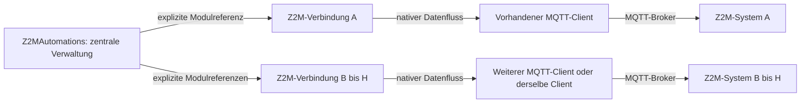

# Umbauplan: eine Verwaltung für bis zu acht Z2M-Systeme

Stand: 04.11.2026. Schritte 1 bis 3 lokal vorhanden; keine Migration.
Architekturentscheidung: [ADR 0026](adr/0026-central-manager-and-system-connections.md).

Fortschritt: Die lokale Grundlage von Schritt 1 ist inzwischen implementiert:
SystemContract und die rein lesenden Metadatenfunktionen GetSystemMigrationSource
und PreviewSystemMigration. Prüfungen mit synthetischen Quellen für 1/2/8 Systeme
sind vorhanden. Der folgende Zielplan beschreibt weiterhin den gesamten Umbau.
Schritt 2 ergänzt Z2MConnection mit dem bestehenden nativen MQTT-Datenfluss,
Status/Health, Installation, Katalogabruf und zeitlich begrenztem Debugkanal.
Transport und Katalogparser sind gemeinsam mit dem Bestandsmodul genutzt.
Acht synthetische Verbindungen sind lokal geprüft; native Konsolen-/Brokerpraxis
für diesen neuen Baustein steht noch aus. Archivexport, persistente Registrierung/
Rollenmarker, Besitzerwechsel und Übernahmeoberfläche sind noch nicht umgesetzt.
Schritt 3 ergänzt den versionierten lokalen Arbeitsbereich mit Systemliste,
getrennten Dokumenten, Bearbeitungskontexten, Katalogen und nativen Bindungen.
Quittungen, Konfliktschutz, gerichtete Freigaben und aktuelle Rechte sind lokal
geprüft; gemeinsamer Editor und Migration sind weiterhin offen. Details und
Grenzen stehen in [WORKSPACE.md](WORKSPACE.md). Die Metadaten-
vorschau ist keine Sicherung, keine aktuelle Rechteprüfung und keine Migration.

## 1. Ziel und verbindliche Grenzen

Eine zentrale Automationsinstanz bietet einen Browserdesigner und einen nativen
Einstieg für alle eingerichteten Z2M-Systeme. Pro System gibt es einen eigenen
Verbindungsbaustein. Unterstützt werden zunächst eine bis acht Verbindungen zu
Z2M-Systemen auf einem bis acht MQTT-Brokern. Acht Systeme sind ein zu prüfendes
Ausbauziel und keine bereits nachgewiesene Betriebsfreigabe.

Die Verwaltung erstellt Entwürfe. Ausführung und Wiederanlauf bleiben in den
einzelnen Z2M-Erweiterungen. Weder Symcon noch die spätere Windows-Anwendung
werden für laufende Automationen oder für die Brokerweiterleitung benötigt.
Jedes Z2M behält seine eigene Datei, Revision, Prüfsumme, Sitzung, Aktivierung
und Wiederanlaufeinstellung. Es entsteht keine gemeinsame ausführbare YAML.

Dieser Plan verändert weder Live noch Test, installiert keine Erweiterung,
konfiguriert keine Broker und führt keine Migration aus. Rückwärtskompatibilität
mit alten Implementierungsstrukturen ist kein Entwicklungsziel; vorhandene
Benutzerdaten und eindeutige Ziele müssen trotzdem erhalten bleiben.

## 2. Module und Zuständigkeiten

Die Pfeile zwischen Verwaltung und Verbindungen sind Modulaufrufe, keine
zusätzlichen Datenfluss-Parents. Die Verwaltung benötigt keinen MQTT-Parent.
Jede Verbindung hat genau einen nativen MQTT-Parent. Ein gemeinsamer MQTT-Client
kann mehrere Verbindungen mit unterschiedlichen Basistopics versorgen.
Vorhandene MQTT-Server-Anbindungen bleiben als unterstützter Transport erhalten;
der Regelbetrieb darf weiterhin nicht von einem Broker in Symcon abhängen.

| Bestandteil | Zuständigkeit |
| --- | --- |
| Z2MAutomations | Systemliste, lokale Entwürfe je System, Editor, Import, Prüfung vor Übergabe, Übernahmebericht und Gesamtübersicht |
| Neues Modul Z2MConnection, Anzeigename Z2M-Verbindung | MQTT-Empfang/-Versand, Health, Erweiterungsinstallation und -status, Katalogabruf, korrelierte Aufträge, Zeitlimits und zeitlich begrenzte Aufzeichnung je System |
| Native MQTT-Instanzen | Brokeranmeldung, TLS, Socket und Abonnements; keine zweite Passwortverwaltung in unserer Library |
| Z2M-Erweiterung | Validierung, persistente Speicherung, Ausführung, Mesh, Laufstatus und Wiederanlauf wie bisher |

Z2MA bleibt das öffentliche Präfix der Verwaltung. Für Z2MConnection ist Z2MC
als neues vierstelliges Präfix vorgesehen; neue Modul-GUID und Präfixkollisionen
werden im ersten Implementierungsschritt geprüft und festgelegt. Bestehende
Library-/Modulidentitäten werden nicht beiläufig geändert.

Die vorhandene Library wird schrittweise zerlegt, nicht ein zweites Mal
implementiert. Gemeinsam genutzte Fachlogik bleibt in libs/. Vorhandene Helper
für DataFlow, ParentConnection, DebugFlow, HTTP, Assets, Formulare und persistente
JSON-Daten werden anhand ihrer Verträge wiederverwendet. Es gibt keine eigene
MQTT-Implementierung in PHP und kein neues zentrales Helper-Framework.

## 3. Identitäten, Datenbesitz und Plattformgrenze

- SystemID ist eine einmal vergebene, im Arbeitsbereich stabile Kennung. Sie
  hängt nicht von Anzeigename, Reihenfolge, Symcon-Instanz-ID oder Broker-IP ab.
- Verbindung enthält SystemID, Anzeigename, ConnectionModuleID, MQTT-Parent-ID,
  Basistopic, Betriebsoptionen und eine Konfigurationsgeneration. Die physische
  Zuordnung erfolgt ausschließlich über IDs und Basistopic, nicht über Namen.
- Geräte-/Gruppenschlüssel bestehen aus SystemID, Zieltyp und IEEE-Adresse bzw.
  Gruppen-ID. Regel- und Folgenkennungen sind innerhalb ihres Systems gültig.
  Gleichnamige Geräte und dieselbe Gruppen-ID anderer Systeme bleiben getrennt.
- Ein Arbeitsbereich enthält je System den exakten YAML-Text, EditorDraft samt
  Basisrevision/-prüfsumme, Katalog und Bindungen, Auswahl und offene Eingaben.
  Definitionen und Verweise werden bei der Übernahme nicht umbenannt.
- Für den Windows-Export gibt es ein versioniertes fachliches Projektformat mit
  Systemkennungen und Dokumenten. Symcon-IDs, native Variablenbindungen und
  Zugänge gehören in einen getrennten Symcon-Adapter und nicht in dieses Format.
  Der Windows-MQTT-Adapter wird erst in einem späteren Projekt implementiert.

Die neue SystemID ist zunächst eine Verwaltungskennung. Das bestehende Mesh
verwendet auf der Leitung weiterhin das Basistopic als Systemidentität.
Deshalb müssen Basistopics im verwalteten Mesh-Verbund eindeutig sein, auch bei
getrennten Brokern. Doppelte Topics werden verständlich als Konflikt angezeigt;
kein automatisches Umbenennen, Remapping oder Zusammenlegen. Ein späterer
Wechsel der Leitungskennung benötigt einen eigenen Protokoll-/Migrationsauftrag.

Ein Broker-/Topicwechsel ändert die Konfigurationsgeneration, entwertet alte
Aufträge, Katalogbestätigungen und Browserrechte, erhält aber gesicherte Entwürfe.
Wiederanbindung an ein anderes Ziel erfolgt nie stillschweigend. Entfernen eines
Systems mit Verweisen benötigt Auflösung der Abhängigkeiten und eine Sicherung.
Die neunte Verbindung wird vor einer Änderung mit einer klaren Meldung abgewiesen.

## 4. Regeln, Folgen und systemübergreifende Aktionen

Eine Automation hat genau ein ausführendes System. Geräteauslöser und
Gerätebedingungen bleiben in dieser Ausbaustufe auf diesem System; mehrere
lokale Auslöser können weiterhin ODER-verknüpft sein. Zeit-/Sonnenregeln erhalten
ihr ausführendes System ausdrücklich. Gemischte Auslöser oder Sensorbedingungen
aus mehreren Systemen werden nicht als neue Laufzeitfähigkeit versprochen.

Aktionsziele dürfen aus allen ausdrücklich zugeordneten Systemen stammen.
Die Verwaltung übersetzt deren SystemID beim Export in die bestehende
target.system-Kennung. Lokale Ziele und vorhandene Dokumente bleiben unverändert.
Der native Variabelfilter für schaltbare Aktionen bleibt im Symcon-Adapter;
lesbare Sensoren bleiben Auslöser und Bedingungen. Nicht mehr auflösbare
Bindungen bleiben sichtbar und geschützt, statt durch Namenssuche ersetzt zu werden.

Wiederverwendbare Folgen bleiben zunächst Definitionen ihres ausführenden
Systems. Gleichnamige Folgen anderer Systeme werden nicht vereinigt. Eine Folge
kann wie bisher entfernte Geräteaktionen enthalten. Zentraler Überblick bedeutet
keine neu eingeführte globale oder verschachtelte Folgenlaufzeit. Ein späteres
Kopieren in ein anderes System ist eine ausdrückliche, separat validierte Kopie.

PeerModuleID wird fachlich durch eine Systemliste und gerichtete Freigaben
ersetzt. mesh_peers sind Empfangsfreigaben, nicht eine Liste aller sichtbaren
Systeme. Vorhandene Freigaben bleiben einschließlich fehlendem oder leerem Feld
erhalten. Neue Verbindungen erteilen keine Rechte. Für acht Systeme genügen im
vollständig freigegebenen Verbund sieben fremde Quellen pro Empfänger; das
bestehende Schema erlaubt bereits acht. Stopp und Wiederanlauf bleiben je Z2M
wirksam, auch für eingehende Aktionen.

Mosquitto-Bridges und ACLs bleiben außerhalb der automatischen Modulkonfiguration.
Ein gemeinsamer Broker benötigt keine Bridge. Getrennte Broker benötigen einen
geprüften schleifenfreien Pfad für z2ma/mesh/# mit passenden Benutzerrechten.
Eine Baumstruktur mit acht Brokern hat sieben Verbindungen; ein zentraler
Bridge-Broker wäre ein gemeinsamer Ausfallpunkt für systemübergreifende Aktionen.
Sein Ausfall stoppt nicht die lokalen Automationen der übrigen Systeme.

## 5. Modulvertrag, Browser und Betrieb

Die Verwaltung kennt ausschließlich registrierte Verbindungsinstanzen.
Leseaufrufe liefern begrenzte normalisierte System-/Katalogansichten.
Schreibaufträge enthalten mindestens SystemID, Generation, Operationskennung,
Entwurfsprüfsumme und den für diese Operation notwendigen Inhalt. Antworten und
spätere Ereignisse werden zusätzlich an Verbindungsinstanz, Basistopic und
Empfängersitzung gebunden. Unbekannte oder alte Kontexte werden verworfen.
Es gibt keinen allgemeinen Publish-, PHP- oder Methodenaufruf aus dem Browser.

Jede Verbindung behält ihren eigenen Auftrag, Timer, Semaphore, Wiederholungs-
schutz und Debug-Lease. Ein langsames System blockiert die übrigen nicht.
Zunächst höchstens ein verändernder Auftrag pro System; Mehrsystem-Schreibaufträge
laufen in angezeigter Reihenfolge. Keine neue dauerhafte Befehlswarteschlange,
keine automatische Wiederholung möglicherweise bereits ausgeführter Befehle.
Kommunikation bleibt außerhalb gehaltener übergreifender Sperren.

Die zentrale Übersicht bietet Systemfilter, gemeinsame Suche und sichtbare
Systemzugehörigkeit an Geräten, Regeln, Folgen und Fehlermeldungen. Native
Einrichtung zeigt bis zu acht Zeilen mit Verbindung, Topic, bestätigtem Status,
Erweiterungsstand, gespeichertem/aktivem Stand und letzter Prüfung.
Prüfen, Speichern, Aktivieren, Stopp und Debug nennen immer ihr Zielsystem.
Bei Aktionen für mehrere Systeme wird das Ergebnis einzeln angezeigt, etwa:
„System 1 gespeichert. System 2 nicht erreichbar; dort wurde nichts bestätigt.“
Es gibt kein vermeintlich atomisches Speichern oder pauschales „Alles aktiv“.

Auf dem Bus bleiben die bisherigen Grenzen je System erhalten: maximal 100
Regeln, 32 Folgen, 16 expandierte Aktionsschritte und 128 KiB YAML. Insgesamt
können acht Systeme damit bis zu 800 Regeln und 256 Folgen verwalten; ein
einzelnes Dokument bleibt trotzdem an seine eigene Größenbegrenzung gebunden. Die
Browserantwort bleibt auf 2 MiB begrenzt. Acht vollständige Kataloge werden
nicht blind in eine Antwort oder ein natives Formular gepackt: Übersicht klein,
Details und Gerätedaten systemweise bei Bedarf. Gemeinsame Suche liefert
begrenzte Treffer; die Ergebnisse verschwinden nicht unbemerkt bei einem Limit.
Die Abnahme misst Größen und Ladezeiten mit den vorhandenen synthetischen
Großkatalog-Fixtures für ein, zwei und acht Systeme.

Browseränderungen benötigen SystemID und den exakten Entwurfskontext dieses
Systems. Zugangsdauer, Herkunftsprüfung, begrenzte Eingaben und Quittungen
gelten weiter. Ein Systemwechsel oder paralleler Editor darf keine Eingaben
in ein anderes System schreiben. Offene Bearbeitungen werden erhalten und
vor einem Wechsel verständlich behandelt. Status ist bestätigt oder unbekannt/
veraltet, nicht aus einer ausgewählten Zeile oder einem MQTT-Connect abgeleitet.

Beide Module erhalten den kanonischen DebugFlowHelper. Verständliche deutsche
Meldungen nennen sichere Systembezüge, Verbindung, Operation, Ergebnis und den
nächsten Schritt. Regellauf-/Aktionsbezüge und ursprüngliche Endzeiten von
Aufzeichnungen bleiben erhalten. Asynchrone Vorgänge werden nur mit tatsächlich
übertragenem Bezug korreliert. Keine eigenen Flowzähler oder Maskierungslogik,
keine Tokens, Passwörter, YAML-Inhalte oder privaten Installationsdaten im Debug.

## 6. Übernahme vorhandener Instanzen

### 6.1 Vorprüfung und Vorschau ohne Änderung

Ein Übernahmeassistent inventarisiert nur ausdrücklich ausgewählte Altinstanzen
derselben Installation. Pro Quelle erfasst er Modul-/Instanzidentität,
MQTT-Parent und dessen Typ, Basistopic, Optionen, Roh-YAML, EditorDraft,
Gerätekatalog mit nativen Variablenbindungen, PeerModuleID, Regeln, Folgen,
Auswahl, offene Bearbeitung und vorhandene Importbezüge. Transport-/Statuswerte
werden als historische Beobachtung gesichert, nicht als neue Freigabe übernommen.
Zugangsdaten der nativen MQTT-Instanzen werden nicht gelesen oder kopiert.

Der Bericht zeigt geplante System- und Verbindungszuordnung, Anzahl der Regeln
und Folgen, ungespeicherte Abweichungen, offene Formulareingaben, Partnerbezüge
und Konflikte. Mehr als acht Quellen, mehrfach ausgewählte Instanzen,
doppelte MQTT-Parent-/Topic-Ziele, doppelte Mesh-Basistopics, ein anderer Besitzer
oder unlesbare Daten blockieren den betroffenen Übernahmesatz. Gleiche Ziele
werden auch bei zwei verschiedenen MQTT-Clients nicht allein daraus für
unterschiedliche Z2M-Systeme gehalten; unklare Aliase werden manuell zugeordnet.

Weichen Roh-YAML und EditorDraft ab, werden beide separat gesichert und als
Konflikt angeboten. Ein neueres lokales Dokument wird nicht durch den Z2M-Stand
ersetzt. Offene native Eingaben einschließlich ihrer Bindung bleiben zunächst
in der Altinstanz erhalten und gesichert. Ohne verlustfreie Überführung blockiert
der Assistent die Freigabe des neuen Editors für dieses System, bis die Eingaben
in der Quelle übernommen oder bewusst verworfen wurden. Kein stiller Import
nur der gerade bequem lesbaren Fassung.

### 6.2 Lokale Sicherung und Vorbereitung

Die Altinstanzen bleiben bis zur ausdrücklichen lokalen Umschaltung bedienbar.
Ein Update allein darf sie nicht konvertieren, vom Gateway trennen oder Z2M
stoppen. Für die Übergangsphase ist ein versionierter Bestandsmodus erforderlich.
Eine frisch angelegte Z2MAutomations-Instanz arbeitet als zentrale Verwaltung;
bestehende Modul-GUIDs und Objekt-IDs werden nicht automatisch ersetzt.
Bestands- und Verwaltungsmodus werden durch versionierte Rollenmarker und
geprüfte Ausgangsdaten unterschieden, niemals nur durch Namen. Die nativen
Parent-Metadaten und Legacy-Empfangspfade bleiben während dieses Übergangs
funktionsfähig. Dass Modulupdate und Neuanlage bei diesen unterschiedlichen
Rollen keinen unbeabsichtigten Parentwechsel verursachen, ist ein eigener
Test-Symcon-Abnahmepunkt vor einem Zwischenupdate, keine bloße Stub-Annahme.

Nach Bestätigung werden private Sicherungen mit Manifest, Herkunft,
Formatschlüssel und Prüfsummen außerhalb des Repositorys erstellt. Die Sicherung
umfasst auch relevante Objekt-IDs, Idents und Zuordnungen für einen Rückweg.
Symcon-Statusvariablen und ihre Archivhistorie werden nicht gelöscht oder
durch neue gleichnamige Variablen ersetzt. Historische Werte werden als solche
erhalten; neue Verbindungsstatus erhalten zunächst „noch nicht bestätigt“.

Neue Verbindungsinstanzen werden inaktiv vorbereitet und mit bestehenden
MQTT-Parents verbunden. Geräte-/Bridge-/Gruppeninstanzen der anderen Library
bleiben an ihren vorhandenen MQTT-Parents, Variablen-IDs und Ereignisse bleiben
unverändert. Es werden keine nativen MQTT-Clients, Sockets, Brokerkonten oder
Abonnements überschrieben oder automatisch angelegt.

### 6.3 Übernahme und lokaler Besitzerwechsel

1. Quellstände anhand ihrer Generation und Prüfsummen nochmals vergleichen.
   Eine Änderung seit der Vorschau macht diese ungültig.
2. Stabile SystemIDs und Verbindungseinträge vorbereiten. Roh-YAML bytegleich,
   Regeln, Folgen, lokale IDs und Partnerfreigaben unverändert übernehmen.
   Keine zusätzliche Revision erzeugen. Alte TransportScopes werden nicht
   unbesehen weiterverwendet; Herkunft und neuer Systemkontext sind getrennt.
3. Native Geräte-/Variablenbindungen gegen aktuellen Parent, Topic, Ident und
   Schaltrecht prüfen. Fehlendes bleibt gesichert, aber nicht als schaltbar
   freigegeben. PeerModuleID auf die neue Systemzuordnung abbilden; nicht
   übernommene Partner bleiben als ungelöster Bezug erhalten, nicht als Löschung.
4. Zielstände pro System vorbereiten und vollständig gegen die Quelle prüfen.
   Kleine zentrale Indizes und systemweise persistente Datensätze verwenden;
   kein unbegrenzter gemeinsamer Attribut-/HTTP-Block für acht Systeme.
5. Eine persistente Übernahmegeneration erst nach vollständiger Prüfung als
   gültig veröffentlichen. Manifest und Journal erlauben nach Abbruch einen
   sicheren Wiederanlauf. Bis dahin sind vorbereitete Kopien nicht schreibbar.
6. Alten und neuen Editor gegen einen gemeinsamen Besitzer-/Generationswechsel
   absichern: alte Aufträge auslaufen lassen, neue Quellschreibvorgänge sperren,
   dann lokale Zuständigkeit übergeben. Es gibt nie zwei schreibende Besitzer.
   Eine zweite Verwaltung mit derselben Verbindung wird vor Schreibfreigabe
   abgewiesen. Die Sperre gilt installationsweit, nicht nur je Browserfenster.
   Andere Symcon-Installationen oder Windows-Clients werden dadurch nicht
   automatisch gesperrt. Deren gleichzeitige Bearbeitung wird weiterhin durch
   Z2M-Sitzung, Basisrevision und Prüfsumme erkannt; bei Konflikt neu laden und
   abgleichen, niemals automatisch überschreiben.
7. Alte Browserzugänge, Auswahlkennungen, Validierungstoken, Aktivierungstoken,
   offene MQTT-Transaktionen und aktive Debug-Leases nicht übertragen. Neue
   Ansichten öffnen; Receiverstatus und Geräteinformationen nur lesend neu
   bestätigen. Offline-Übernahme darf lokale Daten erhalten, aber weder einen
   bestätigten Betriebszustand noch eine Schreibfreigabe vortäuschen.
8. Ergebnisbericht mit Inhaltsvergleich, offenen Bindungen und Status je System
   anzeigen. Übernahme ist kein Anlass für store, activate, deactivate, restart
   oder Gerätebefehle. Bereits laufende Z2M-Automationen bleiben unbeeinflusst.

Die Wiederholung derselben Übernahme aktualisiert keine bearbeiteten Zielentwürfe
und erzeugt keine doppelten Systeme oder Module. Das Journal bindet Quelle,
Quellfingerabdruck und Ziel. Nach einer Zielbearbeitung ist ein erneuter Import
ein ausdrücklich zu behandelnder Konflikt. Laufzeitpuffer werden nie als
verbindliche Bestandsdaten restauriert.

Erfolgreich übernommene Altinstanzen zeigen einen Hinweis mit Verweis auf die
zentrale Verwaltung und bieten keinen zweiten unabhängigen Editor mehr an.
Sie bleiben als nachvollziehbare Übernahmequelle und für den geprüften Rückweg
erhalten. Ein späteres Archivieren oder Entfernen wird separat entschieden.

Bestehende öffentliche Aufrufe bleiben im Übergang an ihr ursprüngliches System
gebunden. Neue Mehrsystem-Aufrufe verlangen SystemID; die gerade im Formular
gewählte Zeile ist kein Standardziel für alte Skripte. Beim Herauslösen werden
notwendige zielgebundene Delegationen dokumentiert und getestet. In diesem
Arbeitspaket wird kein Altaufruf entfernt oder umbenannt; eine spätere Entfernung
benötigt eine ausdrücklich geplante inkompatible Veröffentlichung.

### 6.4 Rückweg

Vor einem Z2M-Schreibauftrag ist der Rückweg lokal: neue Bearbeitung sperren,
seit der Übernahme entstandene Entwürfe zusätzlich sichern, Quellenfingerabdruck
prüfen, Besitz zurückgeben und ursprüngliche Quellinstanzen freigeben.
Vorbereitete Verbindungsmodule werden deaktiviert und aus der Verwaltung gelöst;
Benutzerobjekte, MQTT-Verbindungen und Z2M-Dateien bleiben erhalten. Automatisches
Löschen der Altinstanzen ist ausgeschlossen. Code-Rollback und Daten-Rollback
werden zusammen mit der gesicherten Ausgangsversion auf Test geprüft.

Nach einem später ausdrücklich beauftragten Speichern in Z2M gilt dieser lokale
Rückweg nicht mehr als Wiederherstellung des Gerätebetriebs. Dann müssen die
aktuellen Z2M-Stände erst gesichert und eine eigene Wiederherstellung unter
Revisionskontrolle geplant werden. Keine blinde alte YAML oder Freigabe einspielen.

## 7. Abhängige Umsetzungsschritte

| Schritt | Ergebnis | Freigabekriterium |
| --- | --- | --- |
| 1. Verträge und Bestandsleser | Systemregistrierung, Besitzmodell, versioniertes Export-/Übernahmeformat und reine Vorschau; noch keine Umschaltung | Synthetische Bestände für 1/2/8 Systeme, Konflikte und unveränderte Quellen belegt |
| 2. Z2MConnection | Native MQTT-Anbindung und Systemstatus aus bestehenden Traits herausgelöst; getrennte Timer und Antworten | Gemeinsamer/getrennter Broker, falsche/alte Antwort, Reconnect und offline isoliert geprüft |
| 3. Zentraler Arbeitsbereich | Systemweise Entwürfe, Kataloge, Bindungen, Freigaben und gerichtete Zielauswahl | Kein Vermischen gleicher IDs, Rechteverlust schützt nur betroffene Ziele, YAML bleibt lokal |
| 4. Übernahme und Rückweg | Assistent, persistentes Journal, Besitzerwechsel und Sicherungen | Zweiter Lauf, Abbruch an jedem Schritt, Neustart, Konflikt und Rücknahme ohne Datenverlust |
| 5. Gemeinsame Oberfläche | Native Systemliste und Browserfilter/-suche, alle Editoren systemgebunden | Erstellen/Bearbeiten/Vorbelegung/Validierung, offene Eingaben, alte Tabs, Scrollen und große Datenmengen |
| 6. Mehrsystem-Steuerung | Prüfung, Übertragung, Aktivierung, Stopp, Einzellauf, Buildanzeige und Debug mit explizitem Systembezug | Teilfehler einzeln sichtbar, kein falsches Ziel, keine stillen Wiederholungen oder pauschale Erfolgsanzeige |
| 7. Praxisabnahme | Zuerst freigegebene Testinstanz; danach eigener Live-Umstellungsauftrag | Sicherungs-/Vergleichsbericht und Rückweg bestätigt, erst dann nächste Stufe |

Schritte 1 bis 4 werden zunächst offline implementiert und integriert. Kein
Zwischenupdate darf laufende Bestandsinstanzen in einen halbfertigen Zustand
versetzen. Anschließend Testupdate und reine lokale Übernahme gesondert beauftragen.
Reale systemübergreifende Schaltungen, Erweiterungsupdates und Neustarts bleiben
eigene Praxisaufträge. Die spätere Windows-Anwendung ist nicht Teil dieses Umbaus.

## 8. Prüfmatrix und Übergabe

| Risiko/Anforderung | Notwendiger Nachweis |
| --- | --- |
| Acht Systeme und mehrere Topics je Broker | 1/2/8-System-Integration, neunte Verbindung abgewiesen, doppelte Ziele nicht zusammengeführt |
| Identische Geräte-/Gruppen-/Regel-/Folgen-IDs | Auswahl, Vorbelegung und Rückantwort bleiben exakt beim System |
| Datenübernahme | Roh-YAML bytegleich, IDs und Freigaben identisch, ungespeicherter Entwurf/offene Eingaben erhalten; ungültige/abweichende Fassungen blockiert |
| Wiederholung/Abbruch | Kein Duplikat, kein halber sichtbarer Arbeitsbereich, Journalfortsetzung und lokaler Rollback nach jedem Fehlerpunkt |
| Ein schreibender Besitzer | Zwei Verwaltungen, alter/neuer Tab und gleichzeitige Migration können keine veraltete Änderung übernehmen |
| Betrieb unverändert | In der Übernahme keine store/activate/deactivate/restart/run-Nachricht; bestätigte aktive Prüfsumme und Regeln vorher/nachher gleich |
| Broker-/Topicwechsel und Neustart | Alte Sitzungen/Antworten ungültig; andere Systeme bleiben nutzbar; keine verlorenen Entwürfe |
| Aktionen und Rechte | Schaltbare native Variablen je Ziel, reine Anzeigen als Quellen erlaubt, fehlende Bindungen geschützt |
| Mesh mit mehr als zwei Systemen | Mindestens drei echte Erweiterungsinstanzen synthetisch für A nach B/C, anschließend acht; Freigaben, Timeout und Ausfall eines Zweigs |
| Teilweise Übertragung | Prüfungsfehler verhindern betroffene Speicherung, Teilresultate angezeigt, Aktivierung bleibt ausdrücklich, kein automatischer Rückschreibversuch |
| Größe und Bedienung | 128-KiB-Dokumentgrenze, 2-MiB-Antwortgrenze, native Formularbudgets, große Suchlisten, Mausrad und erreichbare Buttons |
| Debug | Beide Module erklären Ziel, Entscheidung und Ergebnis, vorhandene Lauf-/Schrittbezüge und Lease-Endzeit stimmen, keine Geheimnisse |

Bei der Implementierung tests/validate_structure.php auf zwei konkrete Module
  und deren eigene Präfixe/Datenflussverträge erweitern (mit Schritt 2 umgesetzt).
  Bestehende MQTT-, Workflow-, Designer-, Import-, Runtime-,
Mesh- und Wiederanlauftests erhalten und um Mehrsystemfälle ergänzen. Helper und
Erweiterungsartefakt nur ändern, wenn ein eigener fachlicher Bedarf nachgewiesen
ist. Für den unveränderten Mesh-1-Vertrag ist kein Erweiterungsupdate eingeplant.

Jede Implementierungsstufe benötigt php tests/run.php, Struktur-/Kodierungsprüfung,
offizielle StylePHP-Prüfung und PHP CS Fixer im Prüfmodus. Tatsächliche Z2M-Versionen
und Praxisnachweise getrennt von synthetischen Acht-System-Tests dokumentieren.
Dieser Plan allein belegt noch keine Mehrsystemfähigkeit.

## 9. Erste konkret umzusetzende Aufgabe

Systemmodell, read-only Bestandsvorschau und synthetische Migration-Fixtures
für ein, zwei und acht Systeme implementieren. Dabei neue Modulidentität,
Bestandsmodus, lokale Besitzübergabe und systemgebundenen Modulvertrag als
ausführbare Verträge festlegen. Noch keine Bestandsinstanz konvertieren,
keine Verbindung umhängen und nichts an Z2M übertragen. Danach kann der
Verbindungsbaustein auf diesem geprüften Vertrag aufgebaut werden.

## Schnittstellenquellen

- [Symcon-Datenfluss](https://www.symcon.de/de/service/dokumentation/entwicklerbereich/sdk-tools/sdk-php/datenfluss/): native Verbindung zu einem Parent.
- [Mosquitto-Bridgekonfiguration](https://mosquitto.org/man/mosquitto-conf-5.html): mehrere Bridges, Topicfilter und Vermeidung von Schleifen.
- Repository-Verträge: ADR 0002, ADR 0009, docs/EXTENSION_PROTOCOL.md,
  libs/ExtensionContract.php und libs/z2m/automations.schema.json.
