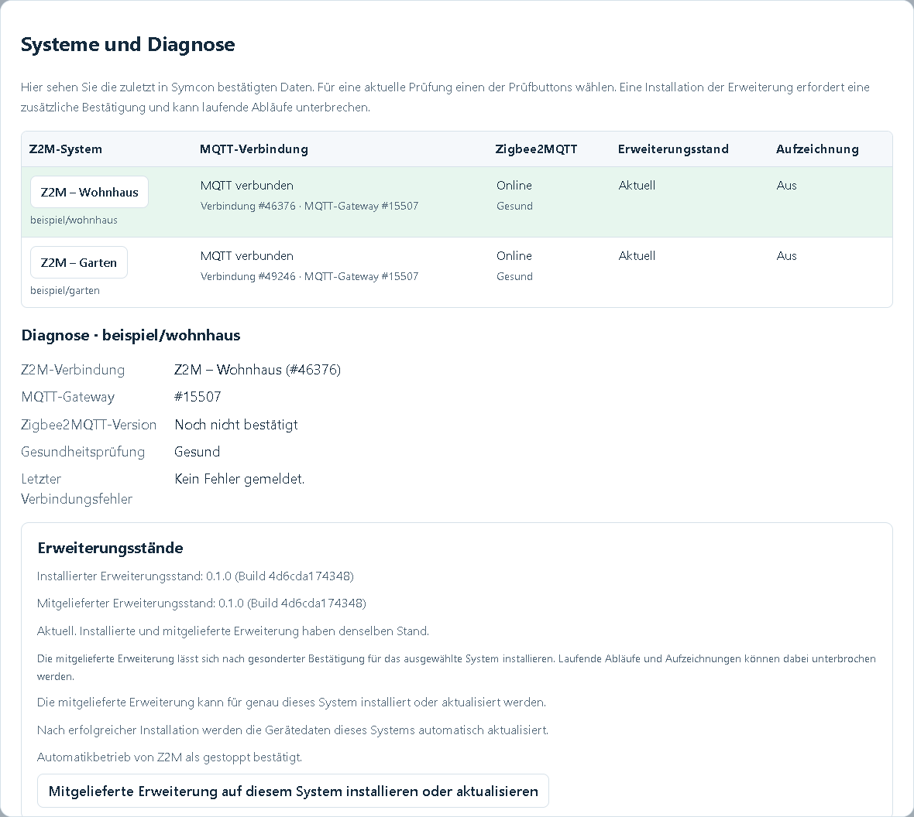

# Eigene Zigbee2MQTT-Erweiterung

Die Erweiterung **z2m-automations.mjs** empfängt die in Symcon erstellten
Automationen, prüft sie und speichert sie im Z2M-Datenordner. Nach dem Aktivieren
führt sie die Regeln direkt in Zigbee2MQTT aus. Ein laufendes Symcon ist dafür
nicht mehr erforderlich.

Die Regeln werden im [Browserdesigner der Automationszentrale](../../Z2MAutomations/README.md#automationsdesigner-im-browser)
erstellt und bearbeitet. Ein manuelles Bearbeiten der Erweiterungsdatei oder
Programmieren in JavaScript ist für die Einrichtung nicht nötig.

## Inhaltsverzeichnis

- [1. Voraussetzungen](#1-voraussetzungen)
- [2. Installieren und aktualisieren](#2-installieren-und-aktualisieren)
- [3. Automationen übertragen und ausführen](#3-automationen-übertragen-und-ausführen)
- [4. Speicherort und Sicherung](#4-speicherort-und-sicherung)
- [5. Mehrere Z2M-Systeme](#5-mehrere-z2m-systeme)
- [6. Ablaufaufzeichnung](#6-ablaufaufzeichnung)
- [7. Dateien und technische Referenzen](#7-dateien-und-technische-referenzen)
- [8. Lizenz](#8-lizenz)

## 1. Voraussetzungen

- Ein eingerichtetes Zigbee2MQTT-System mit erreichbarem MQTT-Broker.
- Die Verwendung externer JavaScript-Erweiterungen muss in Z2M bereits erlaubt sein.
  Die Library ändert diese Freigabe nicht.
- Eine passende [Z2M-Verbindung](../../Z2MConnection/README.md) in Symcon und
  für die zentrale Bearbeitung eine eingerichtete Automationszentrale.
- Schreibzugriff des Z2M-Dienstes auf seinen Datenordner.

Praxisnachweise liegen für **Z2M 2.14.2-dev** sowie als Benutzerbestätigung aus
dem Live-Betrieb für die stabile Version **2.14.2** vor. Die genauen Git-Revisionen
sind nicht zusätzlich dokumentiert. Andere Versionen sind damit nicht allgemein
freigegeben. Umfang und Grenzen stehen in der
[Kompatibilitätsübersicht](../../docs/COMPATIBILITY.md).

## 2. Installieren und aktualisieren

1. Im Browserdesigner das gewünschte **Z2M-System** auswählen.
2. **Verwaltung → Systeme und Diagnose** öffnen.
3. Bei unbekanntem Stand zuerst **Erweiterungsstatus abfragen** wählen.
4. Bei fehlender oder abweichender Erweiterung **Mitgelieferte Erweiterung auf
   diesem System installieren oder aktualisieren** wählen und bestätigen.
5. Die Erfolgsmeldung und das anschließende Nachladen der Gerätedaten abwarten.



Die **Buildkennung** vergleicht den Inhalt der installierten und mitgelieferten
Datei. Die Versionsnummer der Erweiterung ist unabhängig von der Library-Version.
Ab **0.2.0** steigt bei geändertem Erweiterungsinhalt automatisch die letzte
Versionszahl, beispielsweise auf **0.2.1**. Ein erneuter Build ohne Änderungen
behält dieselbe Version. Die genaue Buildkennung bleibt zusätzlich sichtbar.
**Aktuell** bedeutet, dass beide bestätigten Stände übereinstimmen; ein unbekannter
Stand ist noch keine Updatebestätigung.

Vor der Übernahme in eine Zentrale ist die Installation auch direkt im
[Verbindungsmodul](../../Z2MConnection/README.md#53-erweiterung-installieren-oder-aktualisieren)
möglich. Danach wird die Erweiterung über die zuständige Zentrale verwaltet.

Hochgeladen wird nur die mitgelieferte **z2m-automations.mjs**. Das Schema und die
eigenen Hilfsfunktionen sind darin enthalten. Zusätzliche Dateien müssen nicht
hochgeladen und keine zusätzlichen Pakete auf dem Z2M-Rechner installiert werden.
Die Erweiterung verwendet Ajv und js-yaml aus den vorhandenen Z2M-Abhängigkeiten.

Ein Update kann laufende Abläufe kurz unterbrechen. Die gespeicherten Regeln und
die Wiederanlaufeinstellung bleiben maßgeblich; Entwürfe werden dabei nicht
übertragen. Ein Erfolg wird erst nach Bestätigung der neu geladenen Erweiterung
gemeldet. Die normale Installation erfordert keinen zusätzlich vom Modul
ausgelösten Neustart des Z2M-Dienstes.

## 3. Automationen übertragen und ausführen

Die Erweiterung unterstützt Geräteereignisse und Messwerte, feste Uhrzeiten,
Sonnenzeiten mit Versatz, Bedingungen, geordnete Aktionen mit Wartezeiten,
gemeinsame Gerätebefehle, Szenen und wiederverwendbare Aktionsfolgen.

| Bedienaktion in Symcon | Wirkung in Z2M |
| --- | --- |
| Gerätedaten aktualisieren | Liest Geräte, Eigenschaften, Kanäle, Gruppen und vorhandene Szenen. Regeln und Betrieb bleiben unverändert. |
| Z2M-Automationen sicher einlesen | Liest zusätzlich den gespeicherten Regelstand als Ausgangspunkt für die lokale Einrichtung. Speichert oder aktiviert nichts in Z2M. |
| Entwurf in Z2M prüfen | Prüft YAML, Schema und weitere Regelangaben. Bei Ablehnung werden betroffene Regeln und Angaben benannt. |
| Geprüften Entwurf in Z2M speichern | Speichert genau die geprüfte Fassung. Bei geändertem Inhalt endet die bisherige Ausführung. |
| Gespeicherte Automationen aktivieren | Stellt die im gespeicherten Stand eingeschalteten Regeln bereit. |
| Alle Automationen dieses Systems stoppen | Stoppt Automatikbetrieb, laufende Abläufe und den Empfang von Partneraktionen. |

Speichern allein aktiviert keine Regeln. Beim Aktivieren lässt sich festlegen,
ob Z2M den freigegebenen Stand nach einem Neustart automatisch wieder bereitstellt.
Ein bewusster Stopp bleibt auch nach einem Neustart wirksam. Verpasste Zeitpunkte
und unterbrochene Aktionsfolgen werden nicht nachgeholt.

Einzelne gespeicherte Regeln lassen sich einmal mit Bedingungsprüfung ausführen
und deren Lauf gezielt stoppen. Das verändert den dauerhaften Regelschalter nicht.
Bei einer erneuten automatischen Auslösung kann die Regel ignorieren, von vorn
beginnen oder ihre aktuelle Wartezeit zurücksetzen.

Gerätebefehle werden an die interne Befehlsverarbeitung von Z2M übergeben. Ein
erfolgreicher Ablauf bestätigt die Übergabe, nicht die tatsächliche Gerätewirkung.
Bereits gesendete Befehle werden durch Stoppen nicht zurückgenommen.

**Umschalten** verwendet den in Z2M bekannten Ein-/Aus-Zustand des Geräts oder
der Gruppe. Bei unbekanntem Zustand wird die Aktion abgelehnt. **Szene aufrufen**
verwendet eine vorhandene Geräte- oder Gruppenszene; Szenen werden weder angelegt
noch verändert. Fehlt eine Szene inzwischen, wird der Schritt abgelehnt.

Die vollständige Bedienung beschreibt die
[Anleitung der Automationszentrale](../../Z2MAutomations/README.md).

## 4. Speicherort und Sicherung

Die Automationen liegen als **YAML-Datei** im persistenten Z2M-Datenordner,
nicht als Regeldatei innerhalb der Symcon-Library. Bei der normalen Installation
ergibt sich diese Struktur:

```text
<Z2M-Datenordner>/
├── external_extensions/
│   └── z2m-automations.mjs
└── z2m-automations/
    ├── automations.yaml
    ├── automations.previous.yaml
    └── execution-state.json
```

| Datei | Inhalt |
| --- | --- |
| automations.yaml | Zuletzt erfolgreich gespeicherte Automationen, Aktionsfolgen und Partnerfreigaben. |
| automations.previous.yaml | Vorherige gültige Fassung, sofern bereits eine weitere Fassung gespeichert wurde. |
| execution-state.json | Gespeicherter Betriebszustand und Wiederanlaufeinstellung mit Bezug auf den Regelstand. Diese JSON-Datei enthält nicht die Automationsregeln. |

Den gesamten Z2M-Datenordner sichern, damit Erweiterung, Regeln und Betriebszustand
gemeinsam erhalten bleiben. Die vorherige Fassung ist kein Ersatz für eine eigene
Sicherung. Bei beschädigter Hauptdatei kann sie nur lesend verfügbar sein;
der Zustand wird gemeldet und nicht stillschweigend als normaler Betrieb fortgesetzt.
Die Dateien nicht während des Betriebs von Hand ersetzen.

Der lokale Entwurf in Symcon ist davon getrennt: Nicht übertragene Änderungen
liegen noch nicht in dieser Z2M-Datei. Änderungen und Sicherungen der Library
selbst ersetzen keine Sicherung der Symcon-Konfiguration oder des Z2M-Datenordners.

## 5. Mehrere Z2M-Systeme

Jedes beteiligte Z2M-System benötigt seine eigene Erweiterung. Eine
Automationszentrale kann bis zu acht Systeme verwalten. Geräteauslöser und
Gerätebedingungen gehören zum eigenen System; freigegebene Aktionsziele können
auf einem anderen System liegen.

Die Übertragung zwischen den Erweiterungen verwendet ausschließlich
`z2ma/mesh/#`. Bei einem gemeinsamen Broker sind passende Rechte nötig; bei
getrennten Brokern zusätzlich eine Broker-Bridge. Die eingerichteten Verbindungen
arbeiten auch ohne laufendes Symcon weiter.

Das Zielsystem muss den Sender ausdrücklich freigeben und aktiviert sein,
auch wenn es keine eigene eingeschaltete Automation besitzt. Eine Freigabe
gilt nur in eine Richtung. Der Benutzer, mit dem sich Z2M selbst am Broker
anmeldet, benötigt ebenfalls Lese- und Schreibrecht für den Mesh-Bereich.

Ein ausgefallenes Ziel führt zum Abbruch der betroffenen Aktionsfolge; die Aktion
wird nicht später automatisch nachgeholt. Kurzlebige Einmalfreigaben schützen
gegen eine zusätzliche Ausführung alter oder doppelter Ausführungsnachrichten.

Einrichtung:

- [Schrittfolge für bis zu acht Mosquitto-Broker](../../Z2MConnection/README.md#bis-zu-acht-mqtt-broker-miteinander-verbinden)
- [Partnerfreigaben im Browserdesigner](../../Z2MAutomations/README.md#partnerfreigaben-im-browserdesigner)

## 6. Ablaufaufzeichnung

Unter **Verwaltung → Systeme und Diagnose** lässt sich eine zeitlich begrenzte
Aufzeichnung für das ausgewählte System starten. Die Ablaufmeldungen erscheinen
im nativen Symcon-Debugfenster seiner Z2M-Verbindung. Bei systemübergreifenden
Aktionen auf beiden Seiten aufzeichnen.

Die Aufzeichnung verändert weder Regeln noch Automatikbetrieb und endet
automatisch. Sie ändert den globalen Z2M-Loglevel nicht. Die Library empfängt
die eigenen Ablaufmeldungen, keine allgemeinen fremden Z2M-Logtexte.
Bedienung: [Systeme und Diagnose](../../Z2MAutomations/README.md#systeme-und-diagnose-im-browserdesigner).

## 7. Dateien und technische Referenzen

| Datei beziehungsweise Verzeichnis | Aufgabe |
| --- | --- |
| [z2m-automations.mjs](z2m-automations.mjs) | Fertige, hochladbare Einzeldatei; ausschließlich aus den eigenen Quellen erzeugt. |
| [src/extension.mjs](src/extension.mjs) | Empfang, Validierung und Speicherung. |
| [src/runtime.mjs](src/runtime.mjs), [src/sequences.mjs](src/sequences.mjs) | Laufzeit und wiederverwendbare Aktionsfolgen. |
| [src/solar.mjs](src/solar.mjs) | Berechnung der Sonnenzeiten. |
| [src/mesh.mjs](src/mesh.mjs), [src/scenes.mjs](src/scenes.mjs) | Systemübergreifende Aktionen und Szenen. |
| [src/debug.mjs](src/debug.mjs), [debug-events.json](debug-events.json) | Begrenzte Ablaufaufzeichnung und fester Meldungskatalog. |
| [automations.schema.json](automations.schema.json) | Kanonisches YAML-Schema, JSON Schema Draft 7. |
| [examples/automations.yaml](examples/automations.yaml) | Synthetisches Konfigurationsbeispiel. |

Für die Entwicklung wird das Artefakt im Repository-Hauptverzeichnis mit
`npm run build:extension` erzeugt. `npm run check:extension` prüft, ob es zu den
Quellen passt. Die Inhaltskennung umfasst den eigenen Code, das Schema und den
Debugkatalog. Ajv und js-yaml werden nicht in das Artefakt kopiert.

Der Constructor verwendet die zehn Z2M-Argumente. Das optionale elfte Argument
dient ausschließlich synthetischen Tests für Dateisystem, Datenverzeichnis sowie
Uhr und Timer. Die lokale Testbasis verwendet Node ab 22.2, js-yaml 5.4.2 und
Ajv 8.20.0; auf dem Host gilt die Node-Anforderung der jeweiligen Z2M-Version.

Weitere Referenzen:

- [YAML-Vertrag](../../docs/YAML_SCHEMA.md)
- [MQTT- und Speicherprotokoll](../../docs/EXTENSION_PROTOCOL.md)
- [Ausführung und Wiederanlauf](../../docs/RUNTIME.md)
- [Architektur und Zuständigkeiten](../../docs/ARCHITECTURE.md)
- [Buildkennung](../../docs/adr/0016-content-based-extension-build.md)
- [Erneute Auslösung](../../docs/adr/0018-retrigger-running-automations.md)
- [Systemübergreifende Aktionen](../../docs/adr/0009-cross-system-actions-over-mqtt-bridge.md)

Die PHP-, JavaScript- und YAML-Implementierung ist eigenständig. Es wird keine
Implementierung aus fremden Automationsprojekten übernommen.

## 8. Lizenz

[PolyForm Noncommercial License 1.0.0](../../LICENSE).
